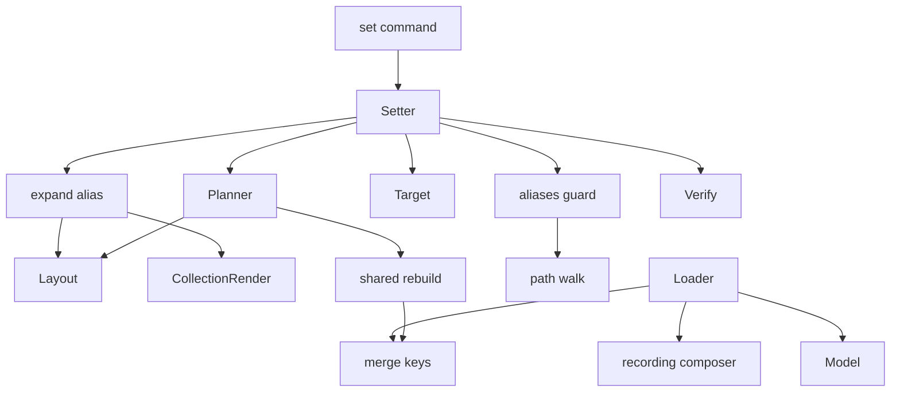
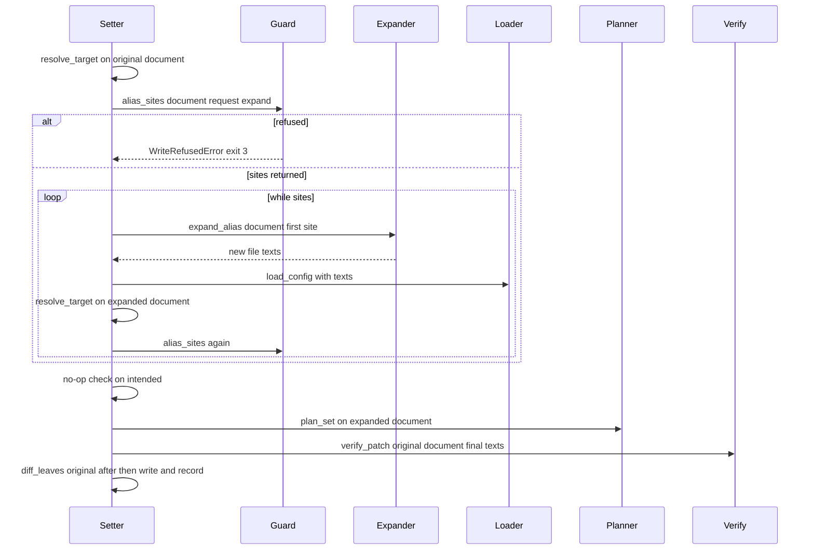
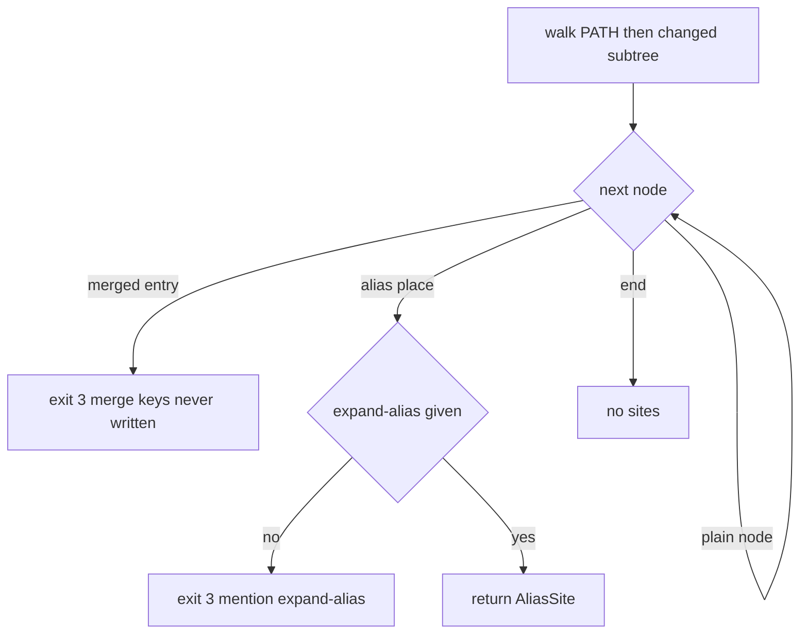

# Design Document: config-aliases

## Overview
Step 6 makes theatres that share settings with YAML anchors usable, and safe to change (tracker issue #2). Anchors
(`&name`), aliases (`*name`) and merge keys (`<<`) now load, and every command sees the **expanded
configuration**. `troupe config set` changes a value defined at an anchor at the anchor, so the change appears
everywhere the anchor is used. A `set` reached through an alias exits 3 and points to `--expand-alias`. With
that flag, the alias is replaced by a block-style copy marked `# expanded from *<name> by troupe`, and the value
is set in the copy. Merge keys are never written.

The loader expands aliases and merge keys into the tree. Every **alias place** is its own node object marked
with an `AliasRef`, and its nodes keep the anchored node's origins. Every entry a mapping receives from a merge
key is marked `via_merge`. Readers need no change. The writer refuses or expands before planning, and writes at
an anchor are replicated to every alias place by the written-location machinery of config-include-overrides
(choice 18).

### Goals
- Load anchors, aliases and merge keys, with the exit-4 refusals (Req 1, 2). Every command reads the expanded
  configuration (Req 3).
- `set` at an anchor changes the anchor and keeps it (Req 4). `set` through an alias is refused (Req 5).
- `--expand-alias` (Req 6) writes the copy exactly as specified (Req 7, 8). Merge keys are never written (Req 9).
- Every write keeps the step 1 safety guarantees (Req 10).

### Non-Goals
- Writing merge keys, creating, renaming or removing anchors or aliases on request, and expanding every alias of
  an anchor at once.
- A VALUE with anchors or aliases (stays exit 2). Any change to rendering rules, events, lineage, reconcile or
  `show` formats.

## Boundary Commitments

### This Spec Owns
- Recording alias occurrences while composing, expanding aliases, merging merge keys, and the load refusals of
  1.3, 1.4 and 2.3 (`config/compose.py`, `config/merge_keys.py`, loader changes).
- The model fields that describe anchors, alias places and merge keys (`Anchor`, `AliasRef`, `MergeKey`,
  `ConfigNode.anchor`/`alias`, `MappingEntry.via_merge`, `ConfigMapping.merge`).
- The decision "refuse, expand or proceed" for a `set` (`writeback/aliases.py`), and its messages.
- The expansion: the copy, the comment and its edits (`writeback/expand.py`).
- The `--expand-alias` flag and the setter's expansion loop.
- The layout's treatment of anchor properties, alias places and merge-key mappings, and `_Rebuild`'s
  re-application of merge keys.

### Out of Boundary
- Scalar, key, block-scalar and collection rendering rules, comment rules and placement rules
  (config-set-writeback). These are reused, and none is changed for files without anchors.
- Placement of new keys below includes and `--in-include` (config-include-overrides). They apply unchanged, also
  inside a copy.
- Events, lineage, reconcile, watch and the `show` emitter. They consume the expanded tree unchanged.

### Allowed Dependencies
- Core (`troupe.config`): `compose` → `loader` → `merge_keys`/`overrides` → `model`. No core module imports
  `writeback` or `cli`.
- File layer (`troupe.config.writeback`): `aliases` and `expand` may import `model`, `paths`, `resolve`,
  `errors` and the writeback modules `layout`, `edits`, `collection_render`, `scalar_render`,
  `block_scalar`, `compare`, `shared` (for `WrittenLocation`) and `target`. Only `setter` calls `load_config`. `planner` may import `aliases` (for `anchor_uses`). `setter` imports
  `aliases` and `expand`. Nothing in `writeback` imports `troupe.cli`.
- CLI: `set_command` passes `expand_alias: bool` to `set_value`.
- ruamel.yaml 0.19.1 (pinned): `YAML.Composer` replaced per instance, overriding `Composer.compose_node`.

### Revalidation Triggers
- A change to `ConfigNode` fields or to the meaning of `origin.span` for anchored nodes (the layout, `shared.py`
  and the planner depend on them).
- A change to how `with_other_places`/`_Rebuild` replicate written locations (anchor writes rely on it).
- Upgrading ruamel.yaml (the composer hook).
- Any later step that defines writes through merge keys or anchors on keys.

## Architecture

### Existing Architecture Analysis
- The loader builds immutable `ConfigNode` trees from composed ruamel nodes, with per-place node objects (also
  for diamonds) and `Origin(file, span)` per node. Anchors are refused in `_refuse_properties`, merge keys in
  `_build_mapping`.
- The writer keys every write by written location `(real_path, start, end)`. `WrittenChanges` +
  `with_other_places` widen the intended configuration to every place that reaches a changed location, and
  verification reloads the in-memory texts and compares.
- `FileLayout` walks the nodes written in one file, for extents, insertion points, comment floors and the
  indentation step. Step 5 taught it to use `include.form` for `$ref` mappings. Step 6 teaches it alias places
  (leaves) and merge-key mappings (`merge.written`) in the same way.

### Architecture Pattern & Boundary Map

- **Selected pattern**: expanded tree with per-place provenance (research.md, Architecture Pattern Evaluation).
- **Existing patterns preserved**: readers on the loaded tree; written-location replication; in-memory reload
  for verification; one module per decision, with messages as module constants.
- **New components**: the recording composer (the only source of alias positions), the merge-key merge (pure),
  the guard (one place for "reached through an alias"), and the expander (the only writer of copies).

### Technology Stack
| Layer | Choice / Version | Role in Feature | Notes |
|-------|------------------|-----------------|-------|
| CLI | argparse (stdlib) | `--expand-alias` (`store_true`) | Same parser rules as `--in-include` |
| Core | ruamel.yaml 0.19.1 | composing with a `compose_node` hook | No new dependency |
| Data | eventsourcing 9.5.5 | unchanged | Events derive from the expanded tree |

## File Structure Plan

### Directory Structure
```
src/troupe/config/
├── compose.py              # NEW: recording composer; ComposedFile(root, aliases); reused-anchor warning silenced
├── merge_keys.py           # NEW: merge a mapping's `<<` sources into its merged view (pure)
├── loader.py               # anchors accepted on values, alias places built, merge keys merged, refusals 1.3/1.4/2.3
├── model.py                # Anchor, AliasRef, MergeKey; anchor/alias on nodes; via_merge; ConfigMapping.merge
└── writeback/
    ├── aliases.py          # NEW: alias_sites guard (5.x, 8.1, 8.2, 9.2), anchor_uses index, refusal messages
    ├── expand.py           # NEW: expand_alias: copy rendering + key-line comment edits (7.x, 8.3–8.5)
    ├── layout.py           # anchor property as indicator/token; alias places as leaves; merge.written walked
    ├── shared.py           # _Rebuild re-applies merge keys; alias places replicated by location
    ├── planner.py          # 4.6 removal of a used anchor, 4.7 anchored include conversion refused
    ├── setter.py           # guard before no-op; expansion loop; final patches on original files
    └── __init__.py         # import order: … target → aliases → expand → planner …
src/troupe/cli/set_command.py   # --expand-alias flag
tests/
├── test_compose.py                 # NEW: recorded alias spans (key, item, merge, nested, alias-as-key)
├── test_loader_aliases.py          # NEW: Req 1 (expansion, origins, AliasRef, refusals, reused names, includes)
├── test_loader_merge_keys.py       # NEW: Req 2 (merge, order, precedence, refusals, quoted <<)
├── test_set_anchors.py             # NEW: Req 4 (byte-exact anchor writes, anchor kept)
├── test_set_alias_refusals.py      # NEW: Req 4.6, 4.7, 5, 9.2 (exit 3 messages, no-op, merge keys never written)
├── test_set_expand_alias.py        # NEW: Req 6, 7, 8 (byte-exact copies, nested, list item, flow/comment refusals)
├── test_e2e_aliases.py             # NEW: issue #2 scenario end to end; Req 3 readers; Req 10 history
├── test_merge_keys.py              # NEW: merge-key merge (pure)
└── writeback/
    ├── test_alias_guard.py         # NEW: alias_sites cases on loaded documents
    ├── test_layout_aliases.py      # NEW: anchor properties, alias leaves, merge-key mappings in the layout
    ├── test_shared_aliases.py      # NEW: replication through aliases and merge keys
    ├── test_planner_aliases.py     # NEW: own keys beside `<<`, 4.6 and 4.7 refusals
    ├── test_expand.py              # NEW: byte-exact copies and expansion refusals
    └── test_setter_aliases.py      # NEW: expansion loop, verification on original files
```

### Modified Files
- `tests/test_loader.py`: the `REFUSALS` cases `anchor-*`, `undefined-alias`, `merge-key` and `nested-merge-key`
  change. Anchors on keys and undefined aliases stay refused (new messages). The others move to the new loader
  tests as accepted.
- `tests/test_loader_includes.py`, `tests/test_e2e_includes.py`, `tests/test_e2e_locate_load.py`: the anchor and
  merge-key refusal cases are replaced by cases that are still refused (undefined alias, anchor on a key).
- `.kiro/specs/config-foundation/requirements.md` (3.9 step-6 note), `.kiro/specs/config-set-writeback/requirements.md`
  (1.1 and 2.1 step-6 notes), `.kiro/steering/roadmap.md` (step 6 checkboxes).

## System Flows

### `set` with the guard and the expansion loop

- The guard runs before the no-op check (5.3, 8.6). When the set is a no-op after expansion, the patches are
  the expansion texts alone, and `diff_leaves` gives no change.
- Each round expands exactly one alias, the first one the guard finds. Nested aliases therefore expand outermost
  first (8.1).

### Guard decision on a walk

- On PATH, every node from the root to the target (or to the deepest existing ancestor) is checked, including
  the target itself (choice 2). Below PATH, only alias places and merged entries whose plain value would change,
  appear or disappear under the intended value are checked (5.2, 8.2). The search does not descend below an
  alias place.

## Requirements Traceability

| Requirement | Summary | Components | Interfaces | Flows |
|-------------|---------|------------|------------|-------|
| 1.1 | Anchors and aliases load | Compose, Loader, Model | `compose_file`, `AliasRef` | — |
| 1.2 | Reused anchor names | Compose | `compose_file` | — |
| 1.3 | Undefined alias → 4 | Loader (composer error) | `ConfigLoadError` | — |
| 1.4 | Recursion, anchor or alias as key → 4 | Loader | build stack, slot `None` | — |
| 1.5 | Any file, any depth, includes | Loader | `_Builder.build` | — |
| 1.6 | Read-only | Loader | — | — |
| 1.7 | Refusals change nothing | Loader, existing `open_theatre` order | — | — |
| 2.1 | Merge semantics | MergeKeys | `merge_mapping` | — |
| 2.2 | Merged order | MergeKeys | `merge_mapping` | — |
| 2.3 | Bad merge value or merge in `$ref` overrides → 4 | Loader | `ConfigLoadError` | — |
| 2.4 | No `<<` in loaded config; quoted `<<` ordinary | MergeKeys, Loader | — | — |
| 3.1 | get/show expanded, no anchors printed | Loader (readers unchanged) | — | — |
| 3.2 | `--sources` names anchor file | Model origins | — | — |
| 3.3 | Import/reconcile/history per alias path | Loader (leaves unchanged) | — | — |
| 3.4 | Hand expansion records nothing | Loader | — | — |
| 3.5 | Watch | unchanged | — | — |
| 4.1 | Change at the anchor | Layout (indicator), Shared | `with_other_places` | set flow |
| 4.2 | New keys and appends inside anchored node | Planner, Shared | — | set flow |
| 4.3 | Anchor kept on replacement | Layout | `ValueSlot.indicator_end` | — |
| 4.4 | Replacement containing anchored node | Planner, Shared | — | — |
| 4.5 | Events for every alias path | leaf_diff (unchanged) | `diff_leaves` | — |
| 4.6 | Removing a used anchor → 3 | Planner, Guard | `anchor_uses` | — |
| 4.7 | Anchored include conversion → 3 | Planner | — | — |
| 5.1 | Through an alias → 3, mentions flag | Guard | `alias_sites` | guard |
| 5.2 | Replacement through aliases below PATH → 3 | Guard | `alias_sites` | guard |
| 5.3 | No-op still refused | Setter order, Guard | — | set flow |
| 5.4 | Refusal records nothing | Setter (pure before write) | — | — |
| 6.1 | Flag position and combination | SetCommand | `add_set_subparser` | — |
| 6.2 | `--expand-alias=TEXT` → 2 | SetCommand | argparse | — |
| 6.3 | No alias → normal set | Guard (no sites) | — | — |
| 6.4 | Events and lineage as usual | Setter | `record_changes` | — |
| 7.1 | Key line and comment | Expander | `expand_alias` | — |
| 7.2 | Block copy, indentation, line breaks | Expander, CollectionRender rules | `RenderContext` | — |
| 7.3 | Scalar, empty and block-scalar copies | Expander | — | — |
| 7.4 | Styles kept, includes copied as written | Expander | — | — |
| 7.5 | No anchors in copy, inner aliases kept | Expander | — | — |
| 7.6 | No comments copied, nothing else changes | Expander | `TextEdit` | — |
| 7.7 | Set in the copy with the usual rules | Setter loop | — | set flow |
| 8.1 | Several aliases outermost first | Setter loop, Guard | — | set flow |
| 8.2 | Replacement expands changed aliases | Guard | — | guard |
| 8.3 | `- *d` | Expander | — | — |
| 8.4 | Alias in flow → 3 | Expander | — | — |
| 8.5 | Existing comment → 3 | Expander, Layout | `comment_start` | — |
| 8.6 | No-op with flag still expands | Setter order | — | set flow |
| 9.1 | Never write `<<` | Guard, Expander (copy with `<<` refused) | — | — |
| 9.2 | Through merge key → 3 | Guard | `alias_sites` | guard |
| 9.3 | Own keys of a mapping with `<<` | Layout (`merge.written`), Planner | — | — |
| 10.1 | Only required bytes change | Expander, Planner | — | — |
| 10.2 | Read-back against intended | Verify, Shared | `verify_patch` | set flow |
| 10.3 | One atomic write | Setter | `write_patches` | — |
| 10.4 | No event for the expansion | Setter (`diff_leaves(original, after)`) | — | — |

## Components and Interfaces

| Component | Layer | Intent | Req Coverage | Key Dependencies | Contracts |
|-----------|-------|--------|--------------|------------------|-----------|
| Model | Core | Anchor, alias place and merge-key provenance | 1, 2, 4 | — | State |
| Compose | Core | Compose one file and record alias occurrences | 1.1–1.3 | ruamel (P0) | Service |
| MergeKeys | Core | Merged view of a mapping with `<<` | 2 | Model (P0) | Service |
| Loader | Core | Accept anchors, build alias places, merge, refuse | 1, 2, 3 | Compose, MergeKeys (P0) | Service |
| Guard (`aliases.py`) | File | Refuse, expand or proceed; anchor uses | 4.6, 5, 8.1, 8.2, 9.2 | resolve, compare (P0) | Service |
| Expander (`expand.py`) | File | Copy and comment for one alias | 7, 8.3–8.5, 9.1 | Layout, CollectionRender (P0) | Service |
| Layout | File | Anchor property, alias leaves, merge-key mappings | 4.1–4.3, 8.5, 9.3 | Model (P0) | State |
| Shared | File | Replicate by location including merge keys | 4.1, 4.2, 10.2 | MergeKeys (P1) | Service |
| Planner | File | Refuse used-anchor removal and anchored conversion | 4.6, 4.7 | Guard (P1) | Service |
| Setter / SetCommand | File / CLI | Guard, loop, write | 5.3, 6, 8.6, 10 | all above (P0) | Service |

### Core

#### Model (`troupe/config/model.py`)
```python
@dataclass(frozen=True)
class Anchor:
    name: str
    span: Span                     # the `&name` property, in the node's own file

@dataclass(frozen=True)
class AliasRef:
    name: str
    token: Origin                  # the `*name` token as written (file and span)
    anchored: "ConfigNode"         # the node as built at its anchor (written structure, for copies)

@dataclass(frozen=True)
class MergeKey:
    written: "ConfigMapping"       # the mapping as written: own entries and the `<<` entry, in written order
    key_origin: Origin             # the `<<` key token

# Added fields, all defaulting to None/False so existing constructions are unchanged:
#   ConfigScalar / ConfigMapping / ConfigSequence: anchor: Anchor | None = None, alias: AliasRef | None = None
#   ConfigMapping: merge: MergeKey | None = None
#   MappingEntry: via_merge: bool = False
```
- Invariants:
  - An anchored node's `origin.span` excludes its property (research.md Decision 3).
  - A node with `alias` is an **alias place**. It and its descendants carry the anchored node's origins. Its own
    written text is `alias.token`.
  - A mapping with `merge` never has a `<<` entry in `entries`. Entries with `via_merge` come from
    `merge.written`'s `<<` value.
  - Keys never carry anchors.
- The docstring invariant "no node has an explicit tag or anchor" becomes "no node has an explicit tag; anchors
  only on values".

#### Compose (`troupe/config/compose.py`, new)
```python
@dataclass(frozen=True)
class AliasOccurrence:
    name: str
    span: Span

AliasSlot: TypeAlias = tuple[int, int | str | None]   # (id(parent node), key node id | item index | None for a key)

@dataclass(frozen=True)
class ComposedFile:
    root: Node | None
    aliases: Mapping[AliasSlot, AliasOccurrence]

def compose_file(source: SourceFile) -> ComposedFile   # raises ConfigLoadError (syntax, documents, undefined alias)
```
- It uses a `YAML(typ="rt")` instance whose `Composer` is a `_RecordingComposer`, and records before delegating
  to `Composer.compose_node`. A recorded span whose text is not `*<name>` is an internal error
  (`ConfigLoadError`, exit 4).
- `ReusedAnchorWarning` is silenced only around the compose call (1.2).
- It replaces `loader._compose`. The existing composer-error description is reused.

#### MergeKeys (`troupe/config/merge_keys.py`, new)
```python
def merge_mapping(written: ConfigMapping, merge_index: int, sources: Sequence[ConfigMapping],
                  key_origin: Origin) -> ConfigMapping
```
- Pure. It returns the merged view: `written`'s own entries in order, and at `merge_index` the entries of
  `sources` (in order, earlier first) whose keys are neither written in the mapping nor in an earlier source.
  Those entries are marked `via_merge=True` (2.1, 2.2). The result's `merge=MergeKey(written, key_origin)`, and
  its `style`, `origin`, `anchor` and `alias` are taken from `written`.

#### Loader (`troupe/config/loader.py`)
- `_refuse_properties` accepts an anchor on a value node and records `Anchor`. Keys still refuse anchors (1.4,
  message "anchor on a mapping key is not supported"). Tags are refused as before.
- `_Builder` keeps `composed.aliases`, a build stack of ruamel node ids, and a map from anchored ruamel node id
  to the node built at its anchor. For each child slot:
  - Slot `None` with a recorded alias (an alias as a key) → exit 4, naming the file and the key path (1.4).
  - A recorded alias whose node is on the build stack → exit 4, "alias '*a' refers to its own anchored node"
    (1.4).
  - Otherwise, the anchored ruamel node is built again for this path, and the result gets
    `alias=AliasRef(name, Origin(file, span), anchored)` (Decision 2).
- `_origin` excludes an anchor property (Decision 3).
- `_build_mapping`: a plain `<<` key (once; a second one is the existing duplicate-key error) has its value built
  as usual. A mapping, an alias place of a mapping, or a list of those is required, else exit 4 (2.3). The
  merged view comes from `merge_mapping`. A `<<` key inside a `$ref` mapping with overrides → exit 4 (2.3). A
  quoted `<<` key stays ordinary (2.4).
- Includes inside anchored nodes are built at each place as usual (1.5).
- `overrides.deep_merge` keeps the included side's `anchor`, `alias` and `merge` on the merged mapping it builds.
  Entries are reused, so `via_merge` stays. Otherwise an alias place or merge-key mapping behind `$ref`
  overrides would lose its provenance, and the guard would miss it (5.1, 9.2).

### File layer (`troupe/config/writeback/`)

#### Guard (`aliases.py`, new)
```python
@dataclass(frozen=True)
class AliasSite:
    place: ConfigNode                  # the alias place (node.alias is set)
    parent: ConfigMapping | ConfigSequence
    key: str | int
    path: ConfigPath                   # path of the alias place

def alias_sites(document: ConfigDocument, request: SetRequest, *, expand: bool) -> tuple[AliasSite, ...]
def anchor_uses(document: ConfigDocument) -> Mapping[WrittenLocation, tuple[AliasRef, ...]]
```
- `alias_sites` returns `()` when nothing on the walk is an alias place or merged entry (6.3). It returns the
  first site when `expand` is true. Otherwise it raises `WriteRefusedError` (exit 3):
  - Alias (5.1, 5.2): file = `alias.token.file.path`, path = PATH, problem = `value is shared through alias
    '*d' (anchor '&d'); setting it here would change every place that uses the anchor; use --expand-alias to
    give this place its own copy`.
  - Merge (9.2, with or without the flag): problem = `value comes from merge key '<<' at <key path>; merge keys
    are never written, and --expand-alias cannot expand them`.
- `request` gives the walk (`walk_path`), `current` and `intended` for the subtree comparison (plain values,
  `compare.plain_equal`).
- Messages are module constants (one decision, one place).

#### Expander (`expand.py`, new)
```python
def expand_alias(document: ConfigDocument, site: AliasSite) -> dict[Path, str]   # real_path → new text
```
- Preconditions, each refused with `WriteRefusedError`, file and PATH named:
  - the alias place's parent is block style (else 8.4, `alias '*d' cannot be expanded inside a flow collection`);
  - `layout.comment_start(line of the token)` is `None` (else 8.5, `the line of alias '*d' already has an
    end-of-line comment`);
  - no mapping in the anchored node's written structure has `merge` (else the 9.2 message from the guard,
    extended with the alias's name).
- Key line (7.1, 8.3): the text from `slot.indicator_end` to the end of the token, plus trailing spaces before
  the line break, is replaced. For a non-empty collection the replacement is `  # expanded from *d by troupe`.
  For a scalar or an empty collection it is ` <scalar or {} or []>  # expanded from *d by troupe`. For a block
  scalar it is ` <header>  # expanded from *d by troupe`.
- Copy lines (7.2–7.5) are inserted after the key line as a `LINES` edit with the file's line break.
  - Columns follow `collection_render`'s rules for the slot (`owner_column`, `in_sequence`, `RenderContext.step`,
    `dash_offset`). Nested collections are in block style, and empty ones are `{}`/`[]`.
  - Keys and single-line scalars copy their source token text.
  - Inner alias places are written `*name` (7.5).
  - An include is written as its directive token, or as its `include.form` mapping in block style (7.4).
  - Block scalars keep their header, and their content lines are shifted by the column difference.
  - Multi-line flow scalars use `render_scalar` with `preferred` set to their style (7.4).
- Edits are applied with `apply_edits(layout, edits)` on the alias's file. No other byte changes (7.6).

#### Layout (`layout.py`)
- `ValueSlot.indicator_end` of an anchored node is after the property, and the property is a token for comment
  floors (4.3).
- In written-node walks (`_written`, `_children`, `written_parts`, `_token_floors`, `_block_entries_in_file`,
  entry ends), an alias place is a leaf spanning `alias.token.span`, and a mapping with `merge` is walked
  through `merge.written` (9.3). `entry_slot` on a merged view resolves own entries only.
- A slot whose node is an alias place has `inline_extent` = the token span (used only by the expander).

#### Shared (`shared.py`)
- `_Rebuild` rebuilds a mapping with `merge` from its rebuilt `merge.written` and re-merges it with
  `merge_mapping`. Alias places are rebuilt like any node by written location, so a change at an anchor appears
  at each of them (4.1, 4.2). `with_other_places`'s reach check includes the anchored node's location when
  PATH is defined at an anchor.

#### Planner (`planner.py`)
- A removal (collection replacement or kind change) whose removed region contains an anchored node used by an
  alias outside that region → `WriteRefusedError` (4.6): `anchor '&d' is still used by alias '*d' at <path>`.
- A conversion of a scalar-form include whose node has `anchor` → `WriteRefusedError` (4.7): `the include at
  anchor '&i' cannot be converted to mapping form`.

#### Setter and SetCommand
```python
def set_value(theatre: Theatre, path: ConfigPath, value: NewValue, context: ChangeContext, *,
              in_include: bool = False, expand_alias: bool = False) -> SetOutcome
```
- `resolve_target`'s own refusals (a `$ref` segment, path not found, wrong kind) come first. The guard runs next,
  so every planner refusal (for example an include root reached through an alias) comes after the alias refusal.
- In the expansion case, the request and its widened intended configuration come from the plan on the
  **expanded** document. `verify_patch` gets the original document and the final patches remapped to the
  original `SourceFile`s, so the change is not widened to the other alias places (10.2).
- Flow as in the sequence diagram. `texts: dict[Path, str]` accumulate per real path, and each round reloads
  with `load_config(config_file, {original texts} | texts)`. Final patches are
  `FilePatch(original_source, final_text)`, for every file whose final text differs from the original, in
  `document.files` order. `verify_patch` and `diff_leaves` use the original document (10.2, 10.4).
- `add_set_subparser` adds `--expand-alias` (`store_true`), and `handle_set` passes `args.expand_alias` (6.1,
  6.2).

## Data Models
Model changes only. See Model. No history store change: events still carry leaf paths and values, and alias
places add their own paths (3.3, 4.5).

## Error Handling

### Error Strategy
| Case | Error | Exit | Names |
|------|-------|------|-------|
| Undefined alias (also defined only in another file) | ConfigLoadError (composer) | 4 | file, alias |
| Recursive alias, anchor on key, alias as key | ConfigLoadError | 4 | file, key path |
| Bad merge value, merge key in `$ref` overrides | ConfigLoadError | 4 | file, key path of `<<` |
| Set through an alias (also own key, no-op, below PATH) | WriteRefusedError | 3 | alias file, PATH, `*name`, `--expand-alias` |
| Set through a merge key | WriteRefusedError | 3 | file, PATH, `<<` |
| Expansion in flow / line has comment / copy would write `<<` | WriteRefusedError | 3 | file, PATH, alias |
| Removing a used anchor | WriteRefusedError | 3 | file, PATH, `&name` |
| Converting an anchored include | WriteRefusedError | 3 | file, PATH, `&name` |
| `--expand-alias=TEXT` | UsageError | 2 | usage |
| Read-back mismatch | WriteRefusedError (existing verify) | 3 | file, PATH |

All refusals are raised before any write. Load errors are raised before history state is opened (1.7, existing
`open_theatre` order).

## Testing Strategy

### Unit Tests
- Compose: recorded spans for a key value, a list item, `<<: *d`, `<<: [*a, *b]`, an alias inside an anchored
  node, and an alias as a key (slot `None`). A reused name gives no warning on stderr.
- Loader: expanded values at anchor and alias places. Origins of alias-place scalars name the anchor span.
  `AliasRef.token` spans. `Anchor` spans and value spans excluding the property (block mapping, block list,
  scalar, flow, empty null). Recursion, anchor-on-key, alias-as-key and undefined-alias refusals with messages.
  Reused names (1.2). Anchors on include strings and `$ref` mappings (1.5).
- Merge keys: precedence of own keys and of earlier sources, order (2.2), nested merges, refusals (2.3), quoted
  `<<` (2.4).
- Guard: on loaded documents, PATH through an alias, own key, merged entry, deepest ancestor through an alias,
  replacement below PATH with changed and unchanged aliases, nested aliases (first site), and no alias (6.3).
- Expander: copies of a mapping, list, scalar, empty collection, literal and folded scalars, quoted keys and
  values, include strings, nested inner alias; list-item alias; CRLF file; indentation step 4; refusals 8.4,
  8.5 and the merge-key copy refusal.
- Layout: `indicator_end` after a property, comment detection after `&d`, insertion after an entry whose value
  is an alias, insertion into a mapping whose last entry is `<<`.

### E2E Tests (real `troupe` console script, real files)
- **Issue #2, byte for byte**: `set coder.settings.model sonnet` exits 3, names `*d` and `--expand-alias`, and
  leaves the file unchanged. `set defaults.model sonnet` changes only `opus` → `sonnet` at the anchor, and
  `get reviewer.settings.model` prints `sonnet`, with `set` events for `defaults.model`,
  `coder.settings.model` and `reviewer.settings.model`. `set --expand-alias coder.settings.model sonnet` gives
  exactly `  settings:  # expanded from *d by troupe` / `    model: sonnet`, with `defaults` and `reviewer`
  unchanged and one `set` event.
- Anchor writes: anchored scalar `&n` kept; a new key in an anchored mapping appears at each alias and at a
  `<<: *d` mapping; replacing an anchored node keeps `&d`; 4.6 and 4.7 refusals.
- Refusals: the alias's own key, a no-op through an alias, a replacement below PATH (changed vs unchanged alias),
  and a merged key with and without the flag (9.2). A new own key in a mapping with `<<` is written after its
  last entry (9.3).
- `--expand-alias`: nested aliases (two comments), `- *d`, a scalar alias, an empty anchored mapping, a
  literal-scalar anchor, a flow alias refused, an existing comment refused, a no-op still expanded (8.6), the
  flag without an alias (6.3), position and `--reason`/`--in-include` combination (6.1), `--expand-alias=x`
  exit 2 (6.2).
- Readers: `get`/`show`/`show --sources` over aliases and merge keys (3.1, 3.2); import and reconcile of a hand
  edit at the anchor (3.3); hand expansion records nothing (3.4); `watch` picks up an anchor edit (3.5).
- Load refusals through `get`: undefined alias, alias defined in another file, recursion, anchor on key, bad
  merge value (1.3, 1.4, 2.3), each with no history state created (1.7).
- The updated step 1 refusal tests.

## Security Considerations
No new inputs. Anchors could be used for exponential expansion ("billion laughs"). Configurations are small and
local, and the build is linear in the expanded size. No limit is added (out of contract; noted in research.md as
a revisit trigger if theatres are shared from untrusted sources).

## Migration Strategy
Configurations without anchors, aliases or merge keys load and write exactly as before. Configurations that used
them were refused (exit 4) and now load. No history migration is needed.
