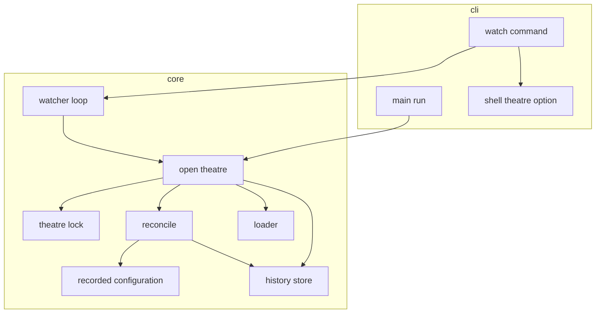
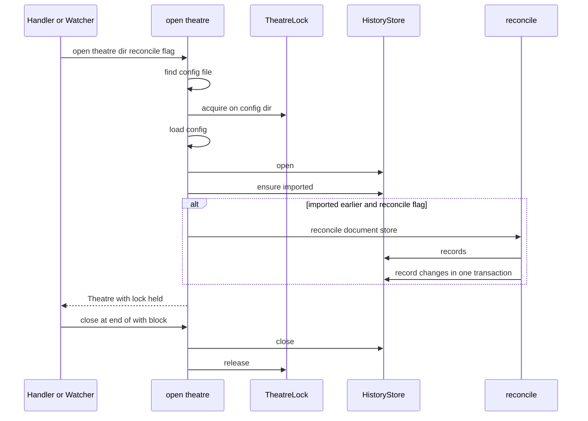
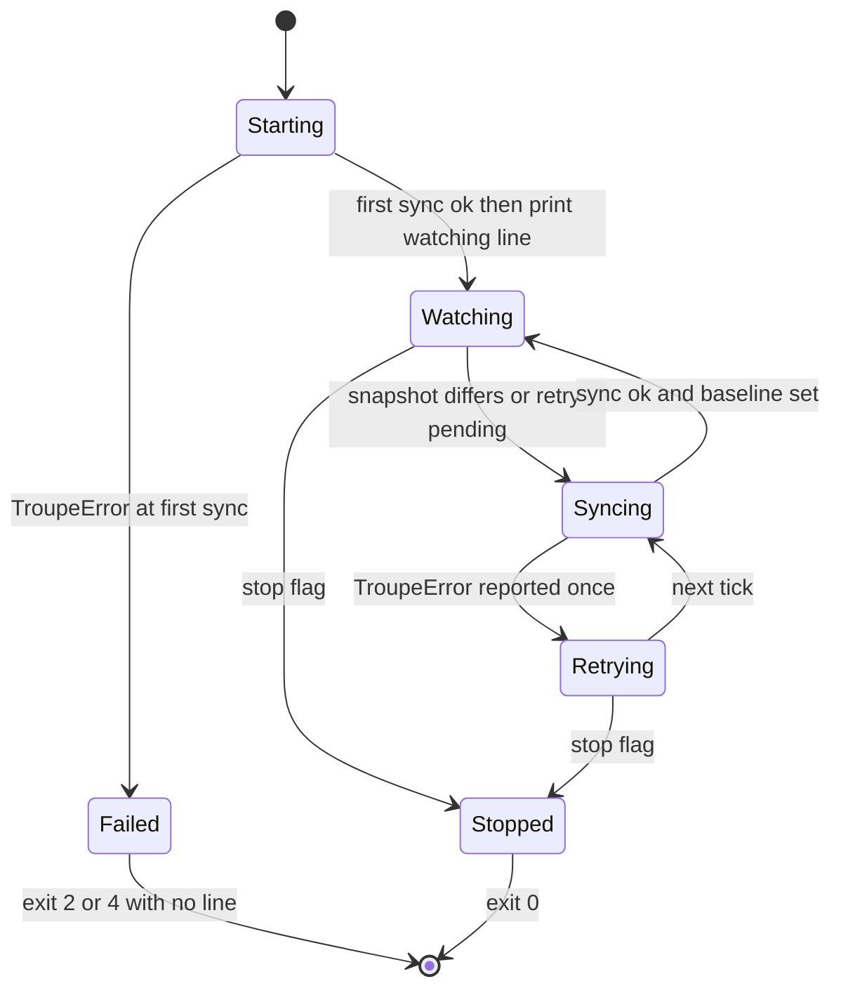

# Design Document: config-file-sync

## Overview
**Purpose**: This feature keeps a theatre's recorded configuration history in step with the files developers
edit by hand. It adds a **reconcile** that compares the files with the configuration as recorded and appends one
`set` or `remove` event per differing leaf. Every `troupe config` command except `history` reconciles first, and
the new `troupe config watch` reconciles continuously, within 2 seconds of each change.

**Users**: Developers who edit `.troupe/` files in their editor while troupe runs, and who read
`troupe config history` to see what changed.

**Impact**: This replaces step 1's "importing is not reconciling" for every command except `history`
(config-foundation 6.9 and 7.3). Product-owner decision A is unchanged: `show` and `set` still read the files as
on disk. What changes is that the history now also records hand edits. Each command now holds an exclusive
per-theatre lock while it runs, so a `set`'s write-back and a concurrent reconcile can never record the same
change twice.

### Goals
- Reconcile leaf by leaf against the recorded configuration, with typed comparison, atomic recording and
  deterministic order (2.1–2.9, 3.1–3.3).
- Reconcile first in every command except `history`, using one code path shared with `watch` (1.1–1.7).
- `watch`: an honest readiness line, changes recorded within 2 s, includes followed, tolerance of broken files
  and store failures, and a clean exit 0 on SIGINT/SIGTERM (3.4–3.5, 4.1–4.9, 5.1–5.7).
- Each change recorded exactly once across concurrent commands, and no leftover files (6.1–6.4, 7.1–7.3).

### Non-Goals
- Any change to how `set` renders and writes values, or to `show`/`history` output formats.
- New event kinds (reconcile reuses `set`/`remove`).
- Native file-system notifications, or any new runtime dependency.
- Concurrent writers to the same file during a `set` (still out of contract), Windows, anchors and aliases.

## Boundary Commitments

### This Spec Owns
- The **recorded configuration** projection: history records folded into live leaves, each with its value and
  creation `seq`.
- The **reconcile** algorithm, its event order, and the rule that it runs inside `open_theatre` for every
  command unless the caller opts out (only `history` opts out).
- The **theatre lock**: one exclusive, inter-process, file-less lock per theatre, held from just after the
  config file is located until the theatre is closed.
- The **watch loop** (watch set, snapshots, readiness, retry on failure, stop flag) and the `watch` subcommand
  (streaming stdout, signal handling, the `watching <dir>` line).
- The raw `--theatre` text, kept so `watch` can print the directory as given.
- Updating the step 1 tests that asserted "hand edits add no events".

### Out of Boundary
- Loading, includes, path rules, error types and exit codes (config-foundation). Used unchanged, apart from the
  additions listed under Modified Files.
- `set`'s resolution, planning, rendering, verification, writing and leaf diffing (config-set-writeback). `set`
  is unchanged; it simply runs inside a theatre that `open_theatre` has locked and reconciled.
- The event schema and the history line format.

### Allowed Dependencies
- `troupe.config.*` core modules: `locate`, `loader`, `model`, `resolve`, `paths`, `scalars`, `history`,
  `store`, `errors`, `constants`.
- Standard library only: `fcntl`, `os`, `signal`, `time`.
- The new core modules (`recorded`, `reconcile`, `lock`, `watch`) **must not import `troupe.config.writeback`**
  or `troupe.cli`. To keep that true, `scalar_equal` moves to `troupe.config.scalars` and `writeback/compare.py`
  re-imports it.
- Dependency direction: `constants/errors/scalars/paths` → `model/resolve/history/recorded` → `store/lock` →
  `reconcile` → `theatre` → `watch` → `cli`. Imports point left only.

### Revalidation Triggers
- A new `troupe config` subcommand: it must decide whether it reconciles. The default is that it does.
- Any change to `open_theatre`'s order (locate → lock → load → store → import or reconcile) or to the `Theatre`
  close order.
- Changes to event semantics (`LeafImported`/`LeafValueSet`/`LeafRemoved`) or to `scalar_equal`, because both
  `set` and reconcile depend on them.
- A move to authoritative history (reversing decision A), or a later step that writes files outside `set`.

## Architecture

### Existing Architecture Analysis
- Each handler validates its arguments, then enters `with open_theatre(dir) as theatre:`. `open_theatre` runs
  locate → load → `HistoryStore.open` → `ensure_imported`. `Theatre.__exit__` closes the store.
- `run()` buffers handler output and copies it to stdout only on success. Every `TroupeError` becomes
  `stderr: <file>: <path>: <problem>` with its exit code.
- `HistoryStore.record_changes` appends a batch in one SQLite transaction. Verified: two processes appending
  concurrently make the second fail with `IntegrityError` (it would surface as exit 4). Typed values,
  including `inf`, `nan`, `1.0` and `True`, round-trip through the store with their Python types.
- `ConfigDocument.files` lists every file read (root, YAML and text includes) with its display `path`, its
  `real_path` and its exact `text`.

### Architecture Pattern & Boundary Map


**Architecture Integration**:
- **Selected pattern: reconcile as part of opening a theatre.** One opener serves every command and every
  `watch` tick, so "reconcile first" can't be forgotten by a new command or diverge between `watch` and the
  other commands.
- **Idempotent diff against what was recorded.** Self-written changes are not tracked. A `set` records its own
  changes, so a later reconcile of its write-back finds nothing.
- **Mutual exclusion via the theatre lock.** It closes the one window in which a self-write could look like a
  hand edit: after `set` writes its files and before it records its events.
- **Existing patterns kept**: errors carry file and path, single-place constants, `with`-scoped resources,
  one transaction per batch, real-file and real-CLI tests.
- **Steering compliance**: nothing is written outside `.troupe/` and no extra file is created (decision E). User
  files are never written by reconcile or `watch` (Principle 1). Every choice that could lose data takes the
  conservative path: a load failure never means "removed".

### Technology Stack

| Layer | Choice / Version | Role in Feature | Notes |
|-------|------------------|-----------------|-------|
| CLI | argparse (stdlib), existing `TroupeArgumentParser` | `watch` subcommand; raw `--theatre` text | No new dependency |
| Core | Python 3.12+ | Projection, reconcile, watcher | `mypy --strict` |
| Data / Storage | eventsourcing ≥9.5.5 (SQLite), existing `HistoryStore` | Reads records; appends reconcile events in one transaction | Unchanged schema |
| Runtime | `fcntl.flock` on the `.troupe/` directory fd; `signal`; `time.sleep` polling | Inter-process lock; SIGINT/SIGTERM; change detection | Linux and macOS only (steering) |

Rationale and the rejected alternatives (watchfiles/watchdog, a lock file, flock on `history.sqlite`, raising
from signal handlers) are recorded in `research.md`.

## File Structure Plan

### Directory Structure
```
src/troupe/
├── config/
│   ├── recorded.py        # NEW: fold history records into live recorded leaves (value + creation seq)
│   ├── reconcile.py       # NEW: diff files vs recorded leaves -> LeafChange batch; record it
│   ├── lock.py            # NEW: TheatreLock - exclusive flock on <theatre>/.troupe, no file created
│   └── watch.py           # NEW: Watcher - watch set, snapshots, sync/retry loop, stop flag, error reports
└── cli/
    └── watch_command.py   # NEW: `watch` registrar + streaming handler, signal flag, readiness line
tests/
├── watch_support.py       # NEW: WatchProcess helper (Popen, wait for line, wait for events, signal, cleanup)
├── test_recorded.py       # NEW: projection folding and creation-seq order
├── test_reconcile.py      # NEW: reconcile_changes/reconcile on real theatres
├── test_lock.py           # NEW: exclusion across processes, no file left, nested-use refusal
├── test_watch_loop.py     # NEW: Watcher in-process (start/sync/retry/stop) on real files
├── test_e2e_reconcile.py  # NEW: CLI reconcile-first for show/set, history never reconciles
└── test_e2e_watch.py      # NEW: real `troupe config watch` process tests (readiness, 2 s, includes, signals, set)
```

### Modified Files
- `src/troupe/config/scalars.py`: gains `scalar_equal`, moved verbatim from `writeback/compare.py`, so core
  code can compare values without importing `writeback`.
- `src/troupe/config/writeback/compare.py`: imports `scalar_equal` from `troupe.config.scalars` and keeps
  exporting the name, so existing imports keep working.
- `src/troupe/config/constants.py`: adds `WATCH_POLL_SECONDS: Final = 0.2` and
  `WATCHING_LINE_PREFIX: Final = "watching "`.
- `src/troupe/config/theatre.py`: `open_theatre(directory, *, reconcile: bool = True)` takes the lock and
  reconciles; `Theatre` gains a `lock` field and releases it after closing the store. The module docstring
  replaces "never recorded (6.9, 7.3)" with the step 2 rule.
- `src/troupe/config/store.py`, `src/troupe/config/history.py`: docstrings only. `record_changes`,
  `LeafValueSet` and `LeafRemoved` are recorded by `set` *and* reconcile, and `ensure_imported` stays
  import-only.
- `src/troupe/cli/shell.py`: the `--theatre` option also stores the raw text in `args.theatre_text` (the
  argument as typed, or the `$TROUPE_THEATRE` value, or `str(Path.cwd())`). Adds the `StreamHandler` type.
- `src/troupe/cli/main.py`: `handle_history` passes `reconcile=False`. `SUBCOMMAND_REGISTRARS` gains
  `add_watch_subparser`. `run()` calls `args.stream_handler(args, stdout, stderr)` when the subcommand sets one
  (`watch`), and otherwise keeps the buffered path.
- Tests asserting the superseded behaviour, updated in the same change as the code:
  `tests/test_e2e_history.py::test_hand_edits_add_no_events_while_show_reflects_them`,
  `tests/test_e2e_show.py::test_show_after_hand_edit_prints_new_value_and_records_no_event`,
  `tests/test_theatre.py::test_hand_edit_after_import_shows_in_show_but_adds_no_history`,
  `tests/test_set_history.py::test_old_value_is_the_hand_edited_value_not_the_imported_one`, and the matching
  case in `tests/writeback/test_setter.py`. `tests/test_store.py::test_second_import_records_nothing_and_never_reconciles`
  stays (`ensure_imported` is still import-only); its docstring is clarified.
- `.kiro/specs/config-foundation/requirements.md` (6.9, 7.3) and `.kiro/specs/config-set-writeback/requirements.md`
  (the 15.1 example note): each gains a note that step 2 supersedes it, pointing to this spec.

## System Flows

### Opening a theatre (every command and every watch sync)

- The lock is taken **after** locating the config file, so the step 1 locate errors (missing `.troupe/`,
  neither or both files) keep their messages and create nothing. It is taken **before** loading, so a `set`'s
  load → write → record runs entirely inside one critical section.
- A load failure releases the lock and records nothing (1.5). A failure after the store opens closes the store
  and then releases the lock. The original error is never masked.
- The reconcile events are committed before the handler runs, so they persist when `show`/`set` then exit 3 or
  5 (1.2) and come before the `set`'s own events (1.7).

### Watch lifecycle

- **Sync** repeats `S = snapshot(W)`, then `with open_theatre(dir) as t: W' = watch_paths(t.document)`, until
  `W' == W`; then `baseline = S`. Because the snapshot of exactly the files later loaded is taken *before* the
  load, any write after the snapshot shows up as a difference at the next tick. Nothing that happens after the
  readiness line can be missed (4.3, 4.4, 5.1). A newly added include enlarges `W'`, which forces one more
  iteration that puts the new file under the baseline (3.4). A removed include shrinks `W`, so its file is
  never looked at again (3.5).
- **Retry**: any `TroupeError` during sync (a load failure, 5.3, or a store failure, 5.4) leaves `pending =
  True`, so the next tick tries again whether or not a file changed. The message is written to stderr only when
  it differs from the last one written, and the memory is cleared after a successful sync. No events are
  recorded on failure, because `open_theatre` records only after a successful load and in one transaction.
- **Stop**: the signal handlers only set a flag. The loop checks the flag between ticks and while sleeping
  (sleep in steps of at most `WATCH_POLL_SECONDS`). A reconcile in progress therefore always finishes its single
  transaction (2.7), the `with` block closes the store and releases the lock, and the handler returns 0 (4.6,
  7.2, 7.3).

## Requirements Traceability

| Requirement | Summary | Components | Interfaces | Flows |
|-------------|---------|------------|------------|-------|
| 1.1 | `show`/`set` reconcile before their own work | TheatreOpener | `open_theatre(reconcile=True)` | Opening |
| 1.2 | Reconcile events kept on exit 3/5 | TheatreOpener, Reconciler | committed before the handler runs | Opening |
| 1.3 | `history` never reconciles | TheatreOpener, CLI main | `open_theatre(reconcile=False)` | Opening |
| 1.4 | First command imports, no reconcile events | TheatreOpener | `ensure_imported` result gates reconcile | Opening |
| 1.5 | Usage/load error: nothing recorded | CLI handlers, TheatreOpener | parse before open; load before store | Opening |
| 1.6 | `show` prints the disk value, no file written | TheatreOpener | `theatre.document` unchanged | Opening |
| 1.7 | Hand-edit event before the `set`'s events | TheatreOpener, TheatreLock | lock spans load → write → record | Opening |
| 2.1–2.3, 2.5 | set/created/removed leaves, type changes | Reconciler | `reconcile_changes` | — |
| 2.4 | Formatting/comment/include-form edits: nothing | Reconciler | leaf-level `scalar_equal` diff | — |
| 2.6 | Sets in document order, removes by creation seq | Reconciler, RecordedConfiguration | `RecordedLeaf.created_seq` | — |
| 2.7 | All or nothing, including on a signal | Reconciler, WatchCommand | one `record_changes`; flag-only signals | Watch lifecycle |
| 2.8 | Text-include content change → one `set` | Reconciler | leaves from `flatten_leaves` | — |
| 2.9 | Same history rendering | (existing) `format_history_line` | — | — |
| 3.1–3.3 | Includes added or removed by hand | Reconciler | leaves come from the loaded document | — |
| 3.4, 3.5 | Watch set follows includes | Watcher | `watch_paths`, sync loop | Watch lifecycle |
| 4.1 | Same theatre default | CLI shell | `theatre_option_parent` | — |
| 4.2 | Start: import or reconcile, then watch | Watcher | `Watcher.start` | Watch lifecycle |
| 4.3, 4.4 | `watching <dir>` once armed, flushed | WatchCommand, Watcher | `theatre_text`; baseline before line | Watch lifecycle |
| 4.5 | Only the line on stdout | WatchCommand | errors to stderr only | — |
| 4.6 | SIGINT/SIGTERM → exit 0 | WatchCommand | flag-only signal handlers in `handle_watch` | Watch lifecycle |
| 4.7, 4.8 | Start-up usage/load errors | CLI main, Watcher | `TroupeError` before the line | Watch lifecycle |
| 4.9 | `watch` never writes user files | Watcher, Reconciler | read-only on user files | — |
| 5.1, 5.2 | ≤2 s, rename-safe, `.yml`↔`.yaml` | Watcher | path-based byte snapshots of both root names | Watch lifecycle |
| 5.3, 5.4 | Load/store failure: report, keep going, retry | Watcher | `pending`, deduplicated reports | Watch lifecycle |
| 5.5 | Net difference allowed | Reconciler | diff against recorded state | — |
| 5.6, 5.7 | Unrelated files / no leaf change: nothing | Watcher, Reconciler | watch set; empty diff | — |
| 6.1–6.4 | Exactly once, no interleaving | TheatreLock, Reconciler | lock around every open; idempotent diff | Opening |
| 7.1–7.3 | State only under `.troupe/`, no leftovers, store closed | TheatreLock, TheatreOpener, Watcher | file-less flock; store opened per sync | Opening |

## Components and Interfaces

| Component | Domain/Layer | Intent | Req Coverage | Key Dependencies | Contracts |
|-----------|--------------|--------|--------------|------------------|-----------|
| RecordedConfiguration | core | History records → live leaves with creation seq | 2.1–2.3, 2.6 | HistoryRecord (P0) | Service |
| Reconciler | core | Files vs recorded → changes; record them atomically | 1.2, 1.7, 2.x, 3.1–3.3, 5.5, 5.7 | RecordedConfiguration (P0), HistoryStore (P0), scalar_equal (P0) | Service |
| TheatreLock | core | Exclusive per-theatre inter-process lock, no file | 1.7, 6.1–6.4, 7.1, 7.2 | fcntl (P0) | Service, State |
| TheatreOpener | core | Locate → lock → load → store → import or reconcile | 1.1–1.6, 7.3 | Lock, Loader, Store, Reconciler (P0) | Service |
| Watcher | core | Watch set, snapshots, sync and retry loop | 3.4, 3.5, 4.2–4.4, 4.9, 5.1–5.7 | TheatreOpener (P0) | Service, State |
| WatchCommand | cli | `watch` subcommand, signals, readiness line | 4.1–4.8, 2.7 | Watcher (P0), shell (P1) | Service |
| CLI main/shell changes | cli | Streaming dispatch, raw theatre text, `history` opt-out | 1.3, 4.1, 4.3 | — | Service |

### Core

#### RecordedConfiguration (`config/recorded.py`)

| Field | Detail |
|-------|--------|
| Intent | Fold history records into the configuration as recorded |
| Requirements | 2.1, 2.2, 2.3, 2.6 |

**Responsibilities & Constraints**
- Pure function over `Sequence[HistoryRecord]` in `seq` order.
  - `import` creates the leaf with `created_seq = seq`.
  - `set` on an absent path creates the leaf with `created_seq = seq`; `set` on a present path updates its value
    and keeps `created_seq`.
  - `remove` deletes the leaf.
- "Absent" is decided by the path's presence in the fold, not by `old is None`, because a leaf can exist with
  value null.

**Contracts**: Service [x]
```python
@dataclass(frozen=True)
class RecordedLeaf:
    path: str             # dotted, as stored in the history
    value: ScalarValue
    created_seq: int      # seq of the event that most recently created this leaf

def recorded_leaves(records: Sequence[HistoryRecord]) -> tuple[RecordedLeaf, ...]:
    """Live leaves ordered by created_seq ascending."""
```

#### Reconciler (`config/reconcile.py`)

| Field | Detail |
|-------|--------|
| Intent | Compute and record the difference between the files and the recorded configuration |
| Requirements | 1.2, 1.7, 2.1–2.8, 3.1–3.3, 5.5, 5.7 |

**Responsibilities & Constraints**
- `reconcile_changes` is pure. For each leaf of `flatten_leaves(document.root)` in document order:
  - a path missing from the recorded leaves gives `SetChange(path, None, value)`;
  - a recorded value that is not `scalar_equal` to the file value gives `SetChange(path, recorded, value)`.

  Then, for each recorded leaf whose path is not in the files, in `created_seq` order, it gives
  `RemoveChange(ConfigPath.parse(path), recorded)`.
- `reconcile` reads `store.records()`, computes the changes and calls `store.record_changes(changes)` once, which
  is one transaction (2.7). An empty diff records nothing.
- Never touches user files (4.9). Never imports `writeback` or `cli`.

**Contracts**: Service [x]
```python
def reconcile_changes(document: ConfigDocument, recorded: Sequence[RecordedLeaf]) -> tuple[LeafChange, ...]: ...
def reconcile(document: ConfigDocument, store: HistoryStore) -> tuple[LeafChange, ...]:
    """Record and return the changes. Raises ConfigLoadError naming the store on store failure."""
```
- Precondition: the store is imported and the caller holds the theatre lock.
- Postcondition: `recorded_leaves(store.records())` equals the document's leaves, by path set and `scalar_equal`
  values.

#### TheatreLock (`config/lock.py`)

| Field | Detail |
|-------|--------|
| Intent | Serialise every command and every watch sync on one theatre |
| Requirements | 1.7, 6.1–6.4, 7.1, 7.2 |

**Responsibilities & Constraints**
- Opens the existing `<theatre>/.troupe` directory read-only (`os.open(dir, O_RDONLY)`) and takes a blocking
  `fcntl.flock(fd, LOCK_EX)`. Release means unlock and close the fd. Process exit releases it as well.
- Creates no file (7.2), and works on Linux and macOS.
- Not reentrant. A second acquire for the same directory while the process already holds it raises
  `RuntimeError` (a programming error) instead of deadlocking. It is tracked in a module-level set of held
  `real_path`s.
- An `OSError` while opening or locking becomes a `ConfigLoadError` naming the `.troupe` directory (exit 4).

**Contracts**: Service [x] / State [x]
```python
class TheatreLock:
    @classmethod
    def acquire(cls, config_dir: Path) -> Self: ...   # blocks until held
    def release(self) -> None: ...                    # idempotent
```

#### TheatreOpener (`config/theatre.py`, modified)

| Field | Detail |
|-------|--------|
| Intent | The one way commands and `watch` open a theatre |
| Requirements | 1.1–1.6, 7.3 |

**Responsibilities & Constraints**
- Order: `find_config_file` → `TheatreLock.acquire(config_file.parent)` → `load_config` → `HistoryStore.open` →
  `imported_now = ensure_imported(...)` → if `reconcile and not imported_now`: `reconcile(document, store)`.
- `Theatre(directory, config_file, document, history, lock)`. `close()` closes the store, then releases the
  lock. On any failure inside `open_theatre`, everything already acquired is released in reverse order and the
  original error is re-raised.
- `theatre.document` remains the files as loaded by this command (decision A). Reconcile does not alter it.

**Contracts**: Service [x]
```python
def open_theatre(directory: Path, *, reconcile: bool = True) -> Theatre: ...
```

#### Watcher (`config/watch.py`)

| Field | Detail |
|-------|--------|
| Intent | Observe the files and reconcile within 2 s, tolerating failures |
| Requirements | 3.4, 3.5, 4.2–4.4, 4.9, 5.1–5.7 |

**Responsibilities & Constraints**
- **Watch set** `W`: the display `path` of every `SourceFile` in `document.files`, plus both root candidates
  `<theatre>/.troupe/troupe.yml` and `.yaml`, so an added or renamed root is seen (5.2).
- **Snapshot**: `dict[Path, bytes | None]`. Each file is read by path, so a replace-by-rename is seen (5.2). A
  missing or unreadable file is `None`. Files outside `W` are never read (5.6).
- `start()` performs the first sync and raises any `TroupeError` (4.8). `run()` loops until the stop flag is set:
  - each tick, if `pending` or `snapshot(W) != baseline`, it syncs;
  - a failed sync reports the message (deduplicated) and sets `pending`;
  - it then sleeps `WATCH_POLL_SECONDS`.
- Each sync uses `open_theatre(directory)` inside a `with` block, so the store is opened and closed per sync and
  the lock is held only during the sync (7.2, 7.3).
- Worst-case latency: a 0.2 s tick plus the sync time plus any wait for a concurrent command's lock. This stays
  well under 2 s for small configurations (5.1).

**Contracts**: Service [x] / State [x]
```python
class Watcher:
    def __init__(self, directory: Path, *, report: Callable[[str], None],
                 stop_requested: Callable[[], bool], poll_seconds: float = WATCH_POLL_SECONDS) -> None: ...
    def start(self) -> None: ...   # first sync; raises TroupeError; on return, changes are observable
    def run(self) -> None: ...     # returns when stop_requested() is true; never raises TroupeError
```
- State: `watch_set`, `baseline`, `pending: bool`, `last_report: str | None`.

### CLI

#### WatchCommand (`cli/watch_command.py`)

| Field | Detail |
|-------|--------|
| Intent | `troupe config watch [--theatre DIR]` |
| Requirements | 2.7, 4.1–4.8 |

**Responsibilities & Constraints**
- `add_watch_subparser` registers `watch` with `parents=[theatre_option_parent()]` and no positional arguments,
  so a surplus argument exits 2 (4.7). It sets `stream_handler=handle_watch`.
- `handle_watch(args, stdout, stderr) -> int` runs these steps in order:
  1. Install SIGINT and SIGTERM handlers that only set a stop flag.
  2. `Watcher.start()`. A `TroupeError` propagates to `run()`, giving the exit code, an empty stdout and the
     stderr message.
  3. Unless a stop was already requested, write `f"watching {args.theatre_text}\n"` as UTF-8, then flush.
  4. `Watcher.run()`, with `report` writing `f"{message}\n"` to stderr and flushing.
  5. Return 0.
- Nothing else is ever written to stdout (4.5).

**Contracts**: Service [x]
```python
type StreamHandler = Callable[[argparse.Namespace, BinaryIO, TextIO], int]   # in cli/shell.py
def handle_watch(args: argparse.Namespace, stdout: BinaryIO, stderr: TextIO) -> int: ...
```

**Implementation Notes**
- Shell: `theatre_option_parent()` uses a small `argparse.Action` that stores both `theatre: Path` and
  `theatre_text: str`, with `set_defaults` for both. Existing handlers keep using `args.theatre`.
- `run()` dispatches to `stream_handler` when present. `TroupeError` handling is shared, and the buffered path
  is unchanged for `show`, `set` and `history`.

## Data Models

### Domain Model
- The aggregate (`ConfigHistory`) and its events are unchanged. Reconcile appends `LeafValueSet`/`LeafRemoved`
  exactly as `set` does, so `history` cannot tell them apart. This is intended: the contract has only the ops
  `set` and `remove`.
- New read model: **recorded configuration**, `path → (value, created_seq)`, derived on demand from the records
  and never persisted.
- Invariants:
  - after any non-`history` command, or any successful `watch` sync, the recorded configuration equals the
    files' leaves;
  - `seq` stays gap-free and consecutive per batch, because one `save` runs per batch and the lock serialises
    batches.

## Error Handling

### Error Strategy
- **Start-up and ordinary commands**: unchanged step 1 conventions. `UsageError` exits 2 and `ConfigLoadError`
  (load, store or lock) exits 4. Stdout stays empty and stderr names the file or store.
- **While `watch` runs**: a `TroupeError` from a sync is reported on stderr in the shared `<file>: <path>:
  <problem>` form, and the sync is retried on every tick. Nothing is recorded until a sync succeeds, and nothing
  is ever read as "leaves removed" while the files cannot be loaded.
- **Unexpected exceptions** (bugs): not caught, as in step 1. A traceback is printed with exit 1. The `with`
  blocks still release the store and the lock.
- **Signals**: flag only. Never raised inside a store transaction.

## Testing Strategy

All tests follow `testing.md`: real theatres on disk, a real CLI for end-to-end tests, and names that state what
they prove.

### Unit Tests
- `recorded_leaves`:
  - import, then set, then remove, then re-set gives the right live set and values;
  - `created_seq` follows re-creation;
  - a set on a null-valued leaf is not a creation;
  - `inf`, `nan` and `1.0` keep their types.
- `reconcile_changes` on real loaded documents:
  - changed, created, removed and type-changed leaves give the exact `SetChange`/`RemoveChange` lists in the
    2.6 order;
  - formatting-only, comment-only, quoting-only, key-order-only and inline-vs-include rewrites give an empty
    list;
  - a text-include content change gives one set;
  - `{}`↔`[]` gives nothing.
- `TheatreLock`:
  - a second process blocks until release (checked with a child process and timestamps);
  - no new file appears under `.troupe/`;
  - nested acquire in one process raises;
  - a missing directory gives a `ConfigLoadError` naming it.
- `open_theatre`:
  - reconcile runs only when already imported and `reconcile=True`;
  - `reconcile=False` records nothing;
  - load failure records nothing and releases the lock;
  - store and lock are released in reverse order on failure.

### Integration Tests
- `Watcher` in-process on real files, with a stop callback:
  - `start()` reconciles offline edits;
  - an edit after `start()` is recorded at the next ticks;
  - a newly added include is followed, and a removed include's file is ignored;
  - half-written YAML gives one report, no events, and recovery once fixed;
  - an unreadable store gives a report, a retry, and the outstanding events recorded once it is readable;
  - stop returns promptly.

### E2E Tests (real `troupe config watch` and commands)
- **Reconcile-first** (`test_e2e_reconcile.py`):
  - a hand edit followed by `history` records nothing, while a following `show` records `set`;
  - a hand edit followed by `set` gives a reconcile `set` before the set's `set`, with `old` chained (1.7);
  - reconcile events persist after `show` exits 5 and after `set` exits 3 (1.2);
  - a first command on a fresh theatre gives import events only (1.4);
  - a usage error or load error records nothing (1.5).
- **Watch** (`test_e2e_watch.py`, using `WatchProcess` from `tests/watch_support.py`):
  - the line is exactly `watching <dir>\n` and appears before any edit, and an edit made immediately after the
    line is recorded within 2 s (4.3, 4.4, 5.1);
  - an edit to a YAML include, a text include, a nested include, an atomic replace by rename, and a
    `.yml`→`.yaml` rename are each recorded within 2 s (5.1, 5.2);
  - a hand-added include's leaves appear as `set` events, and later edits to that include are followed (3.1, 3.4);
  - a comment-only edit and a touch record nothing within 2.5 s (2.4, 5.7);
  - an edit to an unrelated file records nothing (5.6);
  - a `set` while `watch` runs gives exactly the set's events after 2.5 s (6.1);
  - invalid YAML gives a stderr report naming the file, no events, then recovery when fixed (5.3);
  - SIGINT and SIGTERM each give exit 0, no traceback, only the one line on stdout, and no new files under
    `.troupe/` (4.5, 4.6, 7.2);
  - start-up on a missing config gives exit 4 and no line (4.8);
  - a surplus argument gives exit 2 (4.7);
  - `watch` and repeated `show` racing on the same edit record it exactly once (6.3, 6.4);
  - user file bytes are unchanged after a `watch` session (4.9).
- **Superseded step 1 tests** are rewritten to the step 2 expectations listed under Modified Files.

### Timing Robustness
- Positive assertions poll `history` with a 2 s deadline measured from the edit. Negative assertions wait 2.5 s.
- `WatchProcess` always terminates and kills its child in teardown, and waits for the line with a 10 s
  start-up timeout. Start-up is not covered by the 2 s bound.

## Security Considerations
- No new inputs beyond file contents already loaded in step 1. The lock uses the theatre's own `.troupe/`
  directory and nothing world-shared.

## Performance & Scalability
- No targets (steering). Polling at 0.2 s reads only the few watched files, and each sync loads the
  configuration and the history once. Both are small.
