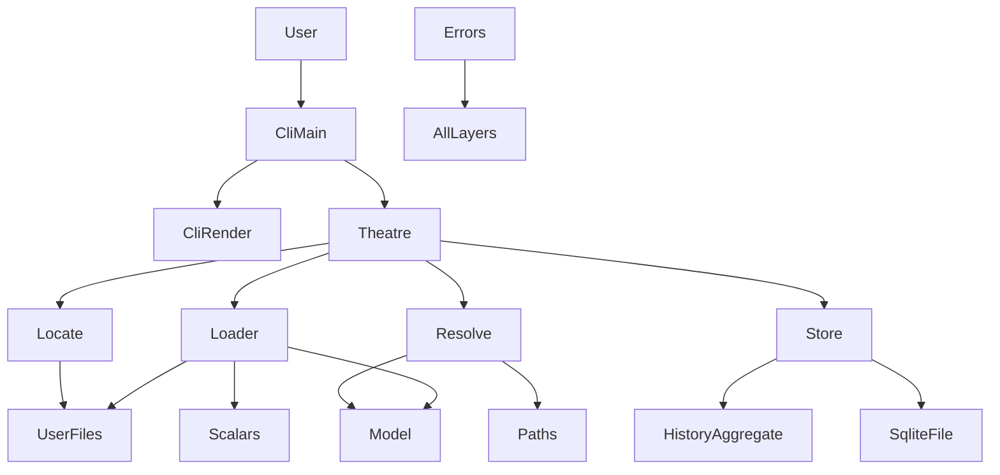
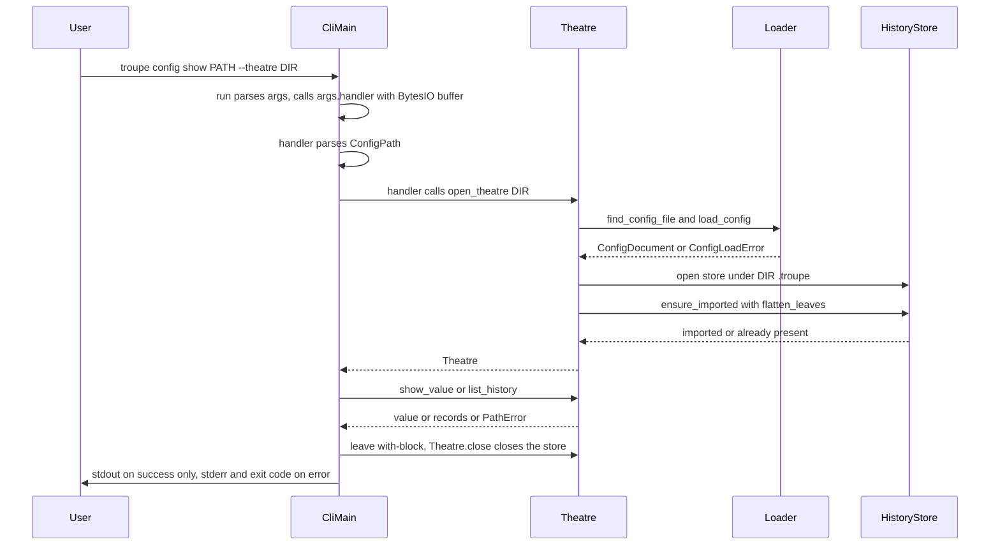
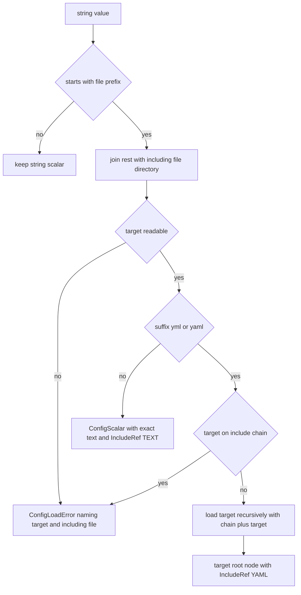

# Design Document: config-foundation

## Overview
**Purpose**: This feature delivers the read side of troupe's configuration subsystem: `troupe config show PATH`
and `troupe config history [PATH]` over a theatre's hand-edited `.troupe/troupe.yml` (or `.yaml`) with recursive
`file:` includes, plus the shared foundations that the downstream `set` command (config-set-writeback) builds on.

**Users**: Developers who hand-edit and diff their theatre configuration use it to read single settings from the
shell and to review the configuration's change history. The config-set-writeback spec uses its model, path
resolution, history API and error types.

**Impact**: Greenfield. Creates the Python package `troupe` (src layout, uv, console script `troupe`), the
`troupe.config` core and file layer, and the `troupe.cli` layer, confirming the layout proposed in
`structure.md`.

### Goals
- `show` and `history` behave exactly as the step 1 contract (General, Includes, show, history) states.
- A source-mapped configuration model that records, for every node, its file, character span, style, block/flow
  kind and include provenance, narrow enough for the byte-surgical writer to consume without re-parsing logic.
- An eventsourcing-based history with one atomic import per theatre and an append API for `set`/`remove` events.
- One error hierarchy and one exit-code mapping used by every subcommand; stdout empty on failure.

### Non-Goals
- `set`, VALUE parsing, write-target resolution, rendering and patching (config-set-writeback).
- Deciding which leaves a `set` changed (config-set-writeback computes the diff with this spec's flattening).
- Support for anchors/aliases/merge keys and explicit tags (refused with exit 4, 3.7, 3.9; PO decisions H, I),
  multi-document files, concurrent writers, Windows.
- A "current value" projection from events (no consumer; see decision "Files are authoritative", confirmed by the
  product owner as decision A).

## Boundary Commitments

### This Spec Owns
- Project scaffold: `pyproject.toml`, uv lock, console script `troupe`, mypy/ruff/pytest configuration.
- Single-place constants: `.troupe` directory name, config file names, include prefix, YAML include suffixes,
  history store file name.
- Locating the root config file and **all reading of the user's files** (root, YAML includes, text includes).
- The **source-mapped config model** (`troupe.config.model`) and YAML 1.2 core-schema scalar typing
  (`troupe.config.scalars`).
- Path syntax (`ConfigPath`), path walking/resolution and leaf flattening (`troupe.config.resolve`).
- The **history**: aggregate, event types, SQLite persistence under `<theatre>/.troupe/`, import, the history
  projection, and the change-recording API (`troupe.config.history`, `troupe.config.store`).
- The theatre session use cases `open_theatre`, `show_value`, `list_history` (`troupe.config.theatre`).
- **Error types and the exit-code mapping** (`troupe.config.errors`) and the CLI that applies them: the leaf
  module `troupe.cli.shell` (parser class, handler/registrar types, `--theatre` parent) and `troupe.cli.main`
  (registration tuple, `build_parser`, `run` with stdout buffering so failures print nothing to stdout, `main`).
- Rendering of `show` scalars and `history` JSON lines (`troupe.cli.render`).

### Out of Boundary
- Any write to user files (atomic writes, patching, rendering of written values) — config-set-writeback.
- The `set` subcommand's argument handling beyond the shared `--theatre` option and error shell.
- Computing set/remove leaf diffs and deciding no-op sets — config-set-writeback (it calls `record_changes`).
- Reconciling hand edits into history (explicitly not done: "importing is not reconciling"). *Superseded by step 2
  (spec config-file-sync, requirements 1.1–1.3, 1.7): every command except `history` now reconciles first.*

### Allowed Dependencies
- Python 3.12 standard library; `ruamel.yaml>=0.19.1,<0.20` (compose only, never dump); `eventsourcing>=9.5.5,<10`
  with its SQLite module.
- Dependency direction (enforced; imports only point left):
  `constants → errors → scalars → paths → model → locate → loader → resolve → history → store → theatre → cli`.
  `troupe.config.*` never imports `troupe.cli.*`.
- Import direction inside `troupe.cli` (enforced; no cycles): `shell ← subcommand modules ← main`.
  `troupe.cli.shell` is a leaf that imports nothing from other `troupe.cli` modules (only stdlib and
  `troupe.config.errors`). Subcommand modules (show/history handler code if split out, `render`, and
  config-set-writeback's `set` module) import shell-level names only from `troupe.cli.shell`, never from
  `troupe.cli.main`. Only `troupe.cli.main` imports subcommand modules. Only `loader` and `locate` read user files; writing user files
  belongs to config-set-writeback's `atomic` module. Only `store` touches `<theatre>/.troupe/history.sqlite*`.
- config-set-writeback may import any public name listed in "Shared Seams" below and nothing else.

### Revalidation Triggers
- Any change to the shared seam types (`SourceFile`, `Span`, `Origin`, `IncludeRef`, node classes, `Leaf`,
  `PathWalk`, `SetChange`/`RemoveChange`/`LeafChange`, `HistoryRecord`, error classes, `INCLUDE_PREFIX`,
  `TroupeArgumentParser`, `Handler`, `SubcommandRegistrar`, `theatre_option_parent`, `SUBCOMMAND_REGISTRARS`) or
  their invariants.
- Moving any shell-level name out of `troupe.cli.shell`, or making `troupe.cli.shell` import any other
  `troupe.cli` module (would reintroduce the `main` ↔ subcommand import cycle).
- Change of authority (e.g. `show` reading the event store) or of when the import happens (authority confirmed by
  the product owner, decision A).
- Change of the session lifecycle (`Theatre` as a context manager whose exit closes the history store, 7.9).
- Change of history storage location, aggregate ID, event names or `seq` derivation.
- Change of span semantics (character vs byte indices, exactness of plain/quoted scalar spans, block scalar spans
  extending over trailing blank lines, unreliable spans of empty null values, tightness of collection spans) or of
  file decoding.
- Change of `load_config` override semantics (used by the downstream write-verify step).

## Shared Seams (consumed by config-set-writeback)
This section names every contract the downstream spec relies on; full signatures are in Components.

| Seam | Module | Public names | Downstream use |
|------|--------|--------------|----------------|
| Constants | `troupe.config.constants` | `INCLUDE_PREFIX` | Detect `file:` include directives (refusal rules, VALUE checks) with the single-place prefix |
| Source-mapped model (values are the true YAML values: folded `>` scalars are folded with no U+0007 markers; source text and spans are untouched) | `troupe.config.model` | `SourceFile`, `LineEnding`, `Span`, `Origin`, `IncludeKind`, `IncludeRef`, `ScalarStyle`, `CollectionStyle`, `ConfigScalar`, `ConfigMapping`, `MappingEntry` (incl. `key_style: ScalarStyle`), `ConfigSequence`, `ConfigNode`, `ConfigDocument` | Find the file and span to patch, value and key style to keep, include provenance for refusal rules, CRLF info |
| Core-schema typing | `troupe.config.scalars` | `ScalarValue`, `resolve_plain_scalar` | Type a plain VALUE exactly as loaded values are typed |
| Loading | `troupe.config.loader` | `load_config(config_file, overrides=None)` | Re-load with patched text in memory to verify before writing |
| Paths | `troupe.config.paths` | `ConfigPath` (`parse`, `segments`, `child`, `__str__`), `is_index_segment` | Parse PATH with identical rules |
| Resolution | `troupe.config.resolve` | `walk_path`, `PathWalk`, `WalkStop`, `resolve_path`, `flatten_leaves`, `Leaf` | Deepest existing ancestor for new keys, list append checks, before/after leaf diff |
| History write API | `troupe.config.store`, `troupe.config.history` | `HistoryStore.record_changes`, `HistoryStore.close`, `SetChange`, `RemoveChange`, `LeafChange` (= `SetChange \| RemoveChange`), `HistoryRecord` | Append one `set`/`remove` event per changed leaf, atomically |
| Session | `troupe.config.theatre` | `Theatre` (context manager; `close()` closes the history store), `open_theatre` | Locate + load from disk + ensure import before `set` runs; `theatre.document` is the configuration as on disk for this command (decision A); the handler uses `with open_theatre(...) as theatre:` so the store is closed at command end (7.9) |
| Errors | `troupe.config.errors` | `ExitCode`, `TroupeError`, `UsageError`, `WriteRefusedError`, `ConfigLoadError`, `PathError`, `PathNotFoundError`, `WrongNodeKindError`, `format_message` | Raise with file/path; the CLI shell maps to exit codes |
| CLI shell (leaf) | `troupe.cli.shell` | `TroupeArgumentParser`, `Handler` (protocol: `Callable[[argparse.Namespace, io.BytesIO], None]`), `SubcommandRegistrar`, `theatre_option_parent` | The `set` subcommand module imports these from `troupe.cli.shell` only (never from `troupe.cli.main`) to define its registrar (adds the `set` subparser with `theatre_option_parent()`, sets its `Handler` via `set_defaults(handler=...)`) |
| CLI entry | `troupe.cli.main` | `SUBCOMMAND_REGISTRARS`, `build_parser`, `run`, `main` | Add one registrar entry (imported from the `set` module) to `SUBCOMMAND_REGISTRARS`; inherits buffering and error mapping from `run` |
| Test support | `tests/` (on pytest `pythonpath`) | `conftest.py` fixtures, helper modules in `tests/` | `tests/` is on `pythonpath` (`[tool.pytest.ini_options] pythonpath = ["tests"]`), so helper modules in `tests/` are importable from subdirectories such as `tests/writeback/` |

## Architecture

### Architecture Pattern & Boundary Map
Layered architecture as proposed in `structure.md`: CLI → core (theatre session, history) → file layer (locate,
loader) and pure model/resolve modules.



**Architecture Integration**:
- Selected pattern: layered with a narrow file layer; the file layer (locate, loader) is the only reader of user
  files. Rationale and rejected alternatives in `research.md`.
- Domain boundaries: model/resolve are pure (no I/O); history/store own the event log; theatre composes them;
  CLI only parses, dispatches, renders and maps errors.
- Steering compliance: one decision per place (constants, errors, message format, event names); errors carry
  file and path; conservative refusals (exit 4) for unsupported YAML features.

### Technology Stack

| Layer | Choice / Version | Role in Feature | Notes |
|-------|------------------|-----------------|-------|
| CLI | `argparse` (stdlib) | `troupe config show/history`, `--theatre` | Parser `error()` overridden to raise `UsageError` (exit 2) |
| Parsing | ruamel.yaml 0.19.1 (`YAML(typ="rt").compose`) | Nodes with character marks, scalar style, flow style | Never constructs or dumps documents |
| Event store | eventsourcing 9.5.5, `eventsourcing.sqlite` | Aggregate, events, persistence, ordering | DB `<theatre>/.troupe/history.sqlite` |
| Runtime | Python 3.12+, uv | `uv run troupe config …` from repo root | Console script `troupe = "troupe.cli.main:main"` |
| Tooling | pytest, mypy (strict), ruff (lint + format) | Quality gates | Dev dependency group in `pyproject.toml`; pytest `pythonpath = ["tests"]` |

## File Structure Plan

### Directory Structure
```
pyproject.toml                 # Project metadata, deps, console script, mypy/ruff/pytest config;
                               # [tool.pytest.ini_options] pythonpath = ["tests"] (helper modules in tests/
                               # importable from subdirectories such as tests/writeback/)
uv.lock                        # Generated by uv
.gitignore                     # .venv, caches
src/troupe/
├── __init__.py
├── py.typed
├── cli/
│   ├── __init__.py
│   ├── shell.py               # Leaf (imports no other troupe.cli module): TroupeArgumentParser, Handler,
│   │                          # SubcommandRegistrar, theatre_option_parent
│   ├── main.py                # SUBCOMMAND_REGISTRARS, show/history registrars + handlers, build_parser,
│   │                          # dispatch, TroupeError → exit code, buffered stdout, main(); imports shell + subcommand modules
│   └── render.py              # show scalar formatting; history JSON line formatting (UTF-8 bytes)
└── config/
    ├── __init__.py
    ├── constants.py           # CONFIG_DIR_NAME, CONFIG_FILE_NAMES, INCLUDE_PREFIX, YAML_INCLUDE_SUFFIXES, HISTORY_STORE_NAME, PATH_SEPARATOR
    ├── errors.py              # ExitCode, error hierarchy, format_message
    ├── scalars.py             # ScalarValue, resolve_plain_scalar (YAML 1.2 core schema)
    ├── paths.py               # ConfigPath parsing/formatting, is_index_segment, path_has_prefix
    ├── model.py               # Source-mapped node types (pure data)
    ├── locate.py              # find_config_file(theatre_dir)
    ├── loader.py              # load_config: read, decode, compose, build model, includes, cycles
    ├── resolve.py             # walk_path, resolve_path, flatten_leaves
    ├── history.py             # ConfigHistory aggregate, events, SetChange/RemoveChange, HistoryRecord
    ├── store.py               # HistoryStore (eventsourcing Application over SQLite)
    └── theatre.py             # Theatre, open_theatre, show_value, list_history
tests/
├── conftest.py                # make_theatre(tmp_path, files) fixture; run_cli() subprocess helper
├── test_cli_usage.py          # exit 2 cases, --theatre default, stdout empty on failure
├── test_locate.py             # .yml/.yaml/neither/both/missing dir via CLI
├── test_loader.py             # spans, styles, CRLF, errors, duplicate keys, tags, root kinds
├── test_includes.py           # YAML/text includes, nesting, relative dirs, missing, cycles
├── test_scalars.py            # core-schema typing table
├── test_paths_resolve.py      # path parsing, walk, resolve, flatten order
├── test_show.py               # show printing rules and exit 5 cases through the CLI
├── test_history.py            # import, JSON lines, seq, filter, no reconcile, atomicity, store errors
├── test_record_changes.py     # set/remove recording API and atomic batches
└── test_read_only.py          # user files byte-identical; only .troupe/history.sqlite* created
```

### Modified Files
- None (greenfield). `.kiro/steering/structure.md` and `tech.md` "Common Commands" are confirmed by this layout;
  updating them after the code lands is a steering task, not part of this spec's implementation.

## System Flows

### Command execution (show and history)


**Key decisions**:
- Order is fixed: parse args → handler validates its arguments → handler calls `open_theatre` (locate → load →
  open store → ensure import) → command. `run` never opens the theatre, so usage errors create no state, and no
  state is created if any earlier step fails (7.4). An exit 5 after the import does not undo the import (decision in `research.md`).
- The handler renders the complete output as UTF-8 bytes into an `io.BytesIO` buffer; `run` copies it to stdout
  only after the handler succeeded (10.2).
- The handler holds the theatre in a `with open_theatre(...) as theatre:` block, so the history store is closed
  when the command ends, on success and on every error (7.9). `open_theatre` itself closes the store before
  re-raising if the import fails.
- Files are the truth (decision A, confirmed by the product owner): every command loads the files from disk;
  `show` reads only that freshly loaded document; the history is change history only. *(Step 2, spec
  config-file-sync 1.1–1.3, 1.7: hand edits are now reconciled into the history by every command except
  `history`; `show` still reads only the files.)*

### Include resolution


## Requirements Traceability

| Requirement | Summary | Components | Interfaces | Flows |
|-------------|---------|------------|------------|-------|
| 1.1 | Run show/history via uv from repo root | Scaffold, CliMain | `main`, console script | Command execution |
| 1.2, 1.3 | `--theatre` / cwd default | CliMain | `theatre_option_parent` | Command execution |
| 1.4 | Malformed command line → 2 | CliMain, Errors | `TroupeArgumentParser.error`, `UsageError`, `SUBCOMMAND_REGISTRARS` | — |
| 1.5 | Malformed PATH → 2 | Paths, Errors | `ConfigPath.parse` | — |
| 2.1–2.4 | Locate yml/yaml, neither/both/missing dir → 4 | Locate, Constants | `find_config_file` | Command execution |
| 3.1 | YAML 1.2 core schema typing | Scalars, Loader | `resolve_plain_scalar` | — |
| 3.2–3.4, 3.7, 3.9 | Unreadable/non-UTF-8/invalid, duplicate keys, root kind, explicit tags, anchors/aliases/merge keys → 4 | Loader, Errors | `load_config`, `ConfigLoadError` | — |
| 3.8 | Folded scalars hold the folded value without U+0007 markers | Loader | `load_config` | — |
| 3.5 | Empty root → empty configuration | Loader | `load_config` | — |
| 3.6 | Read-only access to user files | Loader, Locate | read-only open | — |
| 4.1–4.7 | Includes, recursion, missing, cycles | Loader, Model | `load_config`, `IncludeRef` | Include resolution |
| 5.1–5.5 | Path addressing | Paths, Resolve | `ConfigPath`, `walk_path`, `resolve_path` | — |
| 6.1–6.6 | Scalar printing | CliRender, Theatre | `format_show_output`, `show_value` | Command execution |
| 6.7, 6.8 | Mapping/list or missing → 5 naming file and path | Resolve, Errors | `WrongNodeKindError`, `PathNotFoundError` | — |
| 6.9 | Show reads files as on disk, not history; hand edit adds no event (superseded by config-file-sync 1.1–1.3, 1.7 except for `history`) | Theatre, Store | `show_value` uses `ConfigDocument` only; `ensure_imported` never reconciles | Command execution |
| 7.1, 7.2 | One import event per leaf, document order | Resolve, Store, HistoryAggregate | `flatten_leaves`, `ensure_imported` | Command execution |
| 7.3, 7.5 | Import once; no reconcile; empty config imported | Store, HistoryAggregate | `HistoryStarted`, `is_imported` | — |
| 7.4 | No state on load failure | Theatre | `open_theatre` ordering | Command execution |
| 7.6 | State only under `.troupe/`; nothing created elsewhere | Store, Constants, Loader, Locate | `HISTORY_STORE_NAME`; read-only file layer | — |
| 7.7 | Import atomic | Store | single `save` transaction | — |
| 7.8 | Unreadable store → 4 | Store, Errors | `ConfigLoadError` | — |
| 7.9 | Store closed at command end | Store, Theatre, CliMain | `HistoryStore.close`, `Theatre.__exit__`, handler `with` block | Command execution |
| 8.1–8.7 | History JSON Lines, seq, filter, valid JSON for non-finite floats | Store, Paths, CliRender | `records`, `path_has_prefix`, `format_history_line` | Command execution |
| 9.1–9.4 | Set/remove recording API | Store, HistoryAggregate | `record_changes`, `SetChange`, `RemoveChange` | — |
| 10.1–10.5 | Exit codes, empty stdout, messages | Errors, CliMain | `ExitCode`, `format_message`, `run`, `Handler` (BytesIO buffer) | Command execution |

## Components and Interfaces

| Component | Domain/Layer | Intent | Req Coverage | Key Dependencies | Contracts |
|-----------|--------------|--------|--------------|------------------|-----------|
| Scaffold | Build | Package, console script, tool config | 1.1 | uv (P0) | — |
| Constants | Core | Single-place names | 2.1, 4.1, 4.2, 7.6 | — | State |
| Errors | Core | Error types, exit codes, message format | 10.1–10.5, 1.4, 1.5 | Constants (P2) | Service |
| Scalars | Core | YAML 1.2 core-schema typing | 3.1 | — | Service |
| Paths | Core | Dotted path syntax and prefix matching | 1.5, 5.1, 5.3, 8.3 | Errors (P0) | Service |
| Model | Core | Source-mapped node types | 4.2, 4.3, 6.6 | Scalars (P0) | State |
| Locate | File layer | Find root config file | 2.1–2.4 | Constants, Errors (P0) | Service |
| Loader | File layer | Read files, build model, includes | 3.1–3.9, 4.1–4.7 | ruamel.yaml (P0), Model (P0) | Service |
| Resolve | Core | Walk/resolve paths, flatten leaves | 5.1–5.5, 6.7, 6.8, 7.2 | Model, Paths (P0) | Service |
| HistoryAggregate | Core | Event-sourced history aggregate and events | 7.1, 7.3, 7.5, 9.1–9.4 | eventsourcing (P0) | Event, State |
| Store | Core / persistence | Persist, import, record, project records, close | 7.1–7.9, 8.1–8.6, 9.1–9.4 | eventsourcing SQLite (P0) | Service, State |
| Theatre | Core / application | Session use cases and lifecycle | 6.1–6.9, 7.4, 7.9, 8.5 | Locate, Loader, Resolve, Store (P0) | Service |
| CliMain | CLI | Parse, dispatch, map errors, buffer stdout | 1.1–1.5, 10.1–10.5 | Theatre (P0), CliRender (P0) | Service |
| CliRender | CLI | Format show/history output | 6.1–6.6, 8.1, 8.2, 8.6, 8.7 | Scalars (P2) | Service |

### Core

#### Constants

| Field | Detail |
|-------|--------|
| Intent | Hold every single-place name used by more than one module |
| Requirements | 2.1, 4.1, 4.2, 7.6 |

**Contracts**: State [x]
- `CONFIG_DIR_NAME: Final = ".troupe"`, `CONFIG_FILE_NAMES: Final = ("troupe.yml", "troupe.yaml")`,
  `INCLUDE_PREFIX: Final = "file:"`, `YAML_INCLUDE_SUFFIXES: Final = (".yml", ".yaml")` (case-sensitive),
  `HISTORY_STORE_NAME: Final = "history.sqlite"`, `PATH_SEPARATOR: Final = "."`.

#### Errors

| Field | Detail |
|-------|--------|
| Intent | One error hierarchy, one exit-code mapping, one message format |
| Requirements | 1.4, 1.5, 10.1, 10.3, 10.4, 10.5 |

**Responsibilities & Constraints**
- Every failure that the CLI reports is a `TroupeError` subclass carrying `file`, `path` and `problem`.
- The exit code is a class attribute; the CLI never decides exit codes itself.
- Message format (single home): `"{file}: {path}: {problem}"`, `"{file}: {problem}"`, `"{path}: {problem}"` or
  `"{problem}"`, depending on which of `file`/`path` are set. Files are shown as the path that was opened (theatre
  argument joined with `.troupe/…` and include specs, not resolved), so users recognise them.

**Contracts**: Service [x]
```python
class ExitCode(IntEnum):
    OK = 0
    USAGE = 2
    WRITE_REFUSED = 3
    LOAD = 4
    PATH = 5

def format_message(*, file: Path | None, path: str | None, problem: str) -> str: ...

class TroupeError(Exception):
    exit_code: ClassVar[ExitCode]
    def __init__(self, problem: str, *, file: Path | None = None, path: str | None = None) -> None: ...
    file: Path | None
    path: str | None
    problem: str
    def __str__(self) -> str: ...          # format_message(file=..., path=..., problem=...)

class UsageError(TroupeError): ...         # exit 2
class WriteRefusedError(TroupeError): ...  # exit 3; defined here, raised only by config-set-writeback
class ConfigLoadError(TroupeError): ...    # exit 4 (locate, read, decode, YAML, includes, history store)
class PathError(TroupeError): ...          # exit 5
class PathNotFoundError(PathError): ...    # path does not exist
class WrongNodeKindError(PathError): ...   # node exists but is the wrong kind for the command
```
- Invariant: subclasses of `ConfigLoadError` and `PathError` set `file` (and `path` where a key path is known).

#### Scalars

| Field | Detail |
|-------|--------|
| Intent | Type plain scalars by the YAML 1.2 core schema |
| Requirements | 3.1 |

**Contracts**: Service [x]
```python
ScalarValue: TypeAlias = str | int | float | bool | None

def resolve_plain_scalar(text: str) -> ScalarValue: ...
```
- Applies the core-schema regular expressions (null, bool, int decimal/octal/hex, float incl. `.inf`/`.nan`);
  anything else returns `text` unchanged. Returned values are plain builtins (never ruamel subclasses).
- Quoted and block scalars are not passed here; they are always `str`.

#### Paths

| Field | Detail |
|-------|--------|
| Intent | Parse and format dotted paths; textual prefix match for history |
| Requirements | 1.5, 5.1, 5.3, 8.3 |

**Contracts**: Service [x]
```python
@dataclass(frozen=True)
class ConfigPath:
    segments: tuple[str, ...]
    @classmethod
    def parse(cls, text: str) -> ConfigPath: ...   # UsageError(path=text) if empty or any segment empty
    def child(self, segment: str | int) -> ConfigPath: ...
    def __str__(self) -> str: ...                  # segments joined by "."

ROOT: Final[ConfigPath]                            # ConfigPath(()) — used only internally for the root

def is_index_segment(segment: str) -> bool: ...    # segment matches [0-9]+
def path_has_prefix(path: str, prefix: str) -> bool: ...  # path == prefix or path.startswith(prefix + ".")
```

#### Model (source-mapped configuration model)

| Field | Detail |
|-------|--------|
| Intent | Immutable tree of configuration nodes with exact source provenance |
| Requirements | 4.2, 4.3, 6.6 (data carried for 3.x/4.x/5.x and for config-set-writeback) |

**Responsibilities & Constraints**
- Pure data; no I/O. All dataclasses are `frozen=True`, collections are tuples.
- **Span semantics**: `Span.start`/`Span.end` are **character (code point) indices** into `SourceFile.text`, the
  exact decoded file text (UTF-8, no newline translation, BOM kept). Byte offsets, when needed, are
  `len(text[:i].encode("utf-8"))`. Plain and quoted scalar spans are exact (quoted spans cover the quotes). A
  block scalar's span starts at its indicator (`|`, `>`, with any chomping/indentation indicators) and covers the
  header line and all content lines including the final line break, but it may also extend over trailing blank
  lines (ruamel behaviour: for `'|\n  a\n  b\n\n\n'` the value is `'a\nb\n'` and the span covers all the
  trailing blank lines), so a block scalar's `end` is not tight. The span of an empty (zero-length) null value
  (e.g. `key:` with nothing after it) is not a reliable position; consumers must not patch at it. Mapping/sequence spans are
  as reported by the composer; flow collection spans are exact (`[` … `]`, `{` … `}`), block collection spans
  start at the first entry and may extend over trailing blank lines/comments, so consumers must not treat a block
  collection's `end` as tight.
- **Include provenance**: a node produced by an include carries `include: IncludeRef`; its own `origin` lies in the
  target file. The `file:` string that was replaced is `include.directive` (in the including file). Nodes nested
  inside an included YAML file but not themselves include roots have `include=None` and an `origin` in the
  target file.
- **Text include**: a `ConfigScalar` whose `value` is the target's exact text, `style=None`,
  `origin=Origin(target, Span(0, len(target.text)))`, `include.kind == IncludeKind.TEXT`.
- **Line endings**: `SourceFile.line_ending` reports the file's newline convention so writers can keep CRLF.

**Contracts**: State [x]
```python
class LineEnding(Enum):
    NONE = "none"    # no line break in the file
    LF = "lf"
    CRLF = "crlf"
    MIXED = "mixed"

@dataclass(frozen=True)
class SourceFile:
    path: Path              # path as opened (display form, used in messages; writers target `real_path`)
    real_path: Path         # Path.resolve() of path; identity for cycles and overrides
    text: str               # exact decoded content
    line_ending: LineEnding

@dataclass(frozen=True)
class Span:
    start: int              # character index, inclusive
    end: int                # character index, exclusive

@dataclass(frozen=True)
class Origin:
    file: SourceFile
    span: Span

class IncludeKind(Enum):
    NONE = "none"           # never stored on IncludeRef; used by callers as "not included"
    YAML = "yaml-include"
    TEXT = "text-include"

@dataclass(frozen=True)
class IncludeRef:
    kind: IncludeKind       # YAML or TEXT
    spec: str               # text after "file:" exactly as written
    target: SourceFile      # the included file
    directive: Origin       # span of the "file:..." scalar in the including file

class ScalarStyle(Enum):
    PLAIN = "plain"
    SINGLE_QUOTED = "single"
    DOUBLE_QUOTED = "double"
    LITERAL = "literal"     # |
    FOLDED = "folded"       # >

class CollectionStyle(Enum):
    BLOCK = "block"
    FLOW = "flow"

@dataclass(frozen=True)
class ConfigScalar:
    value: ScalarValue
    style: ScalarStyle | None       # None only for text includes
    origin: Origin
    include: IncludeRef | None = None

@dataclass(frozen=True)
class MappingEntry:
    key: str                        # key scalar text as written (unquoted content)
    key_origin: Origin              # span of the key scalar (incl. quotes)
    key_style: ScalarStyle          # derived from the ruamel key node's style (PLAIN, SINGLE_QUOTED, DOUBLE_QUOTED, ...)
    value: ConfigNode

@dataclass(frozen=True)
class ConfigMapping:
    entries: tuple[MappingEntry, ...]   # in document order
    style: CollectionStyle
    origin: Origin
    include: IncludeRef | None = None
    def get(self, key: str) -> MappingEntry | None: ...

@dataclass(frozen=True)
class ConfigSequence:
    items: tuple[ConfigNode, ...]
    style: CollectionStyle
    origin: Origin
    include: IncludeRef | None = None

ConfigNode: TypeAlias = ConfigScalar | ConfigMapping | ConfigSequence

@dataclass(frozen=True)
class ConfigDocument:
    root_file: SourceFile
    root: ConfigMapping                 # empty root file: ConfigMapping(entries=(), style=CollectionStyle.BLOCK,
                                        #   origin=Origin(root_file, Span(0, 0)))
    files: tuple[SourceFile, ...]       # every file read (root, YAML and text include targets), in read order
    def include_kind(self, node: ConfigNode) -> IncludeKind: ...  # NONE if node.include is None
```
- Invariants: keys within one mapping are unique; no node has an explicit tag or anchor; `value` types are
  builtins only.

### File layer

#### Locate

| Field | Detail |
|-------|--------|
| Intent | Find the root config file of a theatre |
| Requirements | 2.1, 2.2, 2.3, 2.4 |

**Contracts**: Service [x]
```python
def find_config_file(theatre_dir: Path) -> Path: ...
```
- Returns `theatre_dir / ".troupe" / name` for the single existing regular file among `CONFIG_FILE_NAMES`.
- Raises `ConfigLoadError(file=theatre_dir/.troupe/troupe.yml, problem="no configuration file (expected troupe.yml or troupe.yaml)")`
  when none exist (also when `theatre_dir` is missing or not a directory) and
  `ConfigLoadError(file=<.yml path>, problem="both troupe.yml and <.yaml path> exist")` when both exist.
- Only checks existence; never creates directories or files.

#### Loader

| Field | Detail |
|-------|--------|
| Intent | The only reader of user files: read, decode, compose, build the source-mapped model with includes |
| Requirements | 3.1, 3.2, 3.3, 3.4, 3.5, 3.6, 3.7, 3.8, 3.9, 4.1, 4.2, 4.3, 4.4, 4.5, 4.6, 4.7 |

**Responsibilities & Constraints**
- Reads bytes (read-only), decodes UTF-8 strictly (decode failure → `ConfigLoadError(file)`), detects line
  ending, composes with a fresh `YAML(typ="rt")` per file. `MarkedYAMLError` (syntax, multi-document) →
  `ConfigLoadError(file, problem includes line:column)`.
- Builds nodes from ruamel nodes: scalar style from `node.style` (`None`→PLAIN, `'`, `"`, `|`, `>`); plain
  scalars typed with `resolve_plain_scalar(node.value)`, other styles are `str`; collection style from
  `flow_style`. Each `MappingEntry.key_style` is derived the same way from the key node's `style`.
- An empty or comment-only root file yields the empty root mapping with `style=CollectionStyle.BLOCK` and
  `Origin(root_file, Span(0, 0))` (3.5).
- Folded scalars: ruamel 0.19.1's round-trip composer inserts U+0007 fold markers into folded (`>`) values. For
  `ScalarStyle.FOLDED` only, the loader deletes every U+0007 from the value (exact: U+0007 cannot appear literally
  in YAML source and folded scalars have no escapes; double-quoted `"\a"` is unaffected because it is not folded).
  The span and `SourceFile.text` are untouched (3.8).
- Refusals (each `ConfigLoadError` with `file` and the key `path`): duplicate key in a mapping; a node whose
  span text starts with `!` (explicit tag, 3.7) or `&` (anchor, 3.9); an alias (3.9: an alias needs an anchor, so
  a defined alias is caught by its anchor, and an undefined alias is a composer error reported with
  line:column); a plain mapping key `<<` (merge key, 3.9); a non-scalar mapping key; a top-level node that is not
  a mapping (empty document is allowed and yields an empty mapping). Non-UTF-8 bytes are refused at decode time
  (3.2). These are product-owner decisions H and I (`research.md`).
- Includes: any `str` scalar value (any style; never a key) starting with `INCLUDE_PREFIX`. Target path =
  `including_file.path.parent / spec` (no normalisation for display; `real_path` via `resolve()`). Missing,
  unreadable or non-regular target → `ConfigLoadError(file=including file, path=key path, problem names target)`.
  YAML target (suffix in `YAML_INCLUDE_SUFFIXES`): cycle check against the chain of `real_path`s from the root to
  the including file → `ConfigLoadError(file=target, problem lists the chain)`; otherwise loaded recursively and
  its root embedded with `IncludeRef(kind=YAML)`; an empty target yields a null `ConfigScalar` (`Span(0, 0)`);
  a non-mapping target root is allowed (embedding is "as if written in place"). Errors inside the target name the
  target file. Text target: exact decoded text, `IncludeRef(kind=TEXT)`; never parsed, so it cannot form a cycle.
- `overrides` lets a caller substitute in-memory text for any file keyed by `real_path`; the loader then never
  reads that file from disk. This is the write-verify seam for config-set-writeback.

**Dependencies**
- Outbound: Model, Scalars, Paths, Errors, Constants (P0)
- External: ruamel.yaml 0.19.1 `compose` (P0) — marks/styles are not a formal API; pinned below 0.20 and covered
  by span/style tests.

**Contracts**: Service [x]
```python
def load_config(
    config_file: Path,
    overrides: Mapping[Path, str] | None = None,
) -> ConfigDocument: ...
```
- Preconditions: `config_file` returned by `find_config_file`.
- Postconditions: returns a fully expanded `ConfigDocument`, or raises `ConfigLoadError`; no file or directory is
  created, modified, renamed or deleted in any case (3.6, 7.6). Without overrides, the document is exactly the
  files as on disk at the time of the call (decision A).

### Core

#### Resolve

| Field | Detail |
|-------|--------|
| Intent | Walk and resolve dotted paths; flatten leaves |
| Requirements | 5.1, 5.2, 5.3, 5.4, 5.5, 6.7, 6.8, 7.2 |

**Contracts**: Service [x]
```python
class WalkStop(Enum):
    COMPLETE = "complete"            # every segment consumed
    MISSING_KEY = "missing-key"      # mapping has no such key
    INDEX_OUT_OF_RANGE = "index-out-of-range"
    NOT_AN_INDEX = "not-an-index"    # non-digit segment applied to a list
    SCALAR = "scalar"                # segment applied to a scalar (incl. text include)

@dataclass(frozen=True)
class PathWalk:
    path: ConfigPath
    nodes: tuple[ConfigNode, ...]    # root first, then one node per consumed segment
    consumed: int                    # number of segments resolved
    stop: WalkStop
    @property
    def deepest(self) -> ConfigNode: ...   # nodes[-1]

def walk_path(root: ConfigMapping, path: ConfigPath) -> PathWalk: ...
def resolve_path(document: ConfigDocument, path: ConfigPath) -> ConfigNode: ...
    # PathNotFoundError(file=deepest.origin.file.path, path=str(path)) unless stop is COMPLETE

@dataclass(frozen=True)
class Leaf:
    path: ConfigPath
    value: ScalarValue
    node: ConfigScalar

def flatten_leaves(root: ConfigMapping) -> tuple[Leaf, ...]: ...
```
- A digit-only segment applied to a mapping is looked up as a key (digit-only keys are out of contract, so this
  yields MISSING_KEY in practice). Includes are transparent because embedded nodes are part of the tree.
- `flatten_leaves` is depth-first in document order; every `ConfigScalar` (including text includes and null) is
  a leaf; empty mappings/sequences contribute nothing.

#### HistoryAggregate

| Field | Detail |
|-------|--------|
| Intent | Event-sourced record of configuration changes for one theatre |
| Requirements | 7.1, 7.3, 7.5, 9.1, 9.2, 9.3, 9.4 |

**Contracts**: Event [x] / State [x]
```python
HISTORY_AGGREGATE_ID: Final[UUID]    # fixed constant; one aggregate per theatre store

class ConfigHistory(Aggregate):
    @classmethod
    def create_id(cls) -> UUID: ...  # returns HISTORY_AGGREGATE_ID
    # Events (class names are the single home of event names):
    #   HistoryStarted()                                   created event, version 1, not a history line
    #   LeafImported(path: str, new: ScalarValue)          op "import", old null
    #   LeafValueSet(path: str, old: ScalarValue, new: ScalarValue)  op "set"
    #   LeafRemoved(path: str, old: ScalarValue)           op "remove", new null
    def import_leaf(self, path: str, new: ScalarValue) -> None: ...
    def set_leaf(self, path: str, old: ScalarValue, new: ScalarValue) -> None: ...
    def remove_leaf(self, path: str, old: ScalarValue) -> None: ...

@dataclass(frozen=True)
class SetChange:
    path: ConfigPath
    old: ScalarValue        # None when the leaf is newly created
    new: ScalarValue

@dataclass(frozen=True)
class RemoveChange:
    path: ConfigPath
    old: ScalarValue

LeafChange: TypeAlias = SetChange | RemoveChange

HistoryOp: TypeAlias = Literal["import", "set", "remove"]

@dataclass(frozen=True)
class HistoryRecord:
    seq: int                # originator_version - 1; first record is 1
    op: HistoryOp
    path: str
    old: ScalarValue
    new: ScalarValue

def to_history_record(event: ConfigHistory.Event) -> HistoryRecord | None: ...
    # single home of the event → record mapping; None for HistoryStarted
```
- Ordering/delivery: events of the single aggregate are totally ordered by version; `seq` is gapless.
- The aggregate holds no derived leaf state (no consumer; files are authoritative for current values).

#### Store

| Field | Detail |
|-------|--------|
| Intent | Persist the history under `.troupe/`, import once, record changes, project history records |
| Requirements | 7.1, 7.3, 7.4, 7.5, 7.6, 7.7, 7.8, 7.9, 8.1, 8.2, 8.3, 8.4, 9.1, 9.2, 9.3, 9.4 |

**Responsibilities & Constraints**
- Wraps an eventsourcing `Application` constructed with an explicit `env`:
  `PERSISTENCE_MODULE="eventsourcing.sqlite"`, `SQLITE_DBNAME=str(config_dir / HISTORY_STORE_NAME)`,
  `CREATE_TABLE="y"`, `COMPRESSOR_TOPIC=""`, `CIPHER_TOPIC=""` (so ambient environment cannot redirect or
  transform the store). Never touches `os.environ`.
- Opened only after a successful load (7.4); `config_dir` is `<theatre>/.troupe`, which exists because the config
  file was found there; the store never creates directories.
- Every write is one `Application.save(aggregate)` call, i.e. one SQLite transaction (7.7, 9.3).
- Creates files only at `<theatre>/.troupe/history.sqlite` and the SQLite side files `history.sqlite-wal` /
  `history.sqlite-shm` next to it (7.6).
- `close()` closes the eventsourcing `Application` (and with it every SQLite connection); it is idempotent and
  never raises a new error over an error already in flight. Closing the last connection lets SQLite checkpoint the
  WAL and remove the `-wal`/`-shm` side files, which is the observable test for a clean close (7.9).
- Any eventsourcing/SQLite failure while opening, importing, recording or reading → `ConfigLoadError(file=<theatre>/.troupe/history.sqlite)`
  (exit 4). A failed write leaves the store unchanged (transaction rolled back). For `record_changes`, the caller
  (config-set-writeback) owns the ordering between its file write and the event write.

**Contracts**: Service [x] / State [x]
```python
class HistoryStore:
    @classmethod
    def open(cls, config_dir: Path) -> HistoryStore: ...
    @property
    def location(self) -> Path: ...                       # <theatre>/.troupe/history.sqlite
    def is_imported(self) -> bool: ...                    # ConfigHistory aggregate exists
    def ensure_imported(self, leaves: Sequence[Leaf]) -> bool: ...
        # if not imported: HistoryStarted + one LeafImported per leaf, in order, one transaction; returns True
        # if imported: records nothing (no reconciliation); returns False
    def record_changes(self, changes: Sequence[LeafChange]) -> None: ...
        # precondition: is_imported(); empty sequence records nothing;
        # otherwise one LeafValueSet / LeafRemoved per change, in the given order, one transaction
    def records(self) -> tuple[HistoryRecord, ...]: ...  # the history projection, oldest first (applies to_history_record)
    def close(self) -> None: ...                          # closes the Application and its SQLite connections; idempotent
```
- **How a writer records events** (config-set-writeback): after `open_theatre` (which guarantees the import), the
  writer uses `theatre.document` (the configuration loaded from disk for this command, decision A) as the
  before document, so each `old` is the value currently in the files, never a value from the history; it diffs `flatten_leaves` outputs, builds `SetChange` for each leaf changed or
  created and `RemoveChange` for each leaf gone, and calls `theatre.history.record_changes(changes)` once per
  invocation. A no-op set passes an empty sequence (records nothing).

#### Theatre

| Field | Detail |
|-------|--------|
| Intent | Application use cases shared by all subcommands |
| Requirements | 6.1–6.9, 7.4, 7.9, 8.3, 8.5 |

**Contracts**: Service [x]
```python
@dataclass(frozen=True)
class Theatre:
    directory: Path
    config_file: Path
    document: ConfigDocument            # the files as on disk when the command opened the theatre (decision A)
    history: HistoryStore
    def close(self) -> None: ...        # history.close()
    def __enter__(self) -> Theatre: ...
    def __exit__(self, *exc: object) -> None: ...   # close(); never suppresses the exception

def open_theatre(directory: Path) -> Theatre: ...
    # find_config_file → load_config → HistoryStore.open → ensure_imported(flatten_leaves(root));
    # if ensure_imported raises, the store is closed before re-raising (7.9)
def show_value(theatre: Theatre, path: ConfigPath) -> ScalarValue: ...
    # resolve_path on theatre.document; mapping/sequence → WrongNodeKindError(file=node file, path)
def list_history(theatre: Theatre, prefix: ConfigPath | None) -> tuple[HistoryRecord, ...]: ...
    # records(), filtered with path_has_prefix(record.path, str(prefix)) when prefix is given
```
- `show_value` reads only the loaded document, never the store (6.9). Every command calls `open_theatre`, so a
  hand edit made since the import is visible to `show` and to the downstream `set`, and is not added to the
  history (decision A, 7.3).
- Callers use `with open_theatre(directory) as theatre:`; leaving the block closes the store (7.9).

### CLI

#### CliMain

| Field | Detail |
|-------|--------|
| Intent | Parse arguments, dispatch, map errors to exit codes, guarantee empty stdout on failure |
| Requirements | 1.1, 1.2, 1.3, 1.4, 1.5, 10.1, 10.2, 10.3, 10.5 |

**Module split** (breaks the `main` ↔ subcommand import cycle; direction `shell ← subcommand modules ← main`):
- `troupe/cli/shell.py` — CF-owned leaf; imports only stdlib and `troupe.config.errors` (for `UsageError`),
  nothing from other `troupe.cli` modules. Holds every name a subcommand module needs from the CLI.
- `troupe/cli/main.py` — imports `troupe.cli.shell`, `troupe.cli.render`, `troupe.config.theatre` and the
  subcommand modules; holds `SUBCOMMAND_REGISTRARS`, `build_parser`, `run`, `main`. The show/history registrars and
  handlers live here (or in their own modules, which then import shell-level names from `troupe.cli.shell`).

**Contracts**: Service [x]
```python
# ---- troupe/cli/shell.py (leaf) ----
class TroupeArgumentParser(argparse.ArgumentParser):
    def error(self, message: str) -> NoReturn: ...   # raises UsageError(message)

Handler: TypeAlias = Callable[[argparse.Namespace, io.BytesIO], None]
    # A subcommand handler: validates its own arguments (e.g. ConfigPath.parse), then enters
    # `with open_theatre(args.theatre) as theatre:` itself, runs its use case inside the block (so the store
    # is closed at the end, 7.9) and writes UTF-8 bytes into the buffer.
    # Registered on its subparser via subparser.set_defaults(handler=...).

SubcommandRegistrar: TypeAlias = Callable[[argparse._SubParsersAction[TroupeArgumentParser]], None]
    # Adds one subparser (with parents=[theatre_option_parent()]) and sets its handler.

def theatre_option_parent() -> argparse.ArgumentParser: ...  # adds --theatre DIR (default: Path.cwd())

# ---- troupe/cli/main.py (imports from troupe.cli.shell and subcommand modules) ----
def add_show_subparser(subparsers: argparse._SubParsersAction[TroupeArgumentParser]) -> None: ...
def add_history_subparser(subparsers: argparse._SubParsersAction[TroupeArgumentParser]) -> None: ...
def handle_show(args: argparse.Namespace, buffer: io.BytesIO) -> None: ...      # a Handler
def handle_history(args: argparse.Namespace, buffer: io.BytesIO) -> None: ...   # a Handler

# ---- REGISTRATION POINT (extended by config-set-writeback with exactly one entry) ----
SUBCOMMAND_REGISTRARS: Final[tuple[SubcommandRegistrar, ...]] = (
    add_show_subparser,
    add_history_subparser,
)

def build_parser() -> TroupeArgumentParser: ...
    # troupe config {...}: creates the `config` subparsers and calls each entry of SUBCOMMAND_REGISTRARS once
    # (one line per subcommand); every subparser is required to set a handler
def run(argv: Sequence[str], stdout: BinaryIO, stderr: TextIO) -> int: ...
    # args = build_parser().parse_args(argv); buffer = io.BytesIO(); args.handler(args, buffer);
    # on success copy buffer.getvalue() to stdout, return 0;
    # on TroupeError (incl. UsageError from parsing) write str(error) + "\n" to stderr, write nothing to stdout,
    # return error.exit_code. run never opens the theatre itself.
def main() -> NoReturn: ...                       # sys.exit(run(sys.argv[1:], sys.stdout.buffer, sys.stderr))
```
- `run` does not open the theatre: each handler calls `open_theatre` itself after its own argument validation, so
  usage errors (exit 2), including a malformed PATH, create no state.
- All command output is bytes: handlers write UTF-8 encoded text (from `CliRender`, which returns `bytes`) into
  the `io.BytesIO` buffer; nothing is written to `stdout` until the handler returns successfully.
- `--help` keeps argparse's behaviour (stdout, exit 0). Unexpected exceptions are not caught (traceback, exit 1);
  stdout is still empty because output is buffered.
- config-set-writeback extends `SUBCOMMAND_REGISTRARS` in `troupe/cli/main.py` with one entry (its `set`
  registrar, imported from its own module; that module imports `TroupeArgumentParser`, `Handler`,
  `SubcommandRegistrar` and `theatre_option_parent` from `troupe.cli.shell`, never from `troupe.cli.main`) and
  thereby dispatches through `run`, inheriting buffering and the error mapping. No other change to `build_parser`
  or `run` is needed.

#### CliRender

| Field | Detail |
|-------|--------|
| Intent | Pure formatting of command output |
| Requirements | 6.1–6.6, 8.1, 8.2, 8.6, 8.7 |

**Contracts**: Service [x]
```python
def format_show_output(value: ScalarValue) -> bytes: ...
    # UTF-8 encoding of: str: value + ("" if value.endswith("\n") else "\n"); bool: "true"/"false";
    # None: "null"; int: str(value) (decimal); float: repr(value); each non-str followed by "\n"
def format_history_line(record: HistoryRecord) -> bytes: ...
    # UTF-8 encoding of json.dumps({"seq", "op", "path", "old", "new"} in that order, allow_nan=False) + "\n";
    # inf / -inf / nan in old or new are first replaced by the strings ".inf" / "-.inf" / ".nan"
```
- Output is rendered as UTF-8 bytes, written by handlers into the `io.BytesIO` buffer and copied by `run` to the
  binary stdout without newline translation, so CRLF in text includes is kept.
- `bool` is tested before `int` (Python `bool` is an `int` subclass) so `true` never prints as `1`.

## Data Models

### Domain Model
- **Aggregate**: `ConfigHistory`, one per theatre, fixed ID. Transaction boundary = one `save`.
- **Events**: `HistoryStarted`, `LeafImported`, `LeafValueSet`, `LeafRemoved` (past-tense facts). Payload values
  are `ScalarValue` builtins; `path` is the dotted string.
- **Invariants**: import happens once (presence of `HistoryStarted`); `seq = version - 1`; events are never
  edited or deleted.

### Physical Data Model (event store)
- SQLite database `<theatre>/.troupe/history.sqlite` (+ `-wal`, `-shm`), tables created by eventsourcing's SQLite
  recorder. Default JSON transcoder; verified to round-trip `str`, `int`, `float` incl. `inf`, `bool`, `None`.
- No snapshots (histories are small).

### Data Contracts: history JSON line
| Member | Type | Source |
|--------|------|--------|
| `seq` | int ≥ 1 | `originator_version - 1` |
| `op` | `"import"` / `"set"` / `"remove"` | event class |
| `path` | string | event `path` |
| `old` | JSON value | `null` for import; event `old` otherwise |
| `new` | JSON value | `null` for remove; event `new` otherwise |

Every line is valid JSON. Non-finite floats are written as the JSON strings `".inf"`, `"-.inf"`, `".nan"` (their
YAML 1.2 canonical forms); `show` still prints them with `repr()`. Rationale and the rejected `null` option are in
`research.md` (8.7).

## Error Handling

### Error Strategy
Fail fast with a typed error carrying the file and key path; the CLI shell is the only place that turns errors
into exit codes and stderr text. Nothing is written to stdout and no state is created before the configuration
has loaded.

### Error Categories and Responses
| Situation | Error | Exit | Message names |
|-----------|-------|------|---------------|
| Bad command line | `UsageError` | 2 | argparse message |
| Malformed PATH | `UsageError` | 2 | PATH |
| No / both config files, missing theatre dir | `ConfigLoadError` | 4 | expected file / both files |
| Unreadable, non-UTF-8, invalid YAML, multi-document | `ConfigLoadError` | 4 | file (+ line:column) |
| Duplicate key, explicit tag, anchor, alias, merge key, complex key, non-mapping root | `ConfigLoadError` | 4 | file and key path (where known) |
| Include target missing/unreadable | `ConfigLoadError` | 4 | including file, key path, target |
| Include cycle | `ConfigLoadError` | 4 | target file and chain |
| History store unreadable | `ConfigLoadError` | 4 | `<theatre>/.troupe/history.sqlite` |
| Path not found | `PathNotFoundError` | 5 | file of deepest existing node, PATH |
| Mapping/list for `show` | `WrongNodeKindError` | 5 | file of the node, PATH |
| Write refused (downstream) | `WriteRefusedError` | 3 | file and PATH |

### Monitoring
None (CLI tool). Errors are reported on stderr only.

## Testing Strategy
All behaviour tests write real files into `tmp_path` theatres and drive the real console script
(`troupe config …` via subprocess, asserting stdout bytes, stderr text and exit code). Pure-function tests are
used only for the scalar typing table and model spans.

### Unit Tests
- `resolve_plain_scalar` table: `yes`/`on` → str, `True`/`FALSE` → bool, `~`/`null`/empty → None, `0o17` → 15,
  `0x1F` → 31, `1_0` and `2001-12-14` → str, `1e3` → 1000.0, `.inf`, `.NaN`, `-.nan` → str (3.1).
- Loader spans/styles on a fixture with comments, CRLF, multibyte characters, quoted/plain/literal/folded
  scalars and flow/block collections: for plain and quoted scalars `text[span]` equals the written scalar exactly;
  for block scalars the span starts at the `|`/`>` indicator and covers all content lines (it may extend over
  trailing blank lines, so its end is not asserted exactly); each `MappingEntry.key_style` matches the written key
  (plain, single- or double-quoted); `line_ending` is CRLF/LF/MIXED;
  include nodes have `IncludeRef` with the directive span in the including file (model seam).
- Folded scalars (`>`, `>-`, a more-indented line): the model value equals the YAML folded value and contains no
  U+0007; a double-quoted `"\a"` keeps its U+0007 (3.8).
- `walk_path` stop reasons and `flatten_leaves` order across nested includes (5.x, 7.2).
- `format_show_output` for each scalar type including `bool` vs `int` and strings ending in `\n` (6.1–6.5).

### Integration Tests (through the CLI)
- Locate: `.yml` only, `.yaml` only, both → 4 naming both, neither → 4, missing theatre dir → 4 (2.x).
- Includes: YAML include embedded and addressable, text include printed byte-exact incl. CRLF, nested include
  relative to included file's directory, missing target → 4 naming target and includer, cycle → 4 (4.x).
- Load refusals: invalid YAML, non-UTF-8 bytes, duplicate key, explicit tag, anchor, alias, merge key (`<<`),
  non-mapping root → 4 naming file (and key path where known);
  empty file → `show a` exits 5 and `history` prints nothing (3.x).
- Folded values through the CLI: `show` prints the folded text with no `\x07`, and the history import event's `new`
  is the folded text (3.8).
- `show`: each scalar type, mapping/list → 5, missing key/index/descending into scalar → 5 naming file of the
  deepest node and PATH, malformed PATH → 2 (5.x, 6.x, 1.5).
- `history`: first `show` imports (later `history` shows import events with `seq` 1..n, `old` null), first
  `history` imports, second command imports nothing, prefix filter `a` matches `a` and `a.b` but not `ab`,
  booleans print as JSON `true`, and `.inf`/`-.inf`/`.nan` leaves appear as `".inf"`/`"-.inf"`/`".nan"` in lines
  that a strict JSON parser accepts (7.x, 8.x).
- No reconcile and file authority (decision A): import, hand-edit a value, `show` prints the new value, `history`
  output byte-identical to before (no event for the hand edit) (6.9, 7.3). *Superseded by step 2 (spec
  config-file-sync 1.1–1.3, 1.7): `show` now records one reconcile `set`; `history` alone records nothing.*
- Record changes: `record_changes` with set/remove/empty against a real store in `tmp_path`, then the CLI
  `history` shows the appended lines with consecutive `seq` (9.x).

### Safety Tests
- Read-only: hash every file in the theatre (and include targets outside `.troupe`) before and after `show` and
  `history`; only `.troupe/history.sqlite*` may appear (3.6, 7.6).
- State location after every command (decision E): list the whole theatre tree (files and directories, including
  directories holding included files outside `.troupe/`) before and after each of `show`, `history`, a usage
  error, a load failure and a path error; the only new entries anywhere are under `.troupe/` and are
  `history.sqlite*` (7.6).
- Store closed (decision E): after each command, `.troupe/` holds no `history.sqlite-wal` / `history.sqlite-shm`
  (SQLite removes them when the last connection closes), and a store-level test proves `close()` is idempotent and
  that `Theatre.__exit__` closes the store when the body raises (7.9).
- No state on failure: a broken config leaves no `history.sqlite*` (7.4).
- Atomic import: a store-level test injects a failure at the external SQLite boundary (the recorder's insert
  raises after the first rows are written inside the transaction); afterwards `is_imported()` is False, no
  records exist, and the next `ensure_imported` records the complete import (7.7).
- Every non-zero exit asserted with `stdout == b""` (10.2).
