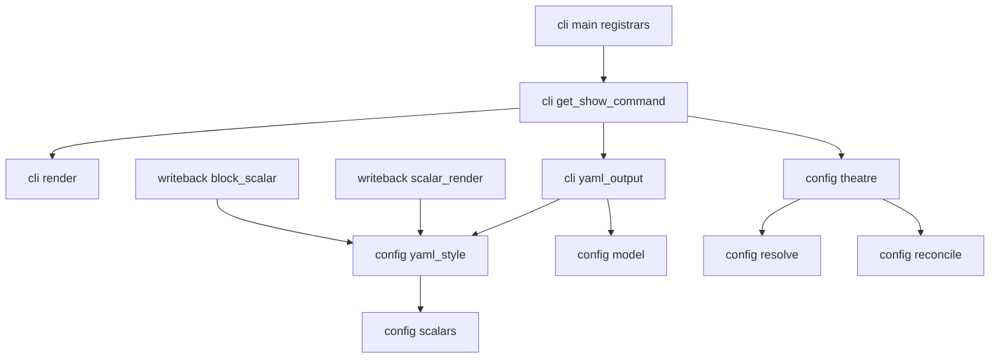
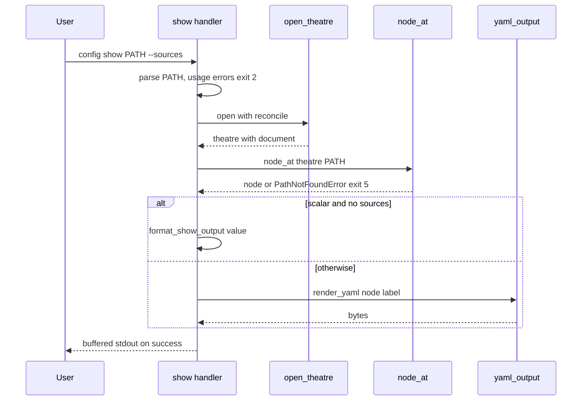

# Design Document: config-get-show

## Overview
**Purpose**: Step 3 splits reading into two commands. `troupe config get PATH` prints a single scalar, as step 1's
`show PATH` did. `troupe config show [PATH]` prints a scalar the same way, and prints a mapping, a list or the
whole configuration as block-style YAML with includes resolved and text includes as literal blocks. `--sources`
adds `# from <file>` to every line that holds a scalar.

**Users**: developers who read a theatre's configuration, often split across `file:` includes, and need to see a
whole section or find the file to edit.

**Impact**: the `show` subcommand moves out of `cli/main.py` into a new command module, next to the new `get`.
Core gains a node lookup for an optional PATH, and `show_value` becomes `get_value`. The write-neutral scalar
presentation rules move from write-back to a core module so `show` can use them. Loading, includes, reconcile,
history and `set` behaviour are unchanged.

### Goals
- `get` behaves exactly as step 1's `show` (1.1, 1.3–1.5), and its exit-5 message also mentions `config show`
  (1.2).
- `show` prints any node. YAML output reads back as exactly the printed configuration (4.1), with the
  contract's one exception: a text include a literal block cannot reproduce (4.5).
- `--sources` names each scalar's file relative to the theatre directory (5.1–5.5).
- Both commands keep the step 1 and 2 conventions: reconcile first, files are the truth, nothing written, error
  shapes (6.1–6.8).

### Non-Goals
- Preserving source formatting in `show` output (comments, quoting, flow style, number spellings; 3.6).
- Other output formats, configurable indentation, comment alignment.
- Any change to loading, includes, path rules, reconcile, `history`, `watch`, or `set`'s output bytes.
- Anchors, aliases and merge keys (step 6), and Windows.

## Boundary Commitments

### This Spec Owns
- The `get` and `show` subcommands: argument parsing (optional PATH, `--sources`), handlers and output.
- The core use cases `get_value` (scalar at PATH, or exit 5 with the `config show` hint) and `node_at` (node at
  an optional PATH).
- The YAML emitter: block layout, scalar and key forms, literal blocks, and per-line source comments.
- The source label format (theatre-relative, lexical, `/`-separated).
- The core module `yaml_style` and its contract: how a string is written as a plain, single- or double-quoted
  scalar, chomping, and which characters a literal block can hold. It owns these rules from now on; write-back
  consumes them.
- Updating the step-1/2 tests, docstrings and the config-foundation and config-file-sync requirement notes that
  refer to `show PATH` (the roadmap's existing-spec updates).

### Out of Boundary
- Loading, includes, `ConfigDocument`/model, path parsing and resolution, error types and exit-code mapping
  (config-foundation). They are reused, and only the wording of `get`'s refusal changes.
- Reconcile, theatre lock, history store (config-file-sync and config-foundation). They are reused through
  `open_theatre`.
- Write-back behaviour: quoting preferences, literal and folded rewriting, refusals (config-set-writeback). Its
  shared rules move but do not change.
- `history`, `set` and `watch` subcommands.

### Allowed Dependencies
- CLI (`troupe.cli.get_show_command`, `troupe.cli.yaml_output`, `troupe.cli.render`) → core (`troupe.config.*`)
  and `troupe.cli.shell`. The CLI read commands do **not** import `troupe.config.writeback`.
- Core `troupe.config.yaml_style` → `troupe.config.scalars`, `troupe.config.model`, `ruamel.yaml` (composer, for
  plain probes). It imports neither `troupe.config.writeback` nor `troupe.cli`, as `tests/test_core_boundary.py`
  enforces.
- `troupe.config.writeback.*` → `troupe.config.yaml_style` (newly allowed; writeback → core is the existing
  direction).
- No new third-party dependency.

### Revalidation Triggers
- Any change to `yaml_style` (contexts, the minimal quoting chain, escaping, chomping, literal characters)
  requires rerunning config-set-writeback's byte-exact suite as well as this spec's tests.
- A change to `SourceFile.path` semantics (display path as opened) or to `ConfigScalar.origin` for includes
  changes `--sources` labels.
- A change to `open_theatre`'s reconcile default changes 6.2/6.3 for both commands.
- Step 6 (anchors and aliases) must decide how shared nodes are shown and labelled.

## Architecture

### Existing Architecture Analysis
- Layering (steering `structure.md`): CLI parses, renders and reports; core holds configuration concepts and use
  cases; write-back (under core) owns the user's bytes. `tests/test_core_boundary.py` forbids core → write-back
  and core → CLI imports.
- Subcommands register through `SUBCOMMAND_REGISTRARS` in `cli/main.py`. A buffered `Handler` writes into a
  `BytesIO` that `run` copies to stdout only on success. `TroupeError`s become `<file>: <path>: <problem>` on
  stderr with the class's exit code.
- `open_theatre(directory)` locates, locks, loads, opens the store, and imports or reconciles. Leaving the `with`
  closes the store and releases the lock.

### Architecture Pattern & Boundary Map



**Architecture Integration**:
- Selected pattern: a thin command handler, a core use case, and a pure renderer. This is the same shape as
  `history` (`list_history` + `format_history_line`).
- Dependency direction (enforced): `cli.shell` ← `cli.get_show_command` → {`cli.render`, `cli.yaml_output`} →
  `config.*`. `config.writeback.*` → `config.yaml_style` → `config.scalars`. Nothing in `config` imports `cli`
  or (outside write-back) `config.writeback`.
- New components rationale: `yaml_output` is the only new behaviour-heavy unit. `yaml_style` is a relocation
  that gives presentation rules a home both writer and viewer may import. `get_show_command` keeps the
  one-module-per-spec registrar pattern.
- Steering compliance: one decision, one place (quoting and chomping in `yaml_style`, label format in
  `render.source_label`, messages in core); errors name path and file; no file writes.

### Technology Stack

| Layer | Choice / Version | Role in Feature | Notes |
|-------|------------------|-----------------|-------|
| CLI | Python 3.12 `argparse` via `TroupeArgumentParser` | `get PATH`, `show [PATH] [--sources]` | Existing shell |
| Core | `troupe.config` (existing) | Load, reconcile, resolve; new `node_at`, `get_value` | No change to loader or store |
| YAML presentation | `ruamel.yaml` 0.19.1 (existing) | Composer used only by plain-scalar probes | No emitter use |
| Runtime | uv, console script `troupe` | Unchanged | No new dependency |

## File Structure Plan

### Directory Structure
```
src/troupe/
├── cli/
│   ├── get_show_command.py   # NEW: get/show registrars and handlers (buffered)
│   ├── yaml_output.py        # NEW: render a ConfigNode as block YAML lines, optional source comments
│   ├── render.py             # MODIFIED: + source_label(); format_show_output reused by get and show
│   └── main.py               # MODIFIED: drop show handler/registrar; register get and show
└── config/
    ├── yaml_style.py         # NEW: write-neutral scalar presentation (moved from write-back) + DOCUMENT context
    ├── theatre.py            # MODIFIED: show_value → get_value (+ config show hint); + node_at
    └── writeback/
        ├── scalar_render.py  # MODIFIED: import and re-export moved names; keep render_scalar/render_key
        └── block_scalar.py   # MODIFIED: import Chomping/required_chomping/literal_characters_fit
tests/
├── test_yaml_style.py        # NEW: DOCUMENT context, quote(), literal_characters_fit, moved-name identity
├── test_yaml_output.py       # NEW: emitter unit tests (layout, scalars, literal blocks, sources lines)
├── test_source_label.py      # NEW: label format
├── test_e2e_get.py           # NEW: get end to end (step 1 show cases + hint)
├── test_e2e_show_yaml.py     # NEW: show of scalars, mappings, lists, whole config, includes, read-back
└── test_e2e_show_sources.py  # NEW: --sources end to end (root file, YAML and text includes, outside dir)
```

### Modified Files
- `src/troupe/cli/main.py`: remove `handle_show` and `add_show_subparser` (and their imports). Import
  `add_get_subparser` and `add_show_subparser` from `get_show_command`. The registrars become `(add_get_subparser,
  add_show_subparser, add_history_subparser, add_set_subparser, add_watch_subparser)`. The module docstring and
  the registration-point comment mention step 3.
- `src/troupe/cli/render.py`: add `source_label`. Update the docstring (`get` and scalar `show` use
  `format_show_output`).
- `src/troupe/config/theatre.py`: rename `show_value` to `get_value` with the new refusal text. Add `node_at`.
  Update the module docstring (decision A applies to `get` and `show`).
- `src/troupe/config/writeback/scalar_render.py`, `block_scalar.py`: the moved definitions are replaced by
  imports from `troupe.config.yaml_style` (re-exported under the existing names). No behaviour change.
- Tests: `tests/test_theatre.py` and `tests/test_theatre_sync.py` (`show_value` → `get_value`; refusal message
  includes the hint); `tests/test_e2e_show.py` (mapping/list cases move to `get`; scalar cases stay valid for
  `show`; docstring); `tests/test_cli_usage.py`, `tests/test_cli_streaming.py`, `tests/test_cli_set.py`
  (registrar list and handler identity); `tests/test_render.py` (unchanged behaviour, docstring if needed).
  Other e2e tests that call `show PATH` on scalars stay valid (2.1) and are left alone unless they assert exit 5
  for a mapping.
- Specs: `.kiro/specs/config-foundation/requirements.md` (step-3 notes on 1.1 and Requirement 6: it now
  describes `get`, and 6.7 gains the hint); `.kiro/specs/config-file-sync/requirements.md` (step-3 note on 1.1,
  1.2, 1.6: "`get` or `show`"); `.kiro/steering/roadmap.md` (tick the step 3 items when done).

## System Flows



- PATH is parsed before the theatre opens, so a malformed PATH creates no state (6.7, config-foundation 1.5).
- The reconcile runs inside `open_theatre` before `node_at`. Its events are committed even when `node_at` then
  raises (6.2).
- `get` follows the same flow with `get_value` and `format_show_output` and no renderer.

## Requirements Traceability

| Requirement | Summary | Components | Interfaces | Flows |
|-------------|---------|------------|------------|-------|
| 1.1 | get prints scalars as step 1 | GetShowCommand, TheatreReads, render | `get_value`, `format_show_output` | get flow |
| 1.2 | get mapping/list → 5 with config show hint | TheatreReads | `get_value` raises `WrongNodeKindError` | get flow |
| 1.3 | get missing PATH → 5 | TheatreReads (resolve) | `PathNotFoundError` | get flow |
| 1.4 | get usage errors incl. `--sources` → 2 | GetShowCommand | `add_get_subparser` | — |
| 1.5 | malformed PATH → 2 | GetShowCommand | `ConfigPath.parse` | — |
| 2.1 | show scalar = get | GetShowCommand | `format_show_output` | show flow |
| 2.2 | show mapping/list as YAML | GetShowCommand, YamlOutput | `render_yaml` | show flow |
| 2.3 | show without PATH = whole config | TheatreReads, YamlOutput | `node_at(theatre, None)` | show flow |
| 2.4 | show missing PATH → 5 | TheatreReads | `PathNotFoundError` | show flow |
| 2.5 | show usage errors → 2 | GetShowCommand | `add_show_subparser`, `ConfigPath.parse` | — |
| 2.6 | show scalar --sources → YAML scalar + comment | YamlOutput | `render_yaml(scalar, label=…)` | show flow |
| 2.7 | `--sources` position-free, PATH optional | GetShowCommand | argparse optional positional + flag | — |
| 3.1 | block style, no flow for non-empty | YamlOutput | layout rules | — |
| 3.2 | mapping entries, nesting indentation | YamlOutput | layout rules | — |
| 3.3 | list items, compact collections in items | YamlOutput | layout rules | — |
| 3.4 | includes resolved in place | YamlOutput (walks expanded tree) | `ConfigDocument` model | — |
| 3.5 | `{}` / `[]`, empty root `{}` | YamlOutput | layout rules | — |
| 3.6 | no source formatting carried over | YamlOutput (renders values only) | — | — |
| 3.7 | no markers, single final newline, no trailing spaces | YamlOutput | line join | — |
| 4.1 | read-back exactness | YamlOutput, YamlStyle | `choose_style`, literal rules | — |
| 4.2 | non-string scalar forms | YamlOutput | scalar rules | — |
| 4.3 | plain/single/double minimal chain | YamlStyle | `choose_style`, `quote` | — |
| 4.4 | literal blocks, chomping, indicator, indent | YamlOutput, YamlStyle | `required_chomping` | — |
| 4.5 | unfit literal: text include stays literal; others double-quoted | YamlOutput, YamlStyle | `literal_characters_fit` | — |
| 4.6 | UTF-8 printable unescaped; escapes only in double quotes (except text includes) | YamlStyle, YamlOutput | `quote` | — |
| 4.7 | no wrapping | YamlOutput, YamlStyle | `quote` never folds | — |
| 4.8 | keys plain only if they read back as the same string | YamlOutput, YamlStyle | key rule | — |
| 5.1 | ` # from <file>` on scalar lines | YamlOutput | `OutputLine.source` | — |
| 5.2 | no comment on non-scalar lines and literal content | YamlOutput | `OutputLine.source = None` | — |
| 5.3 | file = where the scalar is written; text include → included file | YamlOutput | `ConfigScalar.origin.file` | — |
| 5.4 | relative, `/`, lexical label | render | `source_label` | — |
| 5.5 | output minus suffixes = output without `--sources` | YamlOutput | same lines, suffix optional | — |
| 6.1 | same theatre selection and loading | GetShowCommand | `theatre_option_parent`, `open_theatre` | both flows |
| 6.2 | reconcile first; events kept on exit 5 | GetShowCommand | `open_theatre(dir)` (reconcile default) | both flows |
| 6.3 | never-imported → import, no reconcile events | GetShowCommand | `open_theatre` | — |
| 6.4 | values from files as read | TheatreReads | `theatre.document` | — |
| 6.5 | no file created or modified | GetShowCommand | read-only use cases | — |
| 6.6 | load failure → 4, no events | GetShowCommand | `open_theatre` errors | — |
| 6.7 | non-zero exit → empty stdout, conventions | GetShowCommand | buffered `Handler`, `run` | — |
| 6.8 | store closed at end | GetShowCommand | `with open_theatre(...)` | — |

## Components and Interfaces

| Component | Domain/Layer | Intent | Req Coverage | Key Dependencies (P0/P1) | Contracts |
|-----------|--------------|--------|--------------|--------------------------|-----------|
| GetShowCommand | CLI | Register and handle `get` and `show` | 1.1–1.5, 2.1–2.7, 6.1–6.8 | TheatreReads (P0), YamlOutput (P0), shell (P0) | Service |
| YamlOutput | CLI | Render a node as block YAML with optional source comments | 2.2, 2.3, 2.6, 3.x, 4.x, 5.1–5.3, 5.5 | YamlStyle (P0), model (P0) | Service |
| SourceLabel (`render.source_label`) | CLI | Theatre-relative POSIX label of a source file | 5.4 | model (P1) | Service |
| TheatreReads (`get_value`, `node_at`) | Core | Scalar or node at PATH from the loaded files | 1.1–1.3, 2.3, 2.4, 6.4 | resolve (P0), errors (P0) | Service |
| YamlStyle | Core | Write-neutral scalar presentation rules | 4.1, 4.3–4.8 | scalars (P0), ruamel composer (P1) | Service |

### Core

#### YamlStyle (`troupe/config/yaml_style.py`)

| Field | Detail |
|-------|--------|
| Intent | Decide and produce how a string is written as a YAML scalar, and what a literal block can hold |
| Requirements | 4.1, 4.3, 4.4, 4.5, 4.6, 4.7, 4.8 |

**Responsibilities & Constraints**
- Holds, unchanged in behaviour, the definitions moved from `writeback/scalar_render.py` (`Context`,
  `QuoteStyle`, `quote_style_of`, `can_represent`, `choose_style`, escaping, plain probes, with `_render`
  renamed to the public `quote`) and from `writeback/block_scalar.py` (`Chomping`, `required_chomping`, and the
  `_UNFIT` check exposed as `literal_characters_fit`).
- Adds `Context.DOCUMENT`: a scalar alone as the document. Plain is possible only if it also survives the probe
  document `"{text}\n"` with the root node picked, so `--- a`, `...` and `%x` are quoted. Not used by write-back.
- Never raises a write refusal. Surrogates and other characters YAML cannot hold are escaped by `quote(text,
  DOUBLE_QUOTED)`.
- Never folds or wraps (4.7).

**Dependencies**
- Inbound: YamlOutput (P0); `writeback.scalar_render`, `writeback.block_scalar` (P0, re-export)
- Outbound: `troupe.config.scalars.resolve_plain_scalar` (P0), `troupe.config.model.ScalarStyle` (P0)
- External: `ruamel.yaml` composer for plain probes (P1, existing use)

**Contracts**: Service [x]

##### Service Interface
```python
class Context(Enum):
    BLOCK_VALUE = "block-value"
    FLOW_VALUE = "flow-value"
    BLOCK_KEY = "block-key"
    FLOW_KEY = "flow-key"
    DOCUMENT = "document"            # new: a scalar alone at the document root

QuoteStyle: TypeAlias = Literal[ScalarStyle.PLAIN, ScalarStyle.SINGLE_QUOTED, ScalarStyle.DOUBLE_QUOTED]

def quote_style_of(style: ScalarStyle | None) -> QuoteStyle | None: ...
def can_represent(style: QuoteStyle, text: str, context: Context) -> bool: ...
def choose_style(value: str, context: Context, preferred: QuoteStyle | None) -> QuoteStyle: ...
def quote(text: str, style: QuoteStyle) -> str: ...      # was writeback.scalar_render._render

class Chomping(Enum):
    STRIP = "-"
    CLIP = ""
    KEEP = "+"

def required_chomping(value: str) -> Chomping: ...
def literal_characters_fit(value: str) -> bool: ...      # no char a literal block cannot hold (was _UNFIT)
```
- Preconditions: none. Every `str` is accepted.
- Postconditions: `quote(text, choose_style(text, ctx, p))` at `ctx` reads back as `text` (and, for value
  contexts, typed as a string).
- Invariants: write-back output bytes are identical before and after the move.

**Implementation Notes**
- Integration: `writeback/scalar_render.py` imports these names (re-exporting `Context`, `QuoteStyle`,
  `quote_style_of`, `can_represent`, `choose_style` so other write-back modules keep their imports).
  `render_scalar`/`render_key` call `quote`. `writeback/block_scalar.py` imports `Chomping`,
  `required_chomping` and `literal_characters_fit`. `literal_fits` = `literal_characters_fit` + the first-line
  rule.
- Validation: the full existing suite passes unchanged. New tests cover `DOCUMENT`, `quote` and
  `literal_characters_fit`.
- Risks: an accidental behaviour change in the move. It is done as its own task before any `show` code.

#### TheatreReads (`troupe/config/theatre.py`)

| Field | Detail |
|-------|--------|
| Intent | Read a scalar or a node at PATH from the configuration as loaded by this command |
| Requirements | 1.1, 1.2, 1.3, 2.3, 2.4, 6.4 |

**Contracts**: Service [x]

##### Service Interface
```python
def get_value(theatre: Theatre, path: ConfigPath) -> ScalarValue:
    """Scalar at path. Raises PathNotFoundError (exit 5) or WrongNodeKindError (exit 5) whose
    problem is "is a mapping, not a value; print it with `troupe config show <path>`"
    (or "a list"), with file = the node's origin file and path = str(path)."""

def node_at(theatre: Theatre, path: ConfigPath | None) -> ConfigNode:
    """The root mapping when path is None, else resolve_path(theatre.document, path)."""
```
- Preconditions: `theatre` is open. `path` is parsed.
- Postconditions: reads only `theatre.document` (decision A). Never touches the history or files.
- The message shape stays `<file>: <path>: <problem>` (config-foundation 10.3). The hint names the command and
  the PATH as given, e.g. `.troupe/troupe.yml: agents: is a mapping, not a value; print it with `troupe config
  show agents``.

### CLI

#### GetShowCommand (`troupe/cli/get_show_command.py`)

| Field | Detail |
|-------|--------|
| Intent | Parse `get PATH` and `show [PATH] [--sources]`, open the theatre, write the output |
| Requirements | 1.1–1.5, 2.1–2.7, 6.1–6.8 |

**Responsibilities & Constraints**
- `add_get_subparser`: `get` with `parents=[theatre_option_parent()]` and a required positional `PATH`. Any
  other option, including `--sources`, is a usage error from `TroupeArgumentParser` (exit 2).
- `add_show_subparser`: `show` with the theatre parent, `PATH` as `nargs="?"` (default `None`), and
  `--sources` (`store_true`). argparse accepts the flag before or after PATH (2.7).
- `handle_get(args, buffer)`: `ConfigPath.parse(args.path)`, then `with open_theatre(args.theatre)`, then
  `buffer.write(format_show_output(get_value(theatre, path)))`.
- `handle_show(args, buffer)`: parse PATH when given, then `with open_theatre(args.theatre)`, then `node =
  node_at(...)`. A scalar without `--sources` goes to `format_show_output(node.value)`. Anything else goes to
  `render_yaml(node, label=…)`, where `label` is `lambda f: source_label(f, theatre.directory)` when
  `--sources` is set, else `None`.
- Both handlers are buffered `Handler`s, so on any error stdout is empty (6.7). The `with` block closes the store
  (6.8). No file is written (6.5). Reconcile and import come from `open_theatre`'s default (6.2, 6.3).

**Dependencies**: Outbound `troupe.cli.shell` (P0), `troupe.config.theatre` (P0), `troupe.cli.render` (P0),
`troupe.cli.yaml_output` (P0). It must not import `troupe.config.writeback`.

**Contracts**: Service [x]
```python
def add_get_subparser(subparsers: argparse._SubParsersAction[TroupeArgumentParser]) -> None: ...
def add_show_subparser(subparsers: argparse._SubParsersAction[TroupeArgumentParser]) -> None: ...
def handle_get(args: argparse.Namespace, buffer: io.BytesIO) -> None: ...
def handle_show(args: argparse.Namespace, buffer: io.BytesIO) -> None: ...
```
Statically conformant to `SubcommandRegistrar` and `Handler` (as in `set_command.py`).

#### YamlOutput (`troupe/cli/yaml_output.py`)

| Field | Detail |
|-------|--------|
| Intent | Render a `ConfigNode` as block-style YAML, optionally with `# from <file>` on scalar lines |
| Requirements | 2.2, 2.3, 2.6, 3.1–3.7, 4.1–4.8, 5.1–5.3, 5.5 |

**Responsibilities & Constraints**
- Pure. It reads only the node tree and no files (a text include's value is already in the node).
- Builds a list of `OutputLine(text, source)`, where `source` is the `SourceFile` of the scalar the line holds,
  or `None`. It then joins: `text + (" # from " + label(source) if label and source else "")`, with `\n` after
  every line. Because the lines are identical with and without a label, 5.5 holds by construction.
- **Layout** (3.1–3.7):
  - Mapping entry at indent `i`: `{key}: {scalar}` (source = scalar's file). For an empty collection,
    `{key}: {}` / `{key}: []` (no source). For a non-empty collection, `{key}:` (no source), then its content at
    indent `i+2`.
  - Sequence at indent `i`: each item prefixed `- ` at column `i`. A scalar item is `- {scalar}`. An empty
    collection item is `- {}` / `- []`. A non-empty collection item starts on the dash line, with its first
    entry or item rendered at indent `i+2` and its first line's leading spaces replaced by `- ` (compact form).
  - Sequence as the value of a key at indent `i`: items at indent `i+2`.
  - Root: a mapping at indent 0, a sequence at indent 0, an empty root `{}`, or a scalar alone (2.6) in the
    `DOCUMENT` context.
  - No `---`/`...`. Output = lines joined with `\n` plus a final `\n`. No line ends with a space except literal
    content lines whose text does.
- **Scalars** (4.2–4.7):
  - `bool` → `true`/`false` (checked before `int`). `None` → `null`. `int` → `str`. A finite `float` →
    `repr`, `inf` → `.inf`, `-inf` → `-.inf`, `nan` → `.nan`.
  - `str` with no `\n` that is not a text include → `quote(s, choose_style(s, ctx, None))`, where `ctx` is
    `BLOCK_VALUE`, or `DOCUMENT` at the root.
  - Literal block when the scalar is a text include (`node.include` kind `TEXT`, always), or when the string
    contains `\n` and `literal_characters_fit(s)`. Otherwise (a non-include multi-line string with unfit
    characters) → `quote(s, DOUBLE_QUOTED)`.
  - Literal block form: header `|` + (`2` if the first line that is not empty starts with a space) +
    `required_chomping(s).value`. Content indent = column of the key or dash that owns the header + 2 (0 + 2 at
    the root). Content lines = `s` with its trailing `\n`s removed, split on `\n`. An empty line is written
    empty; any other line is indent + line, characters unchanged (a `\r` stays). Under `KEEP`, one empty line
    is added per trailing `\n` beyond the first (all of them when there is no content), as in write-back's
    `render_literal`. The header line carries the source; content lines carry none (5.2).
  - Reading of 4.4's "two spaces more than the line that holds the block's header": the indentation that
    counts is the column of the key or dash owning the header. For `- k: |` that is the key's column, since
    content at the dash column + 2 would fall outside the mapping and break 4.1. Verified with ruamel.yaml
    (research.md, literal block experiment).
- **Keys** (4.8): `quote(k, style)` where `style = choose_style(k, BLOCK_KEY, None)`. If that is `PLAIN` but
  `resolve_plain_scalar(k)` is not a `str`, the chain restarts at single-quoted (single-quoted if it can
  represent `k`, else double-quoted).
- **Sources** (5.1–5.3): a scalar line's source is `node.origin.file`. For a text include this is the included
  file (model invariant); for a scalar in a YAML include it is that file.

**Contracts**: Service [x]
```python
type SourceLabeler = Callable[[SourceFile], str]

def render_yaml(node: ConfigNode, *, label: SourceLabeler | None) -> bytes:
    """Block YAML for node (a mapping, a sequence, or a scalar alone), UTF-8 encoded.
    With label, every line holding a scalar ends with ' # from ' + label(file)."""
```
- Preconditions: `node` comes from a loaded `ConfigDocument` (no anchors or tags; keys unique).
- Postconditions: for every node that contains no unfit text include, `load_config` reading the output (as a
  root file, when the node is a mapping) yields the same keys, order and typed values (4.1).

**Implementation Notes**
- Integration: imports `troupe.config.yaml_style`, `troupe.config.model`, `troupe.config.scalars` only.
- Validation: unit tests on hand-built nodes come from **loaded real files** (testing.md: real shapes).
  Read-back tests reload the output with `load_config`.
- Risks: a root literal block with an indicator (strict parsers place the root at indentation −1). This is
  documented in research.md and accepted.

#### SourceLabel (`troupe/cli/render.py`)

```python
def source_label(file: SourceFile, theatre_dir: Path) -> str:
    """Path(os.path.relpath(os.path.abspath(file.path), os.path.abspath(theatre_dir))).as_posix()"""
```
- Lexical: `abspath` normalises `.` and `..` without resolving symbolic links. The result has `..` only at the
  start. Examples: `.troupe/troupe.yml`, `.troupe/agents/lead.yml`, `../shared/prompt.md` (5.4).

## Data Models
No persistent data changes. No new events; the history is untouched apart from the reconcile and import that
`open_theatre` already performs. The emitter's internal `OutputLine(text: str, source: SourceFile | None)` is a
private frozen dataclass.

## Error Handling

### Error Strategy
All errors reuse the existing `TroupeError` hierarchy, so exit codes and message format stay in one place.

| Situation | Error | Exit | Message names |
|-----------|-------|------|---------------|
| `get` on a mapping or list | `WrongNodeKindError` (problem includes ``print it with `troupe config show <PATH>` ``) | 5 | node's file, PATH |
| PATH not found (`get`, `show`) | `PathNotFoundError` | 5 | deepest existing node's file, PATH |
| Malformed PATH | `UsageError` from `ConfigPath.parse` | 2 | PATH |
| Missing or surplus PATH, unknown option (`get --sources`) | `UsageError` from the parser | 2 | usage problem |
| Load or locate failure, unreadable store | `ConfigLoadError` | 4 | file or store |

`show` has no failure mode of its own: every string can be printed (unfit text includes are emitted as literal
text, and other strings fall back to double quotes).

## Testing Strategy
Every test names the requirement IDs it proves at the start of its docstring (project convention). All tests
use real files in a temporary theatre.

### Unit Tests
- `test_yaml_style.py`: `Context.DOCUMENT` quotes `--- a`, `...`, `%x`, `true` and keeps `hello` plain (4.3,
  2.6). `quote` escapes control characters and surrogates in double quotes (4.6). `literal_characters_fit`
  rejects `\r`, `\x01`, U+2028 (4.5). The write-back modules' re-exported names are the very `yaml_style`
  objects (Decision 1).
- `test_yaml_output.py`, on documents loaded from real files:
  - The layout of nested mappings, lists, lists of mappings and lists of lists matches the exact expected bytes
    (3.1–3.3, 3.7), and `{}`/`[]` are used for empty collections and the empty root (3.5).
  - Source formatting is not carried over: flow style becomes block, `0o17` → `15`, `~` → `null`, comments
    dropped, unnecessary quotes dropped (3.6).
  - Scalar forms: `true`, `null`, `15`, `1.5`, `1e+16`, `.inf`, `-.inf`, `.nan`, and the strings `'true'`,
    `'5'`, `''`, `'a: b'`, `"tab\there"` and a non-ASCII `café` printed unescaped (4.2, 4.3, 4.6). Long strings
    are not wrapped (4.7).
  - Literal blocks: `|`, `|-`, `|+`, `|2` for a first line starting with a space, a nested content indent, and
    the indent under `- k: |` (4.4). A CRLF text include stays literal with exact `\r\n` bytes. A non-include
    string containing `\r` is double-quoted (4.5).
  - Keys `true`, `null`, `a: b`, `<<` and an empty key are quoted; `plain_key` is not (4.8).
  - With a label: exactly the scalar lines get ` # from …`; `key:` lines, `{}`/`[]` lines and literal content do
    not; the header gets it (5.1, 5.2). Removing the suffixes gives the unlabelled output (5.5).
- `test_source_label.py`: the root file `.troupe/troupe.yml`, a nested include, a `sub/../x.yml` spec
  normalised, a file outside the theatre `../shared/p.md`, a relative and an absolute theatre argument, a
  symlinked directory not resolved (5.4).
- `tests/test_theatre.py` (updated): `get_value` returns scalars and refuses mappings and lists with the hint
  (1.1, 1.2). `node_at(None)` is the root mapping (2.3).

### Integration Tests (read-back)
- `test_e2e_show_yaml.py::…reads_back…`: for fixtures covering every scalar kind, quoting edge cases, nested
  collections, YAML includes and LF text includes, write `show`'s output to a fresh theatre, load it with
  `load_config`, and compare `flatten_leaves` paths, order and `scalar_equal` values with the original (4.1, 3.4).

### E2E Tests (real `troupe` console script)
- `test_e2e_get.py`: every step-1 scalar printing case (strings with and without a final newline, booleans,
  null, ints, floats, a text include) (1.1). Mapping and list → 5, stdout empty, stderr names the file and PATH
  and contains `config show` (1.2). Missing → 5 (1.3). No PATH, two PATHs, `--sources` → 2 (1.4). `a..b` → 2
  (1.5).
- `test_e2e_show_yaml.py`: a scalar gives the same bytes as `get` (2.1). A mapping section with a YAML include
  and a text include gives exact expected bytes (2.2, 3.4, 4.4). `show` without PATH prints the whole
  configuration (2.3), and `{}` for an empty file (3.5). Missing → 5 (2.4). Surplus PATH, unknown option, `a.`
  → 2 (2.5). Reconcile first: a hand edit before `show` appears in `history` as a `set` event (6.2). A
  never-imported theatre is imported without reconcile events (6.3). The files are byte-identical after
  `show`/`get` and nothing new remains outside `.troupe/` state (6.5). A missing config file → 4, no events (6.6).
  Non-zero exits have empty stdout (6.7). Both `troupe.yml` and `troupe.yaml` work, and `TROUPE_THEATRE` is
  honoured (6.1).
- `test_e2e_show_sources.py`: `--sources` on the whole configuration with a root file, a YAML include in a
  subdirectory, a text include (labelled with the included file, the comment on the `|` header) and an
  include outside the theatre directory (`../…`) gives exact expected bytes (5.1–5.4). `--sources` before and
  after PATH gives the same output (2.7). A scalar with `--sources` gives `value # from .troupe/troupe.yml`,
  and a text include scalar gives a root literal block with the comment on its header (2.6). A CRLF text
  include is emitted with `\r\n` content lines (4.5).
- `test_e2e_show.py` (updated): the scalar cases keep passing for `show` (2.1). The former "mapping/list → 5"
  cases move to `get` (1.2).
- Store closure (6.8): covered by the existing `open_theatre` tests. An e2e check that a second command after
  `show` succeeds (no leftover lock).

## Security Considerations
Read-only commands. Source labels reveal only paths the user's own configuration references. No new surface.

## Performance & Scalability
No targets (steering). The plain-probe parse runs once per string and key, as in write-back. Configurations are
small.
