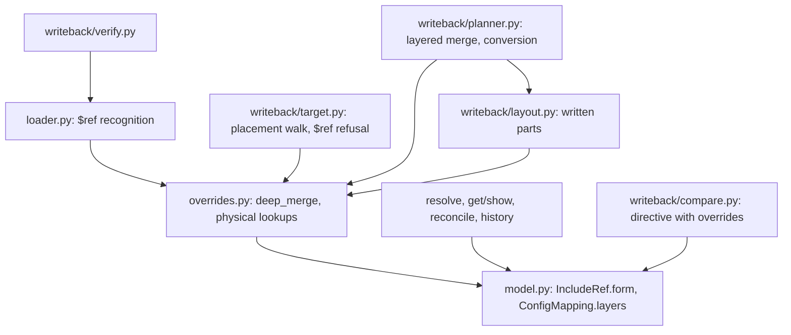

# Design Document: config-include-overrides

## Overview
Step 5 lets a theatre adjust a shared included YAML file without changing it. An include may be written in
mapping form, `{$ref: "file:…", <overrides>}`. Its value is the included content deep-merged with the overrides.
`troupe config set` writes a new key below an included section as an override in the including file. Where the
include is still in scalar form, it is first converted to mapping form.

The loader builds the **merged view** as the configuration tree. Every reader (`get`, `show`, `--sources`,
history, reconcile, `watch`) therefore sees the contract's value unchanged. Each merged mapping keeps its
**layers**: the included mapping and the override mapping as written. The writer uses these to find the file and
the written mapping behind a merged value.

### Goals
- Load mapping-form includes and deep-merge their overrides (Req 1), with the exit-4 refusals (Req 2).
- The merged configuration is what every command reads and records (Req 3).
- New keys under includes go to the including file as overrides (Req 4, 5, 6). Existing values change where they
  are written (Req 7).
- `$ref` is reserved (Req 8). Every write keeps the step 1 safety guarantees (Req 9).

### Non-Goals
- Deleting an included key through an override, overriding list items, `$ref` to anything but `file:` strings.
- Any change to rendering rules, events, lineage, reconcile or `show` formats.

## Boundary Commitments

### This Spec Owns
- Recognising, validating and deep-merging mapping-form includes in the loader, and the model fields that record
  their layers (`IncludeRef.form`, `ConfigMapping.layers`, `MergeLayers`).
- The helpers that map a merged value to the mappings written in files (`config/overrides.py`).
- Write-target placement for new keys (the replaced rule 2), and the physical target of changed and removed
  values below merged mappings.
- The scalar-form → mapping-form conversion edits.
- The `$ref` PATH refusal and the VALUE `$ref` directive form for verification.
- Updating the tests and spec notes that pinned the old rule 2.

### Out of Boundary
- Quoting, indentation, comment, insertion-point and removal rules (config-set-writeback, reused as is).
- History events, lineage, reconcile, watch and lock mechanics (config-file-sync, config-lineage).
- `show` output format and source labels (config-get-show; labels follow node origins).
- Scalar-form include semantics, path syntax, error format (config-foundation).

### Allowed Dependencies
- `config/loader.py` → `config/overrides.py` (merge) → `config/model.py`.
- `config/writeback/*` → `config/overrides.py`, `config/model.py`, `config/resolve.py`.
- No CLI module changes: errors flow through the existing `TroupeError` handling.
- No new third-party dependency.

### Revalidation Triggers
- Any change to `IncludeRef`, `ConfigMapping` or `MergeLayers` fields (loader, layout, planner, target, compare
  all read them).
- A change to the deep-merge order rule (1.3), because verification compares order.
- Step 6 (anchors/aliases/merge keys) touching `$ref` or merged nodes.

## Architecture

### Existing Architecture Analysis
- Layers: CLI → core (`config/`) → file layer (`config/writeback/` owns every byte written). The loader is the
  only reader of files.
- The model is frozen and source-mapped. An include root has its `origin` in the target and its `directive` in
  the including file.
- The writer resolves a `SetRequest` (`target.py`), plans text edits per file (`planner.py` with `layout.py`),
  verifies by reloading (`verify.py`), diffs leaves and writes atomically (`setter.py`).

### Architecture Pattern & Boundary Map


### Technology Stack
| Layer | Choice / Version | Role in Feature | Notes |
|-------|------------------|-----------------|-------|
| YAML parsing | ruamel.yaml 0.19 (existing, compose only) | positions and styles of `$ref` mappings | no dumping |
| Runtime | Python 3.12+, uv | — | no new dependency |

## File Structure Plan

### Directory Structure
```
src/troupe/config/
├── constants.py          # + INCLUDE_REF_KEY = "$ref"
├── model.py              # + IncludeRef.form, MergeLayers, ConfigMapping.layers
├── overrides.py          # NEW: deep_merge, physical_entry, physical_holders, written_parts, is_ref_mapping
├── loader.py             # $ref recognition, validation (2.1-2.3), building merged/bare include roots
└── writeback/
    ├── compare.py        # IncludeDirective.overrides, VALUE $ref, containment equality, root_plain
    ├── target.py         # KeyPlacement walk, AddKeyTarget.placement, $ref PATH refusal (8.1)
    ├── planner.py        # physical replace, layered merge/deletion/pruning, routed additions, conversion
    ├── collection_render.py  # render_ref_form_lines / render_flow_ref_form for the conversion
    ├── layout.py         # written form at slots; tree walks over written parts
    └── verify.py         # compare root plain (root may be a mapping-form include)
tests/
├── test_loader_overrides.py        # NEW unit: recognition, merge, order, refusals, layers
├── test_e2e_overrides_read.py      # NEW e2e: get/show/--sources/history/reconcile/watch over overrides
├── test_set_overrides.py           # NEW e2e byte-exact: new keys, conversion, lists, existing values, $ref
├── test_set_targets.py             # updated: the old rule-2 test now expects an override
└── writeback/
    ├── test_overrides_lookup.py    # NEW unit: physical_entry/holders, written_parts
    ├── test_target_placement.py    # NEW unit: placement walk cases
    ├── test_planner_overrides.py   # NEW unit: layered merge, pruning, conversion edits
    ├── test_layout_overrides.py    # NEW unit: slots/extents/comments in mapping-form files
    └── test_compare.py             # updated: directive overrides equality, root_plain
```

### Modified Files
- `.kiro/specs/config-foundation/requirements.md` — step-5 note under Requirement 4.
- `.kiro/specs/config-set-writeback/requirements.md` — step-5 notes on rule 2 / Requirement 3.1–3.2, Requirement
  2.1/2.6, 11.5 (conversion exception).
- `.kiro/specs/config-get-show/requirements.md` — step-5 note: merged view, override provenance.
- `.kiro/steering/roadmap.md` — tick the step-5 items when done.

## System Flows

### `set` of a new key below an include
```mermaid
sequenceDiagram
    participant S as setter.set_value
    participant T as target.resolve_target
    participant P as planner.plan_patch
    participant V as verify.verify_patch
    S->>T: PATH, VALUE
    T->>T: refuse $ref segment (8.1)
    T->>T: walk_path (merged) -> deepest A; placement walk up from A
    T-->>S: AddKeyTarget(placement: mapping | include-to-convert, prefix)
    S->>P: plan
    alt placement.mapping
        P->>P: add_entries(written mapping, nest(prefix + missing, VALUE))
    else placement.include (scalar form)
        P->>P: conversion edits in the directive's file
    end
    S->>V: reload with patches; compare root plain (ordered)
```

### Placement walk (Decision 2 of research.md)
Given the merged node chain `root … A` (A = the deepest existing mapping) and the keys to add below A:
1. For X = A, then each ancestor upward:
   - X is a merged mapping (`layers`) → **place inside `X.layers.over`** with the relative keys from X to A
     prepended. Descend through the override layer while those keys exist there as mappings, then rerun this walk
     on that sub-chain, stopping at its top: if the top is reached, the result is the deepest written mapping
     there.
   - X is a YAML include root with `include.form` (bare mapping form) → mapping `include.form`, prefix = keys X→A.
   - X is a YAML include root in scalar form → convert X, prefix = keys X→A.
   - X is a list item (its parent in the chain is a sequence) → mapping A, prefix `()` (step 1 rule).
2. Reaching the root without stopping → mapping A, prefix `()`.

The result mapping is always a **written** mapping: none of its entries comes from another layer.

## Requirements Traceability

| Requirement | Summary | Components | Flows |
|-------------|---------|------------|-------|
| 1.1, 1.4, 1.6, 1.7, 1.8 | Recognise mapping-form includes anywhere; bare = scalar form; overrides resolved first; no writes | Loader | — |
| 1.2, 1.3, 1.5 | Deep merge, order, no `$ref` in value | Overrides.deep_merge, Loader | — |
| 2.1, 2.2, 2.3, 2.4 | Exit-4 refusals | Loader | — |
| 3.1, 3.2, 3.3, 3.4, 3.5 | Merged view in get/show/sources/history/reconcile/watch | Model (merged tree), unchanged readers | — |
| 4.1, 4.2, 4.3, 4.4, 4.5, 4.6 | New-key placement | Target.placement, Planner.add_entries | set new key |
| 4.7 | Events per created leaf, none for conversion | existing leaf_diff over read-back | — |
| 5.1, 5.2, 5.3, 5.4, 5.5 | Conversion edits | Planner.convert_include, CollectionRender | set new key |
| 6.1, 6.2, 6.3 | Lists | Target.placement (list-item stop), existing AppendTarget | — |
| 7.1, 7.2 | Overridden vs not | Overrides.physical_entry, Planner.replace | — |
| 7.3, 7.4 | Collection replacement across layers, removals, pruning | Planner._merge_layered, routed additions | — |
| 7.5, 7.6 | Include root refusal, bare text include | existing `_change_include` (include set on merged roots) | — |
| 8.1 | `$ref` PATH refused | Target | — |
| 8.2 | VALUE `$ref` | Compare.new_to_plain / plain_equal, Verify | — |
| 8.3 | get/show `$ref` not found | merged tree (no `$ref` key) | — |
| 9.1, 9.2, 9.3 | Byte-surgical, read-back, atomic | Planner, Verify (root_plain), existing atomic writer | — |

## Components and Interfaces

### Core

#### Model (`troupe/config/model.py`)
```python
@dataclass(frozen=True)
class IncludeRef:
    kind: IncludeKind
    spec: str
    target: SourceFile
    directive: Origin            # the include string: scalar form, or the `$ref` value
    form: "ConfigMapping | None" = None
    """Mapping form: the `$ref` mapping as written in the including file (its entries: `$ref` with the raw
    include string scalar, then the overrides as loaded). None for the scalar form."""

@dataclass(frozen=True)
class MergeLayers:
    base: "ConfigMapping"   # the included side, as loaded (an include root's base has include=None)
    over: "ConfigMapping"   # the override side as loaded; for an include root, its `$ref` mapping

@dataclass(frozen=True)
class ConfigMapping:
    entries: tuple[MappingEntry, ...]
    style: CollectionStyle
    origin: Origin
    include: IncludeRef | None = None
    layers: MergeLayers | None = None   # set on every merged mapping
```
- A merged mapping has `style` and `origin` of its base. An include root with overrides carries `include` (with
  `form`). A nested merged mapping carries its base value's `include` (usually None).
- Merged entries: base entries in base order (an overridden one replaced by the override entry, or by a merged
  entry when both are mappings), then the override-only entries in override order. Scalars and lists are the same
  objects as in their layer, so their origins name their own file.

#### Overrides (`troupe/config/overrides.py`, new)
```python
def deep_merge(base: ConfigMapping, over: ConfigMapping, *, include: IncludeRef | None) -> ConfigMapping
def is_ref_key(key: str) -> bool
def override_entries(mapping: ConfigMapping) -> tuple[MappingEntry, ...]   # entries without `$ref`
def physical_entry(mapping: ConfigMapping, key: str) -> tuple[ConfigMapping, MappingEntry]
def physical_holders(mapping: ConfigMapping, key: str) -> tuple[Holder, ...]
def written_parts(node: ConfigNode) -> tuple[ConfigNode, ...]
```
- `deep_merge`: pure. It never mutates or reuses a merged node as a layer of another site. `over` may hold `$ref`
  (it is skipped).
- `physical_entry`: for a merged mapping, the override side if it has the key, else the base side, recursively.
  Otherwise `(mapping, entry)`. The returned mapping is written in one file.
- `physical_holders`: every written mapping holding `key` below `mapping` (override side first, then base), each
  with the chain of written override mappings and keys that lead to it, for pruning (Decision 4).
- `written_parts`: what is written for a node, for layout walks. A merged mapping gives `(base, over)`. A bare
  mapping-form include gives `(form, node with form cleared)`. Any other node gives `(node,)`.

#### Loader (`troupe/config/loader.py`)
- In `_build_mapping`, a key whose text is `$ref` (any key style) marks the mapping:
  - The `$ref` value is built **without** include expansion. If it is not a string scalar starting with `file:`
    → `ConfigLoadError` at the mapping's path: "`$ref` must be an include string (file:…)" (2.2).
  - The other entries are built as usual (overrides may themselves contain includes, 1.7).
  - `form` = the mapping as written. Target = `<dir of file>/spec`.
  - Text target: with overrides → `ConfigLoadError` naming the including file, the path and the target, "overrides
    apply only to YAML includes" (2.1). Otherwise a text include scalar with `include.form`.
  - YAML target: cycle check and read as for scalar form (1.8). For an empty target or non-mapping content with
    overrides → `ConfigLoadError` naming the including file, the path and the included file, "overrides need an
    included mapping" (2.3). With overrides: `deep_merge(content, form, include=ref)`. Bare:
    `replace(content, include=ref)`.
- `load_config` accepts a merged or bare mapping-form root (the root's value must still be a mapping).

### File layer (`troupe/config/writeback/`)

#### Compare
- `IncludeDirective` gains `overrides: PlainMapping | None = field(default=None, compare=False)`.
- `new_to_plain(NewMapping)` with a `$ref` entry whose value is a `file:` string →
  `IncludeDirective(text, None, overrides=<other entries>)`.
- `plain_equal`: when one directive has `overrides` and the other has content, the content must contain the
  overrides (mapping into mapping recursively, otherwise `plain_equal`).
- `root_plain(document) -> PlainMapping`: the root's plain mapping, unwrapping a root include directive. Used by
  `resolve_target` (current) and `verify_patch` (after).

#### Target
```python
@dataclass(frozen=True)
class IncludeSite:
    node: ConfigNode                       # scalar-form YAML include root to convert
    parent: ConfigMapping | ConfigSequence # merged parent (physical entry found via overrides)
    key: str | int

@dataclass(frozen=True)
class KeyPlacement:
    mapping: ConfigMapping | None   # a written mapping receiving the entries, or
    convert: IncludeSite | None     # a scalar-form include to convert
    prefix: tuple[str, ...]         # existing keys to create as intermediate mappings first

@dataclass(frozen=True)
class AddKeyTarget:
    mapping: ConfigMapping          # deepest existing (merged) mapping, for messages
    missing: tuple[str, ...]
    placement: KeyPlacement

def place_new_keys(document: ConfigDocument, mapping_path: ConfigPath) -> KeyPlacement
```
- `resolve_target` refuses any `$ref` segment first: `WriteRefusedError` "`$ref` is reserved for includes", naming
  PATH and the root file (8.1).
- `place_new_keys` implements the placement walk. The planner also uses it for the new keys of a collection
  replacement (7.3).

#### Planner
- `replace`: the parent's written entry comes from `physical_entry`. The slot is in that entry's file, and
  `change_slot` gets the merged node for comparisons (7.1, 7.2).
- `_merge_mapping` on a merged mapping → `_merge_layered`:
  - Kept keys: `change_slot` at their physical entry.
  - Removed keys: deleted from every holder. A holder that is a nested override losing every entry (and gaining
    none) is pruned: its own entry is deleted from its holder instead, upward, never past a `$ref` mapping (7.4,
    Decision 4).
  - New keys go through `place_new_keys(at)` (7.3).
- `_merge_mapping` on an unmerged mapping: new keys go through `place_new_keys(at)`. When the placement is the
  mapping itself with no prefix, the existing single insertion with `deleted` styles is used.
- `add_key` / routed additions: `placement.mapping` → `add_entries(mapping, nest(prefix, entries))`.
  `placement.convert` → `convert_include`.
- `convert_include(site, entries)`: the written slot of the include string comes from `physical_entry` or
  `item_slot`. Then:
  - Flow parent: one INLINE edit replacing the include string with `{$ref: <raw>, <flow entries>}` (5.4).
  - Block parent: the include string must end on the owner's line, else refuse (Decision 7).
    - With an end-of-line comment: delete `[indicator end, string end)` with `EditKind.LINES` (no comment
      re-alignment, 5.2).
    - Without a comment: delete `[indicator end, line content end)`, but for a list item without a comment
      replace the string with `$ref: <raw>` (compact, 5.3).
    - Insert the following lines after the owner's line: `$ref: <raw>` (unless compact) and the new entries,
      at column owner + indent step (mapping) or `-` + 2 (list item) (5.1, 5.3).
  - `<raw>` is the include string's exact source text. New-entry styles follow the `$ref` entry as sibling.

#### CollectionRender
```python
def render_ref_form_lines(raw: str, entries: Sequence[tuple[str, NewValue]], column: int,
                          siblings: SiblingStyles, ctx: RenderContext, *, with_ref: bool) -> str
def render_flow_ref_form(raw: str, entries: Sequence[tuple[str, NewValue]],
                         siblings: SiblingStyles, ctx: RenderContext) -> str
```

#### Layout
- `_local(node)`: what is written at a slot. A mapping-form include root gives its `form` (when here). A
  scalar-form root gives its directive span (when here). Otherwise the node (when here), else `ValueError`.
  `inline_extent`, `body_lines`, `_value_end` and `_value_start` work on `_local(node)`.
- `_token_floors`, `_block_entries_in_file`, `_block_scalar_key_columns` and the `_children` walk use
  `written_parts`, so `$ref` lines and override lines get their token floors, indentation detection and
  block-scalar owner columns.

## Data Models
- The plain form of a mapping-form include is `IncludeDirective("file:…", merged content, kind)`, the same as the
  scalar form. Changing between the forms therefore changes neither the plain tree nor any leaf (3.4, 4.7).

## Error Handling

### Error Strategy
| Case | Error | Exit | Names |
|------|-------|------|-------|
| `$ref` not an include string | ConfigLoadError | 4 | file, mapping path |
| Non-YAML target with overrides | ConfigLoadError | 4 | including file, path, target |
| Overrides on non-mapping YAML content | ConfigLoadError | 4 | including file, path, included file |
| `$ref` segment in `set` PATH | WriteRefusedError | 3 | root file, PATH |
| Mapping-form include root replaced with a different value | WriteRefusedError (existing) | 3 | PATH, included file |
| Conversion of an include string not on its owner's line | WriteRefusedError | 3 | directive file, PATH |
| Read-back mismatch / VALUE `$ref` that cannot load | WriteRefusedError (existing verify) | 3 | file, PATH |

A load error is raised before any history state is opened (2.4, existing `open_theatre` order).

## Testing Strategy

### Unit Tests
- Loader: bare YAML/text forms equal scalar form, deep merge (nested mappings, scalar over mapping, list
  replaces), merged order (1.3), no `$ref` in entries, `$ref` at root, in list item, in included file, flow form,
  override value that is itself an include, refusals 2.1–2.3 with messages, origins of overridden scalars.
- Overrides lookups: `physical_entry` for override-only, base-only and both-sides keys; holders with pruning
  chains; `written_parts`.
- Target placement: each walk case (merged root, bare form, scalar form, nested includes, list item stop, existing
  override mapping, root), `$ref` refusal.
- Planner: overridden scalar changed in the override; layered merge with removals in both layers and pruning;
  routed additions; conversion edits (comment / no comment / list item / flow / directive on next line refused).
- Layout: comment detection and indentation step in files with `$ref` mappings; slot extents for a mapping-form
  include root.
- Compare: directive overrides containment equality; `root_plain`.

### E2E Tests (real `troupe` console script, real files)
- The contract example byte for byte: `coder: file:agents/coder.yaml  # c` + `set agents.coder.temperature 0.3`
  gives exactly the three lines, with `coder.yaml` unchanged and one `set` event.
- A second new key goes after the first override. Nested missing keys create intermediate override mappings. A key
  under an included nested mapping becomes `params:` / `  k: v` in the override. Nested includes write in the
  middle file.
- Overridden value changed in the override. A non-overridden value inside the include is changed in the included
  file.
- List append in the included file. A new key in a list item inside the include goes to the included file. A
  list-item include is converted in the list file.
- Exit 4 cases through `get`. A `$ref` PATH is refused with exit 3. A VALUE with `$ref` round-trips.
- `get`/`show --sources` over overrides. History after hand-adding an override. No event for a form-only hand edit.
- The updated old rule-2 test in `test_set_targets.py`.

## Security Considerations
No new inputs beyond YAML already read. Include targets resolve as before (relative to the including file).

## Migration Strategy
Configurations without `$ref` keys load exactly as before. A configuration that used `$ref` as an ordinary key
with a non-include value now fails to load (exit 4, choice 1). With an include value, it is now read as an
include.
