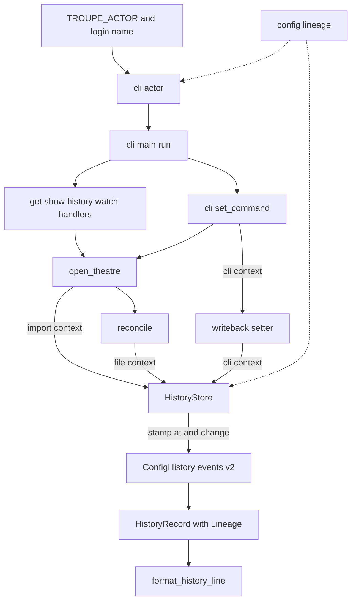
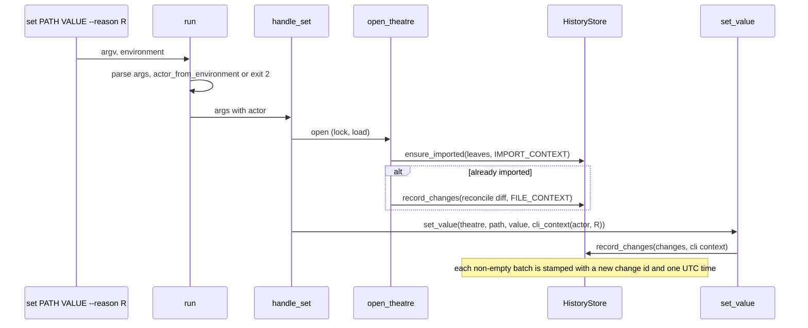

# Design Document: config-lineage

## Overview
**Purpose**: Step 4 makes the configuration history auditable. Every event printed by `troupe config history`
also says who made the change (`actor`), how (`via`), when (`at`), why (`reason`) and which other events belong
to the same change (`change`).

**Users**: auditors reading `history`, and the people and AI agents who change configuration through troupe.
They declare who they are with `TROUPE_ACTOR` and give a reason with `set --reason`.

**Impact**: the three history events gain lineage fields (schema version 2, with an upcaster for older
stores). The store stamps every batch it records with one time and one change id. Import, reconcile and `set`
each pass the context of their batch. The CLI reads `TROUPE_ACTOR` once per command and `set` gains `--reason`.
`history` prints five more members. Loading, write-back, reconcile logic, `watch`, `get` and `show` are
unchanged.

### Goals
- Five lineage members on every history line, after the step 1 members (1.1–1.8).
- Actor from `TROUPE_ACTOR` or the login name, and invalid values refused with exit 2 by every subcommand before
  any state is touched (2.1–2.4).
- Import and file events are attributed to nobody, CLI events to the command's actor (3.1–3.4).
- One change id and one timestamp per batch, never reused (4.1–4.4, 5.1–5.3).
- `set --reason TEXT` (6.1–6.6).
- Lineage persisted with the events, and pre-step-4 stores readable (7.1–7.4).

### Non-Goals
- Filtering `history` by lineage, authenticating actors, attributing hand edits, a reason for other commands.
- Any change to which events are recorded, their order, `seq`, or the five step 1 members.

## Boundary Commitments

### This Spec Owns
- The lineage model: `Actor`, `ChangeContext`, `Lineage`, the `via` vocabulary, the timestamp format and change
  id generation (`troupe/config/lineage.py`).
- Lineage fields on the history events, their schema version and the legacy upcaster; `HistoryRecord.lineage`.
- The context parameter of `HistoryStore.ensure_imported` / `record_changes` and stamping per batch.
- Which context each caller passes: import (`open_theatre`), file (`reconcile`), cli (`set_value`, from
  `handle_set`).
- `TROUPE_ACTOR` parsing, the default actor, and its validation in `run()` (`troupe/cli/actor.py`).
- `set --reason`.
- The five extra members of `format_history_line`.
- Updating step 1–3 tests that pin the history line shape or build `HistoryRecord`, and step-4 notes in the
  config-foundation, config-set-writeback and config-file-sync requirements.

### Out of Boundary
- What a batch contains and when it is recorded: import, reconcile diffing, write-back, and the lock
  (config-foundation, config-file-sync, config-set-writeback). This spec labels batches. It does not change
  them.
- `history`'s PATH filter and `seq` numbering; `get`/`show`/`watch` output.
- The store location, persistence module and close behaviour (config-foundation).

### Allowed Dependencies
- `troupe.config.lineage` → standard library only (`dataclasses`, `datetime`, `uuid`, `typing`).
- `troupe.config.history`, `troupe.config.store`, `troupe.config.reconcile`, `troupe.config.theatre`,
  `troupe.config.writeback.setter` → `troupe.config.lineage`.
- `troupe.cli.actor` → `troupe.config.lineage`, `troupe.config.errors`, standard library (`getpass`, `os`).
  `troupe.cli.main` → `troupe.cli.actor`. `troupe.cli.set_command` → `troupe.config.lineage`.
- Core never imports `troupe.cli` and never reads `os.environ` for lineage (enforced by
  `tests/test_core_boundary.py`).

### Revalidation Triggers
- Any new command that writes configuration must record its batch with a cli context.
- Changing batch boundaries (for example merging reconcile and `set` into one transaction) changes how events
  group into changes.
- Changing the event class names or field names (stored topics and state) needs another upcaster.
- A later contract step that specifies how history recorded before step 4 is shown (today our choice, research Decision 5).

## Architecture

### Existing Architecture Analysis
- `HistoryStore` (eventsourcing SQLite application, one `ConfigHistory` aggregate) records batches in
  `ensure_imported` and `record_changes`, each one `save`. `to_history_record` maps events to records.
  `format_history_line` prints them.
- `open_theatre` imports or reconciles. `set_value` records the `set`'s batch. `run()` dispatches every
  subcommand after `build_parser().parse_args`.

### Architecture Pattern & Boundary Map


### Technology Stack
| Layer | Choice / Version | Role in Feature | Notes |
|-------|------------------|-----------------|-------|
| Event store | eventsourcing 9.5.5 (existing) | stores lineage fields; `class_version` + upcaster for older events | no new dependency |
| Runtime | Python 3.12 stdlib | `uuid4`, `datetime.UTC`, `getpass.getuser` | |

## File Structure Plan

### Directory Structure
```
src/troupe/config/
└── lineage.py          # NEW: Actor, ActorKind, Via, ChangeContext, Lineage, UNKNOWN_ACTOR,
                        #      IMPORT_CONTEXT, FILE_CONTEXT, cli_context(), stamp(), format_utc()
src/troupe/cli/
└── actor.py            # NEW: TROUPE_ACTOR_VARIABLE, actor_from_environment()
tests/
├── test_lineage.py                 # NEW: model, stamp, format
├── test_cli_actor.py               # NEW: TROUPE_ACTOR grammar, default actor, message
├── test_store_lineage.py           # NEW: stored lineage per batch, reopen, legacy upcast
├── test_e2e_lineage.py             # NEW: history lineage for import / file / cli, change grouping, time
├── test_e2e_actor.py               # NEW: TROUPE_ACTOR through the real CLI, exit 2 for every subcommand
└── test_e2e_reason.py              # NEW: set --reason through the real CLI
```

### Modified Files
- `src/troupe/config/history.py`: lineage fields and `class_version = 2` on `LeafImported`, `LeafValueSet`,
  `LeafRemoved`; legacy upcasters; command methods take the lineage fields; `HistoryRecord.lineage`;
  `to_history_record` builds the `Lineage`.
- `src/troupe/config/store.py`: `ensure_imported(leaves, context)` and `record_changes(changes, context)` stamp
  the context once per batch and pass the fields to every event.
- `src/troupe/config/theatre.py`: `open_theatre` passes `IMPORT_CONTEXT`.
- `src/troupe/config/reconcile.py`: `reconcile` passes `FILE_CONTEXT`.
- `src/troupe/config/writeback/setter.py`: `set_value(theatre, path, value, context)` passes its context to
  `record_changes`.
- `src/troupe/cli/main.py`: `run()` sets `args.actor = actor_from_environment(os.environ)` after parsing and
  before dispatch.
- `src/troupe/cli/set_command.py`: `--reason TEXT`; `handle_set` passes `cli_context(args.actor, args.reason)`.
- `src/troupe/cli/render.py`: `format_history_line` appends `actor`, `via`, `at`, `reason`, `change`.
- `tests/support.py`: `step1_members(line)` projection helper (the five step-1 members of a history line).
- Existing tests that compare whole history lines/dicts or build `HistoryRecord` (e.g. `test_e2e_history.py`,
  `test_e2e_reconcile.py`, `test_e2e_show.py`, `test_e2e_watch.py`, `test_e2e_watch_concurrency.py`,
  `test_e2e_includes.py`, `test_set_replacements.py`, `test_set_history.py`, `test_cli_watch.py`,
  `test_e2e_show_yaml.py`, `test_render.py`, `test_history_aggregate.py`, `test_record_changes.py`,
  `test_store.py`, `test_theatre.py`, `test_theatre_sync.py`, `test_reconcile.py`, `test_recorded.py`,
  `writeback/test_setter.py`): assert the same step 1–3 facts through the projection or with a context
  argument.
- `tests/test_core_boundary.py`: `troupe.config.lineage` is core and reads no environment.
- `.kiro/specs/config-foundation/requirements.md`, `config-set-writeback/requirements.md`,
  `config-file-sync/requirements.md`: step-4 notes.

## System Flows



An empty batch (no reconcile differences, no-op `set`) is not stamped and records nothing (4.4, 6.6).

## Requirements Traceability

| Requirement | Summary | Components | Flows / Notes |
|-------------|---------|------------|---------------|
| 1.1, 1.7 | five members after the step 1 members | Render | key order fixed in `format_history_line` |
| 1.2 | actor object | Render, Lineage | `{"kind", "id"}` |
| 1.3 | via vocabulary | Lineage (`Via`) | |
| 1.4, 5.1, 5.3 | RFC 3339 UTC `Z`, six digits | Lineage (`format_utc`, `stamp`) | `datetime.now(UTC)` |
| 1.5, 6.2, 6.3 | reason or null | ChangeContext, SetCommand | contexts other than cli have `reason=None` |
| 1.6 | change string | Lineage (`stamp`) | |
| 1.8 | filtered lines keep lineage | Render | `list_history` returns full records |
| 2.1, 2.2 | actor grammar and default | CliActor | `getpass.getuser`, `null` on failure |
| 2.3, 2.4 | exit 2 for every subcommand, before state | CliActor, Run | parsed in `run()` before any handler |
| 3.1 | import lineage | Theatre (`IMPORT_CONTEXT`) | |
| 3.2 | file lineage, incl. watch | Reconcile (`FILE_CONTEXT`) | watch reconciles via `open_theatre` |
| 3.3 | cli lineage | SetCommand, Setter | |
| 3.4 | unknown only when unknown | Lineage constants | `UNKNOWN_ACTOR` used only by import/file contexts and the legacy upcaster |
| 4.1, 5.2 | same change and time within a batch | HistoryStore | one `stamp` per batch |
| 4.2 | reconcile and set differ | HistoryStore | two batches, two stamps |
| 4.3 | never reused | Lineage (`uuid4`) | across processes and restarts |
| 4.4, 6.6 | no events → no change | HistoryStore | empty batch returns before stamping |
| 6.1, 6.4, 6.5 | `--reason` parsing | SetCommand | argparse `store`, missing TEXT → exit 2 |
| 7.1, 7.2 | persisted, identical reprints | History events, HistoryStore | lineage stored as event fields; `at` stored as text |
| 7.3 | legacy stores | History events (upcasters) | Decision 4, 5 in research.md |
| 7.4 | no extra files | HistoryStore | same SQLite file, no new state |

## Components and Interfaces

| Component | Layer | Intent | Req Coverage | Key Dependencies |
|-----------|-------|--------|--------------|------------------|
| Lineage | Core | lineage values, stamping, time format | 1.2–1.6, 3.4, 4.3, 5.1, 5.3 | stdlib |
| History events | Core | lineage fields, upcast, record mapping | 7.1–7.3 | eventsourcing, Lineage |
| HistoryStore | Core | stamp per batch | 4.1, 4.2, 4.4, 5.2, 7.4 | Lineage |
| Theatre / Reconcile / Setter | Core | pass the right context | 3.1–3.3 | Lineage |
| CliActor | CLI | `TROUPE_ACTOR` → `Actor` or exit 2 | 2.1–2.4 | Lineage, errors |
| Run / SetCommand | CLI | validate actor, `--reason` | 2.4, 6.1–6.6 | CliActor |
| Render | CLI | five members | 1.1, 1.7, 1.8 | Lineage |

### Core

#### Lineage (`troupe/config/lineage.py`)
##### Service Interface
```python
type ActorKind = Literal["human", "agent", "unknown"]
type Via = Literal["import", "cli", "file"]

@dataclass(frozen=True)
class Actor:
    kind: ActorKind
    id: str | None

UNKNOWN_ACTOR: Final = Actor(kind="unknown", id=None)

@dataclass(frozen=True)
class ChangeContext:
    """Who made a batch of changes, how, and why (reason only for cli)."""
    actor: Actor
    via: Via
    reason: str | None = None

IMPORT_CONTEXT: Final = ChangeContext(actor=UNKNOWN_ACTOR, via="import")
FILE_CONTEXT: Final = ChangeContext(actor=UNKNOWN_ACTOR, via="file")

def cli_context(actor: Actor, reason: str | None) -> ChangeContext: ...

@dataclass(frozen=True)
class Lineage:
    actor: Actor
    via: Via
    at: str            # formatted by format_utc
    reason: str | None
    change: str

def stamp(context: ChangeContext) -> Lineage:
    """The lineage of one batch recorded now: format_utc(now UTC), change = str(uuid4())."""

def format_utc(moment: datetime) -> str:
    """'YYYY-MM-DDTHH:MM:SS.ffffffZ' of an aware datetime converted to UTC."""
```
- Preconditions: `format_utc` receives an aware datetime (naive → `ValueError`).
- Invariants: `stamp` never returns the same `change` twice.

#### History events (`troupe/config/history.py`)
- `LeafImported`, `LeafValueSet` and `LeafRemoved` gain the fields `actor_kind: str`, `actor_id: str | None`,
  `via: str`, `at: str`, `reason: str | None` and `change: str` (flat JSON primitives, stable under the
  transcoder). They also gain `class_version = 2` and a static `upcast_v1_v2(state)`.
- Legacy upcast (7.3): `actor_kind="unknown"`, `actor_id=None`, `reason=None`,
  `at=format_utc(state["timestamp"])`. For `LeafImported`: `via="import"`, `change="legacy-import"`. For the
  other two: `via="cli"`, `change=f"legacy-{state['originator_version'] - 1}"` (that is, its seq).
- Command methods: `import_leaf(path, new, **lineage fields)`, `set_leaf(path, old, new, **…)`,
  `remove_leaf(path, old, **…)` with explicit keyword parameters (no `**kwargs`, for `mypy --strict`).
- `HistoryRecord` gains `lineage: Lineage`. `to_history_record` rebuilds `Lineage` from the fields. An unknown
  `actor_kind`/`via` in stored data is a `ValueError`, which the store reports as an unreadable store (exit 4).

#### HistoryStore (`troupe/config/store.py`)
```python
def ensure_imported(self, leaves: Sequence[Leaf], context: ChangeContext) -> bool: ...
def record_changes(self, changes: Sequence[LeafChange], context: ChangeContext) -> None: ...
```
- Each call that records events calls `stamp(context)` once, and passes the same fields to every event of the
  batch before the single `save`. An empty `changes` returns before stamping. An import of zero leaves records
  only `HistoryStarted` (no lineage needed).

#### Theatre, Reconcile, Setter
- `open_theatre`: `history.ensure_imported(leaves, IMPORT_CONTEXT)`.
- `reconcile(document, store)`: `store.record_changes(changes, FILE_CONTEXT)`.
- `set_value(theatre, path, value, context: ChangeContext)`: `theatre.history.record_changes(changes, context)`.

### CLI

#### CliActor (`troupe/cli/actor.py`)
```python
TROUPE_ACTOR_VARIABLE: Final = "TROUPE_ACTOR"

def actor_from_environment(environ: Mapping[str, str]) -> Actor:
    """The command's actor (2.1, 2.2); raises UsageError naming TROUPE_ACTOR on an invalid value (2.3)."""
```
- Grammar: split at the first `:`. The kind must be exactly `human` or `agent`, and the id must be non-empty
  and not only whitespace (`id.strip() != ""`). The id is kept verbatim.
- Unset → `Actor("human", _login_name())`. `_login_name()` returns `getpass.getuser()`, or `None` on `OSError`
  or `KeyError`.
- Message: `TROUPE_ACTOR: invalid value '<value>': expected human:<id> or agent:<id>` (value quoted with
  `repr`-style quotes so empty and whitespace values are visible).

#### Run (`troupe/cli/main.py`) and SetCommand (`troupe/cli/set_command.py`)
- `run()`: after `parse_args`, `args.actor = actor_from_environment(os.environ)`. A `UsageError` follows the
  existing path: stderr message, exit 2, empty stdout. No handler has run, so there is no state.
- `set`: `parser.add_argument("--reason", metavar="TEXT", default=None, help=...)`. `handle_set` calls
  `set_value(theatre, path, value, cli_context(args.actor, args.reason))`.

#### Render (`troupe/cli/render.py`)
`format_history_line` adds, after `new`: `"actor": {"kind": …, "id": …}`, `"via"`, `"at"`, `"reason"`,
`"change"`.

## Data Models

### Stored event state (version 2)
| Field | Type | Meaning |
|-------|------|---------|
| `path`, `old`, `new` | unchanged | step 1 |
| `actor_kind` | `"human"`, `"agent"`, `"unknown"` | actor kind |
| `actor_id` | string or null | actor id |
| `via` | `"import"`, `"cli"`, `"file"` | origin |
| `at` | string, `YYYY-MM-DDTHH:MM:SS.ffffffZ` | UTC time the batch was recorded |
| `reason` | string or null | `set --reason` |
| `change` | string | batch id (UUID4 text, or `legacy-…`) |

### History line (JSON)
`{"seq", "op", "path", "old", "new", "actor": {"kind", "id"}, "via", "at", "reason", "change"}`

## Error Handling

### Error Strategy
| Situation | Behaviour | Req |
|-----------|-----------|-----|
| `TROUPE_ACTOR` invalid | `UsageError` → exit 2, empty stdout, stderr names `TROUPE_ACTOR` and the value; no handler runs | 2.3, 2.4 |
| `--reason` without TEXT | argparse usage error → exit 2 | 6.5 |
| Login name unavailable | actor id `null` (not an error) | 2.2 |
| Stored lineage malformed | `ConfigLoadError` naming the store (exit 4), as for any unreadable store | config-foundation 7.8 |

## Testing Strategy

### Unit Tests
- `test_lineage.py`: `format_utc` gives six digits and `Z` and converts a non-UTC aware time to UTC; `stamp`
  keeps the context's actor/via/reason and yields distinct `change` values; the import and file contexts are
  unknown actor and null reason (1.4, 3.4, 4.3, 5.1, 5.3).
- `test_cli_actor.py`: `human:alice`, `agent:planner:v2` (id keeps `:`), `human: x ` (id verbatim); invalid
  values `""`, `"human"`, `"human:"`, `"agent:   "`, `"Human:x"`, `"robot:x"` raise a `UsageError` whose
  message names `TROUPE_ACTOR` and the value; unset → login name; unset and login name unavailable → id None
  (`getpass.getuser` patched to raise, a real external boundary) (2.1–2.3).
- `test_store_lineage.py`: an import stamps all events with one lineage; two `record_changes` batches have
  different change ids and one time each; an empty batch records nothing; lineage survives close and reopen;
  a store whose rows are rewritten to the pre-step-4 shape (fields and `class_version` removed from the stored
  JSON) reads with the legacy lineage, and new events append after it (4.1, 4.4, 5.2, 7.1, 7.3).

### E2E Tests (real `troupe` console script, real files)
- `test_e2e_lineage.py`: first `history` → import events with `via import`, unknown actor, null reason, one
  change; a hand edit then `get` → file events, unknown actor, even with `TROUPE_ACTOR` set; `set` of a mapping
  changing several leaves → one change, `via cli`, actor from `TROUPE_ACTOR`; a hand edit then `set` → two
  changes (file then cli); successive commands never share a change; `at` lies between times taken before and
  after the command and is identical within a change, also with `TZ` set to a non-UTC zone; key order of the
  line; `history PATH` lines equal the corresponding unfiltered lines; reprinting `history` gives identical
  output; `watch` rounds are separate file changes; no extra files under the theatre (1.x, 3.x, 4.x, 5.x,
  7.1, 7.2, 7.4).
- `test_e2e_actor.py`: `TROUPE_ACTOR=agent:planner` and `human:alice` on `set` show in history; unset uses
  `USER`/`LOGNAME` as the login name; every subcommand (`get`, `show`, `set`, `history`, `watch`) with an
  invalid value exits 2 with empty stdout, a message naming `TROUPE_ACTOR`, no `.troupe/history.sqlite`
  created and files byte-identical (2.1–2.4).
- `test_e2e_reason.py`: `--reason` before/between/after the positionals and `--reason=TEXT`; text kept exactly
  (spaces, unicode, empty); absent → null; given twice → last; missing TEXT → exit 2 with no state; reconcile
  events before a reasoned `set` have null reason; a no-op `set --reason` records nothing (6.1–6.6).

## Security Considerations
`TROUPE_ACTOR` is self-declared and not authenticated. History is an audit aid, not access control. This is
stated in requirements (out of scope). Ids and reasons are printed through `json.dumps`, so they cannot break
the JSON Lines format.

## Migration Strategy
No migration step: older stores are upcast on read (7.3). New events are written with schema version 2.
Nothing is rewritten in place.
