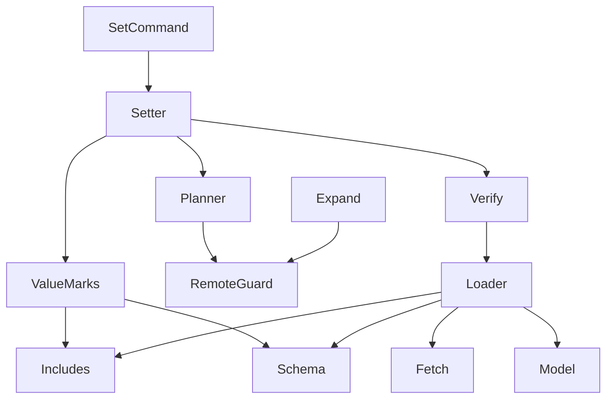
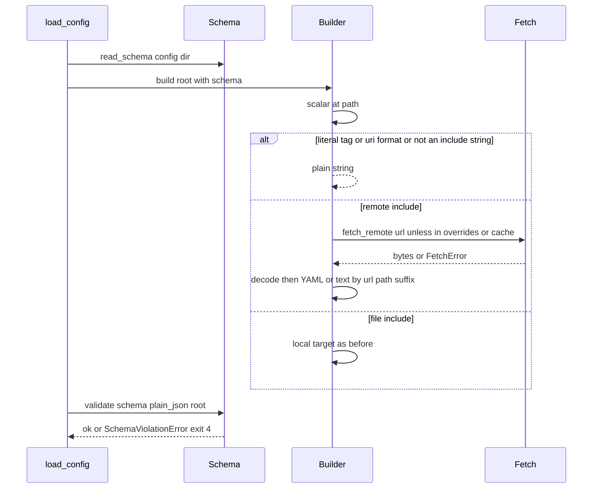
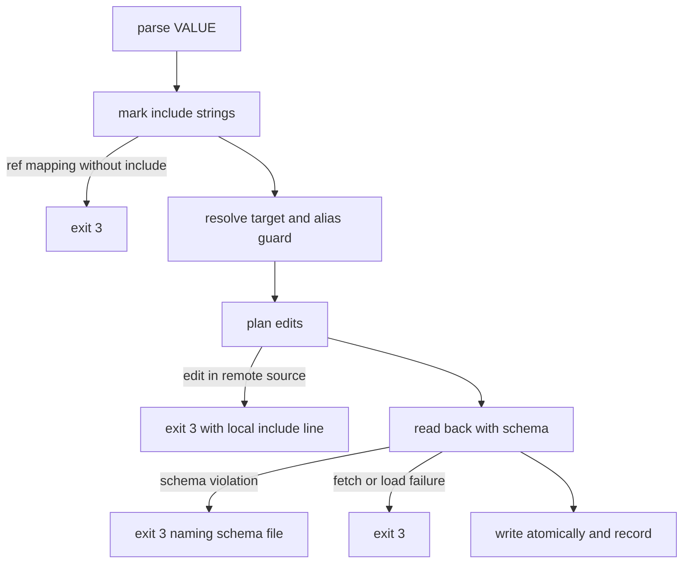

# Design Document: config-remote-schema

## Overview
Step 7 lets a theatre include a shared configuration from an `https://` or `http://` URL and describe its
configuration with a JSON Schema. The loader fetches remote includes every time the configuration loads, and every
reader sees their content. Strings tagged `!literal`, or whose schema says `"format": "uri"`, stay plain strings.
The loaded configuration must validate against `.troupe/troupe.schema.json` when that file exists. `troupe config
set` refuses to change anything written in remote content and quotes the local include line. It refuses a result
that does not validate, and writes include-like VALUE strings tagged `!literal` unless `--include` is given.

The loader decides what an include is, in one place, while it walks the tree with the current path. A remote
source is an in-memory `SourceFile` with a URL identity, so every reader works unchanged; only the writer treats it as
read-only. Validation happens in the loader, so a `set`'s read-back (config-set-writeback 13.6) also checks the
schema before anything is written.

### Goals
- Remote includes load, fail with exit 4 and reach every reader (Req 1–3); literals (Req 4); the schema on load and
  on `set` (Req 5, 7); read-only remote content (Req 6); `!literal` VALUEs and `--include` (Req 8, 9); every earlier
  guarantee kept (Req 10).

### Non-Goals
- Authentication, custom headers, caching, offline use, remote schemas, tags other than `!literal`, format
  assertion, `file:` includes in remote content.
- Any change to rendering rules, events, lineage, reconcile, override placement or alias expansion beyond the points
  named below.

## Boundary Commitments

### This Spec Owns
- Include recognition (`file:`, `https://`, `http://`) and the literal decision (`!literal`, schema `format: uri`):
  `config/includes.py`, loader changes.
- Fetching remote sources and turning failures into load errors: `config/fetch.py`, loader changes.
- Reading the schema file, the `format: uri` walker and validation: `config/schema.py`.
- The model additions: `SourceFile.url`, `ConfigScalar.literal`, `IncludeRef.string`, `ConfigDocument.schema`,
  `SchemaSource`.
- The writer's remote write guard and its message (`writeback/remote_guard.py`), the VALUE string marks and the
  `!literal ` rendering, and the schema refusal at read-back.
- The `--include` flag, `--sources` labels of remote scalars, and the schema file in the watch set.

### Out of Boundary
- Override placement, conversion to mapping form and `--in-include` (config-include-overrides): reused unchanged.
- Scalar, collection and comment rendering rules (config-set-writeback): unchanged apart from the tag prefix.
- Anchors, aliases, merge keys and `--expand-alias` (config-aliases): unchanged apart from refusing an expansion in
  remote content and copying a `!literal` tag.
- Reconcile, events, lineage and the `watch` loop mechanics (config-file-sync, config-lineage): unchanged.

### Allowed Dependencies
- Core: `constants` ← `includes`, `fetch` (stdlib `urllib.request` only), `schema` (`jsonschema`, `referencing`)
  ← `loader`. `model` imports only `constants` and `scalars`. No core module imports `writeback` or `cli`.
- File layer chain (updated): `value` → `remote_guard` → `compare` → `layout` → … → `target` → `shared` →
  `aliases` → `expand` → `planner` → `verify` → `leaf_diff` → `atomic` → `setter`. `value` and `remote_guard`
  import core modules only. Only `loader` and `fetch` touch the network.
- CLI: `set_command` passes `include: bool` to `set_value`; `render.source_label` reads `SourceFile.url`.
- New runtime dependency `jsonschema` (>=4.23,<5, MIT; `referencing` comes with it). New dev dependency
  `types-jsonschema` (jsonschema 4.26 ships no `py.typed`).

### Revalidation Triggers
- A change to `SourceFile` identity (`key`/`shown`) or a new consumer of `SourceFile.path` that may see a remote one.
- A change to the include prefixes, the `!literal` tag, the schema walker rules or the schema file name.
- Upgrading `jsonschema` (error selection, `$ref` resolution, the default "no remote retrieval").
- Any later step that allows writes into remote content, caching, or tags other than `!literal`.

## Architecture

### Existing Architecture Analysis
- The loader recognises includes by the `file:` prefix (`_Builder._build`, `_ref_value`) and reads local targets
  (`_include`, `read_include`, cached by `real_path`). `load_config(config_file, overrides)` takes texts keyed by
  real path; read-back and alias expansion reload through it. `_refuse_properties` refuses every tag (decision I).
- Six writeback sites rebuild `"file:" + spec`; `compare.new_to_plain` decides VALUE includes by prefix. Every edit
  of a file passes `_Planner._layout(file)` or `_Planner._replace_file`. `watch` and `source_label` use
  `SourceFile.path`.

### Architecture Pattern & Boundary Map

- **Selected pattern**: decide includes while walking, keep remote sources as ordinary `SourceFile`s, and guard
  writes at the one place every edit passes (research.md, Architecture Pattern Evaluation).
- **Existing patterns preserved**: one decision per module with messages as module constants; readers on the loaded
  tree; read-back verification as the final gate; pure planning before any write.
- **New components**: `Includes` (the only include test), `Fetch` (the only network code), `Schema` (the only
  JSON Schema code), `RemoteGuard` (the only remote refusal), `ValueMarks` (the only literal decision for VALUE).

### Technology Stack
| Layer | Choice / Version | Role in Feature | Notes |
|-------|------------------|-----------------|-------|
| CLI | argparse (stdlib) | `--include` (`store_true`) | Same rules as `--in-include` |
| Core | `urllib.request` (stdlib) | GET with 10 s timeout, redirects | No HTTP dependency |
| Core | jsonschema 4.x, `Draft202012Validator` | `check_schema`, `iter_errors`, `best_match` | Format not asserted by default |
| Tests | `http.server.ThreadingHTTPServer` (stdlib) | Real HTTP on 127.0.0.1 in a thread | No internet |

## File Structure Plan

### Directory Structure
```
src/troupe/config/
├── constants.py          # + REMOTE_INCLUDE_PREFIXES, LITERAL_TAG, SCHEMA_FILE_NAME, SCHEMA_DIALECT,
│                         #   REMOTE_FETCH_TIMEOUT_SECONDS
├── includes.py           # NEW: is_include_string, is_remote_include, include_is_yaml
├── fetch.py              # NEW: fetch_remote(url, timeout) -> bytes; FetchError(reason)
├── schema.py             # NEW: read_schema, uri_format_at, plain_json, validate
├── errors.py             # file: Path | str; SchemaViolationError(ConfigLoadError)
├── model.py              # SourceFile.url/key/shown; ConfigScalar.literal; IncludeRef.string; SchemaSource;
│                         #   ConfigDocument.schema
├── compose.py            # errors name SourceFile.shown
├── loader.py             # recognition, !literal, remote reads, schema read + validation
├── resolve.py            # PathNotFoundError names SourceFile.shown
├── theatre.py            # WrongNodeKindError names SourceFile.shown
├── watch.py              # watch set: local files, root candidates, schema file; local bytes only
└── writeback/
    ├── value.py          # ScalarMark, NewScalar.mark, mark_include_strings (8.1, 8.2, 8.6, 9.3)
    ├── remote_guard.py   # NEW: remote_refusal (6.1, 6.2) and its message
    ├── compare.py        # new_to_plain by mark; include strings via IncludeRef.string
    ├── scalar_render.py  # "!literal " prefix for LITERAL marks; line break -> double-quoted (8.3)
    ├── layout.py         # inline extent of a !literal scalar starts at its tag (8.4)
    ├── shared.py         # include strings via IncludeRef.string; new includes keyed by SourceFile.key
    ├── planner.py        # remote guard in _layout/_replace_file; tagged strings never block scalars
    ├── expand.py         # remote guard; copies keep !literal
    ├── verify.py         # overrides by key; SchemaViolationError -> exit 3 (7.1)
    ├── atomic.py         # backstop: never write a remote source
    └── setter.py         # mark VALUE, include flag, texts keyed by SourceFile.key
src/troupe/cli/
├── set_command.py        # --include
└── render.py             # source_label: URL for a remote source (3.2)
tests/                    # all NEW; each test names its requirement IDs
├── remote_support.py     # RemoteServer (ThreadingHTTPServer in a thread) + remote_server fixture
├── test_includes.py, test_fetch.py, test_schema.py            # core units
├── test_loader_literals.py, test_loader_remote.py, test_loader_schema.py
├── test_e2e_remote.py    # readers, watch, history, fetch failures through the CLI
├── test_set_literals.py, test_set_remote.py, test_set_schema.py
└── writeback/test_remote_guard.py, writeback/test_value_marks.py
```

### Modified Files
- `pyproject.toml`, `uv.lock`: `jsonschema` runtime, `types-jsonschema` dev.
- `tests/conftest.py`: registers the `remote_server` fixture from `remote_support.py`.
- Tests pinning "explicit tags → exit 4" gain the `!literal` exception, while other tags stay refused:
  `tests/test_e2e_locate_load.py` (~:210), `tests/test_loader.py` (~:455, `REFUSALS`), `tests/test_loader_aliases.py`
  (~:316, `TAGGED_ANCHORS`).
- Tests pinning decision D (`file:` VALUE written plain) pass `--include` (or `include=True`), and new rows pin the
  tagged form: `tests/test_set_targets.py` (~:202–231), `tests/test_set_history.py` (~:200, 220),
  `tests/test_set_overrides.py` (~:918, 1398 and every other include-like VALUE), `tests/test_e2e_reconcile.py`
  (~:160), and the other `set` tests found by searching for include-like VALUEs.
- `.kiro/specs/config-foundation`, `config-set-writeback`, `config-file-sync`, `config-get-show`: step-7 notes;
  `.kiro/steering/roadmap.md`: step 7 checkboxes.

## System Flows

### Loading with remote includes, literals and the schema

- The literal decision comes before any read, so a literal is never fetched (4.6).
- `overrides` and the remote cache are keyed by `SourceFile.key` (the URL for a remote source), so the read-back
  and expansion reloads of a `set` reuse fetched text (10.3); a URL the set newly writes is fetched (9.4).

### `set` with marks, the remote guard and the schema check


## Requirements Traceability

| Requirement | Summary | Components | Interfaces | Flows |
|-------------|---------|------------|------------|-------|
| 1.1, 1.2 | Remote include in both forms; YAML or text by URL path suffix | Includes, Loader | `is_include_string`, `include_is_yaml`, `_Builder._is_include` | load |
| 1.3, 1.4, 1.5 | Remote in remote; `file:` in remote → 4; cycles → 4 | Loader | `_Loader.read_remote`, `_include`, `_refuse_cycle` by key | load |
| 1.6 | Once per load, redirects, 10 s, no files | Fetch, Loader | `fetch_remote`, cache by URL | load |
| 2.1 | Fetch failure → 4 naming file, key path, URL | Fetch, Loader | `FetchError` → `ConfigLoadError` | load |
| 2.2 | Unloadable remote YAML → 4 naming URL | Loader, compose | `SourceFile.shown` | — |
| 2.3, 5.6 | No state on load failure; schema never written | Theatre (existing order), Watch | `open_theatre` | — |
| 3.1, 3.3 | Readers print and record remote leaves | Loader (readers unchanged) | — | — |
| 3.2 | `--sources` labels the URL | Render | `source_label` | — |
| 3.4, 3.5 | watch set, re-fetch, failure retried | Watch | `_watch_paths`, `_loaded_bytes` | — |
| 3.6 | Every command loads, `history` too | Theatre (unchanged) | `open_theatre` | — |
| 4.1, 4.2, 4.3 | `!literal` value; refused tag forms; `$ref: !literal` | Loader, Model | `ConfigScalar.literal`, `_refuse_properties`, `_ref_value` | load |
| 4.4, 4.5 | `format: uri` literal and walker rules | Schema, Loader | `uri_format_at` | load |
| 4.6 | Literals never fetched | Loader | `_is_include` before any read | load |
| 5.1, 5.2 | Read, validate, invalid → 4 | Schema, Loader, Errors | `read_schema`, `validate`, `SchemaViolationError` | load |
| 5.3, 5.4, 5.5 | Unusable schema → 4; absent file; format not asserted | Schema | `read_schema`, `Draft202012Validator` | — |
| 6.1, 6.2 | Remote write → 3 with the outermost local include line | RemoteGuard, Planner, Expand | `remote_refusal` | set |
| 6.3, 6.4 | Overrides and new keys stay local | Planner, Target (existing) | `physical_entry`, `place_new_keys` | — |
| 6.5 | Include-root rule | Planner | `_change_include` with `IncludeRef.string` | — |
| 6.6, 7.2 | No event on refusal | Setter (pure before write) | — | — |
| 7.1 | Invalid result → 3 | Verify, Loader | `SchemaViolationError` → `WriteRefusedError` | set |
| 8.1, 8.2, 8.6 | Tagging, `format: uri` paths, `$ref` without `--include` | ValueMarks, Schema | `mark_include_strings` | set |
| 8.3, 8.4 | One line, never block; existing literal replaced with its tag | ScalarRender, Layout, Planner | `render_scalar`, `inline_extent` | — |
| 8.5, 8.8 | No-op on equal value; text include content untagged | Compare, Planner | `new_to_plain`, `plain_equal` | — |
| 8.7 | Tags in VALUE → 2 | value parser (unchanged) | `parse_value` | — |
| 9.1, 9.2 | Flag position, combination, `--include=TEXT` → 2 | SetCommand | `add_set_subparser` | — |
| 9.3, 9.5 | Include strings written plain; no include string → as before | ValueMarks, Compare | `ScalarMark.INCLUDE` | set |
| 9.4 | Remote VALUE fetched on read-back | Verify, Loader | `verify_patch` | set |
| 9.6, 10.1 | Events, lineage and earlier guarantees | Setter, Atomic (unchanged) | `write_patches`, `record_changes` | set |
| 10.2 | Unchanged without remote, tags, schema | all | — | — |
| 10.3 | One fetch per command | Loader, Verify, Setter | overrides by `SourceFile.key` | load |
| 10.4 | No credentials, nothing cached | Fetch | `fetch_remote` | — |

## Components and Interfaces

| Component | Layer | Intent | Req Coverage | Key Dependencies | Contracts |
|-----------|-------|--------|--------------|------------------|-----------|
| Model | Core | Remote identity, literal property, schema source | 1, 3.2, 4.1, 5 | — | State |
| Includes | Core | The one include-string test | 1.1, 1.2, 8.1 | constants (P0) | Service |
| Fetch | Core | One GET, failures as `FetchError` | 1.6, 2.1, 10.4 | urllib (P0) | Service |
| Schema | Core | Read, walk for `uri`, validate | 4.4, 4.5, 5, 7.1 | jsonschema (P0) | Service |
| Loader | Core | Recognition, literals, remote reads, validation | 1–5, 10.3 | Includes, Fetch, Schema (P0) | Service |
| Readers (resolve, theatre, render, watch) | Core / CLI | Show URLs, watch local files and schema | 2.2, 3 | Model (P0) | — |
| ValueMarks (`value.py`) | File | Mark VALUE strings | 8.1, 8.2, 8.6, 9.3, 9.5 | Includes, Schema (P0) | Service |
| RemoteGuard | File | Refusal naming the local include line | 6.1, 6.2 | Model, resolve (P0) | Service |
| Render, Compare, Layout | File | Tag prefix, marks in plain trees, literal extent | 8.3–8.5, 8.8 | ValueMarks (P0) | — |
| Planner, Shared, Expand | File | Guard edits; include strings via `.string` | 6.1, 6.5 | RemoteGuard (P0) | — |
| Verify, Setter, Atomic, SetCommand | File / CLI | Schema refusal, keys, flag | 7, 9, 10 | Loader (P0) | Service |

### Core

#### Model (`config/model.py`)
```python
@dataclass(frozen=True)
class SourceFile:
    path: Path              # local: as opened; remote: Path(url), a stand-in that is never opened or shown
    real_path: Path         # local: resolved path; remote: same stand-in
    text: str
    line_ending: LineEnding
    url: str | None = None  # set for a remote source (the remote include's URL)
    @property
    def key(self) -> Path | str: ...    # identity: url, else real_path (caches, overrides, written locations)
    @property
    def shown(self) -> Path | str: ...  # what messages and labels name: url, else path

@dataclass(frozen=True)
class SchemaSource:
    path: Path              # <dir>/.troupe/troupe.schema.json as opened
    text: str               # exact decoded content (watch baseline)
    contents: JsonValue     # parsed JSON, checked as a 2020-12 schema

# Added, all defaulting to None:
#   ConfigScalar.literal: Span | None        the `!literal` property; origin.span excludes it
#   ConfigDocument.schema: SchemaSource | None
# IncludeRef.string (property): the whole include string, `file:` + spec, or the URL (spec) for a remote target
type JsonValue = None | bool | int | float | str | list[JsonValue] | dict[str, JsonValue]
```
- Invariants: a node's own span excludes its properties (anchor and `!literal`); `!literal` is the only tag in the
  model and only on scalars; `ConfigDocument.files` lists remote sources too (with `url`), in load order.
- Every message and label names a source by `shown`; every cache, override map and written location uses `key`.
  `path`/`real_path` of a remote source are never opened.

#### Includes (`config/includes.py`, new)
```python
def is_include_string(value: ScalarValue) -> bool    # str starting with file:, https:// or http://
def is_remote_include(text: str) -> bool             # https:// or http://
def include_is_yaml(text: str) -> bool               # file: name suffix; remote: urlsplit(text).path suffix
```
- Case-sensitive prefixes and suffixes (choice 13). Only the loader decides whether a string is an include;
  `is_include_string` only says it would be one if written plain.

#### Fetch (`config/fetch.py`, new)
```python
class FetchError(Exception):
    reason: str            # e.g. "HTTP 404 Not Found", "timed out", "connection refused"

def fetch_remote(url: str, *, timeout: float = REMOTE_FETCH_TIMEOUT_SECONDS) -> bytes
```
- `urllib.request.urlopen(Request(url, method="GET"), timeout=timeout)`; redirects followed by urllib's default
  handler. A final status outside 200–299, an `HTTPError`, `URLError`, `TimeoutError` or `OSError` raises
  `FetchError`. No headers beyond urllib's defaults, no credentials, nothing written to disk (10.4).

#### Schema (`config/schema.py`, new)
```python
def read_schema(config_dir: Path) -> SchemaSource | None        # None when the file is absent (5.4)
def uri_format_at(schema: SchemaSource | None, path: ConfigPath) -> bool
def plain_json(node: ConfigNode) -> JsonValue                  # the expanded configuration's value
def validate(schema: SchemaSource, root: ConfigMapping) -> None
```
- `read_schema` raises `ConfigLoadError(file=schema path)` when the file is not a regular file, cannot be read, is
  not UTF-8, is not JSON (`json.loads`), is not an object or boolean, has a `$schema` other than
  `SCHEMA_DIALECT` (choice 15), or fails `Draft202012Validator.check_schema` (5.3).
- `uri_format_at` walks from the root subschema: `properties[segment]`, else for a digit-only segment `items`, else
  `additionalProperties`, each only when it is a JSON object; the result is `True` only when the final subschema's
  `format` is exactly `"uri"` (4.4, 4.5).
- `validate` builds `Draft202012Validator(contents)` (format not asserted, 5.5) and takes
  `jsonschema.exceptions.best_match(iter_errors(plain_json(root)))`. A failure raises `SchemaViolationError`
  (file = schema path, path = dotted `absolute_path` or `None` at the root, problem = `the configuration does not
  match the schema: <message>`). `referencing.exceptions.Unresolvable` raises `ConfigLoadError` naming the schema
  file (`cannot resolve $ref …`); remote `$ref`s are never retrieved (no retrieval is configured).

#### Errors (`config/errors.py`)
- `TroupeError(problem, *, file: Path | str | None, path)`; `SchemaViolationError(ConfigLoadError)` keeps
  `key_path: str | None` and `detail: str`, so verify can re-word it.

#### Loader (`config/loader.py`)
- `load_config(config_file, overrides: Mapping[Path | str, str] | None = None)`: `read_schema(config_file.parent)`
  first, then build with the schema, then `validate` when a schema exists; the document carries `schema`.
- `load_include(including, text, overrides, *, path=ROOT, schema=None)`: takes the whole include string; built at
  `path` so the literal decisions match the place it is written.
- `_Builder._is_include(scalar, path)`: `scalar.literal is None and is_include_string(scalar.value) and not
  uri_format_at(schema, path)` — used by `_build`. `_ref_value` requires an include string without `literal` (4.3).
- `!literal` (4.1, 4.2): `_refuse_properties` lets a tag exactly `!literal` through on a `ScalarNode` only, when no
  anchor follows it; `_scalar` gives value `str(node.value)` (fold markers removed), style from the node, `literal`
  = the tag's span, and `_origin` skips the tag like an anchor (empty scalar: empty span at the tag's end).
- Remote reads: `_include` branches on `is_remote_include(spec_text)`. In a remote source a `file:` include raises
  (1.4, file = URL, key path). `_Loader.read_remote(url, including, key_path)` returns the cached source, or the
  override text keyed by URL, or `fetch_remote` + strict UTF-8 decode; `FetchError` and decode errors raise
  `ConfigLoadError("cannot fetch include <url>: <reason>", file=including.shown, path=key path)` (2.1). The
  source is `SourceFile(path=Path(url), real_path=Path(url), text, line_ending, url=url)`.
- Cycles and caches compare `SourceFile.key`. Every `file=` in loader and compose errors uses `shown` (2.2).

#### Readers
- `resolve.resolve_path` and `theatre.get_value` name `shown`. `render.source_label` returns `file.url` for a
  remote source (3.2), the relative path otherwise.
- `Watcher._watch_paths`: `path` of every source with `url is None`, the root candidates, and
  `<dir>/.troupe/troupe.schema.json` always (3.4). `_loaded_bytes`: local sources and the schema text. Each sync
  reloads, so remote content is fetched again; failures keep the existing retry (3.5, choice 11).

### File layer (`troupe/config/writeback/`)

#### ValueMarks (`value.py`)
```python
class ScalarMark(Enum):
    NONE = "none"          # an ordinary value (also an include string the schema makes a literal)
    INCLUDE = "include"    # an include string written plain to be an include (--include)
    LITERAL = "literal"    # an include-like string written tagged !literal

@dataclass(frozen=True)
class NewScalar:
    value: ScalarValue
    spelling: str | None
    mark: ScalarMark = ScalarMark.NONE

def mark_include_strings(value: NewValue, path: ConfigPath, schema: SchemaSource | None, *,
                         include: bool) -> NewValue
```
- Walks VALUE with each string's own path (keys and indices appended to PATH). For an include string:
  `uri_format_at(schema, own path)` → `NONE` (8.2); else `INCLUDE` with `include`, `LITERAL` without (8.1, 9.3).
  Non-strings and keys are never marked.
- A mapping with a `$ref` key without `include` raises `WriteRefusedError(path=PATH)`: `` a `$ref` mapping is an
  include; give --include to write it `` (8.6). `parse_value` still refuses every tag (8.7).

#### RemoteGuard (`remote_guard.py`, new)
```python
REMOTE_READ_ONLY: Final = ("the value comes from the remote include {string} (line {line}); troupe does not "
                           "change remote content: change that include line or the shared configuration")

def remote_refusal(document: ConfigDocument, source: SourceFile, path: ConfigPath) -> WriteRefusedError
```
- Finds an include root whose `include` chain has `target.key == source.key`, preferring nodes on `walk_path(PATH)`,
  else the first in document order. While its directive lies in a remote source, it continues with the include
  whose target is that source, so the result is the outermost directive written in a local file (6.2).
- The error: file = that local file's `shown`, path = PATH, `{string}` = the directive's source text exactly as
  written (`file.text[span]`, quotes included), `{line}` = its 1-based line (6.1).

#### Render, Compare, Layout
- `render_scalar`: a `LITERAL` string is `LITERAL_TAG + " " + quote(text, style)`, the style chosen as before, and
  double-quoted when it has a line break (8.3). Keys are never tagged.
- `compare.new_to_plain`: `INCLUDE` → `IncludeDirective(text, None)`; a `$ref` mapping is a directive only when its
  `$ref` string is `INCLUDE`; every other string is a plain value (8.5, 9.3). `node_to_plain` and `_Rebuild` use
  `include.string`.
- `layout.inline_extent` of a scalar whose `literal` lies in this file starts at the tag (`literal.start`), so a
  replacement removes the tag; `indicator_end` still sits after an anchor before it (8.4). The tag counts as a
  token for comment floors.

#### Planner, Shared, Expand
- `_Planner._layout(file)` and `_replace_file(file, …)` raise `remote_refusal(document, file, PATH)` for a source
  with `url` (6.1). Every edit (changed values, additions, removals, conversions, `--in-include` placements,
  text-include rewrites) passes one of them. The include-root rule message uses `include.string` (6.5).
- A `LITERAL` string never takes the literal-block path, and an existing `!literal` block scalar is replaced as a
  whole, never rewritten in place (8.3, 8.4).
- `shared._Loading` keys new includes by `(including.key, string)`, calls `load_include` with the whole string,
  and decides YAML with `include_is_yaml`.
- `expand_alias`: an alias token in a remote source raises `remote_refusal`; a copied scalar with `literal` is
  written `!literal ` + its token (config-aliases 7.4).

#### Verify, Setter, Atomic, SetCommand
```python
def set_value(theatre: Theatre, path: ConfigPath, value: NewValue, context: ChangeContext, *,
              in_include: bool = False, expand_alias: bool = False, include: bool = False) -> SetOutcome
```
- `set_value` marks VALUE first (`mark_include_strings(value, path, theatre.document.schema, include=include)`),
  so marks reach target resolution, the alias guard and the no-op check. Texts and overrides are keyed by `key`.
- `verify_patch` overrides every loaded source by `key` (remote text reused, 10.3). `SchemaViolationError` becomes
  `WriteRefusedError(file=schema path, path=PATH, problem="the set would make the configuration invalid:
  <key path>: <detail>")` (7.1); other load errors keep the existing read-back refusal, which names the URL (9.4).
- `write_atomically` raises an internal `WriteRefusedError` for a source with `url` (backstop, never reached).
- `add_set_subparser` adds `--include` (`store_true`, help "write include strings in VALUE as includes instead of
  tagging them !literal"); `handle_set` passes `include=args.include` (9.1, 9.2).

## Error Handling
| Case | Error | Exit | Names |
|------|-------|------|-------|
| Fetch failure (connect, timeout, status, UTF-8) | ConfigLoadError | 4 | including file, key path, URL, reason |
| Remote YAML not loadable; `file:` in remote content; remote cycle | ConfigLoadError | 4 | URL, key path where known |
| `!literal` on a collection or before an anchor; other tags; `$ref: !literal` | ConfigLoadError | 4 | file, key path, tag |
| Schema unreadable, not JSON, not 2020-12, other `$schema`, unresolvable `$ref` | ConfigLoadError | 4 | schema file |
| Configuration invalid | SchemaViolationError | 4 | schema file, failing key path |
| Write into remote content | WriteRefusedError | 3 | local file, PATH, include string as written, line |
| Set result invalid | WriteRefusedError | 3 | schema file, PATH, failing key path |
| `$ref` VALUE without `--include` | WriteRefusedError | 3 | PATH |
| `--include` VALUE that cannot be fetched on read-back | WriteRefusedError | 3 | first patched file, PATH, URL |
| `--include=TEXT` | usage | 2 | usage |

All load errors happen before history state is opened (existing `open_theatre` order); all set refusals happen
before the first write.

## Testing Strategy
- **Infrastructure**: `RemoteServer` (`tests/remote_support.py`), a `ThreadingHTTPServer` on `127.0.0.1:0` in a
  daemon thread with a mutable route table (status, body bytes, headers), redirects, a delayed route and a request
  log. The fixture sets `NO_PROXY=127.0.0.1,localhost` (the CLI subprocess inherits it) and stops the server.
- **Unit**: include prefixes and suffixes (case, query, fragment); fetch statuses, redirect, refused connection,
  short timeout, one request per call; schema refusals (absent, JSON, 2020-12, `$schema`, UTF-8), the walker
  (`properties`/`items`/`additionalProperties`, `true`, `$ref` and `allOf` not followed), `best_match` path,
  unresolvable `$ref`; loader `!literal` in every style, empty, aliased, refused forms; schema literals inside
  included files; remote YAML/text, mapping form with overrides, remote in remote, `file:` in remote, cycles, one
  request per URL, overrides by URL; remote guard directive lookup, quoted text and line; VALUE marks and the tag
  prefix in block and flow contexts.
- **E2E** (real console script, real files, local server, `troupe.yml` and `troupe.yaml`): `get`/`show`/`--sources`
  over remote YAML and text (1.x, 3.1, 3.2); fetch failures with no history state (2.x); `history`, reconcile and
  `watch` with remote content (3.3–3.6); every 6.x refusal byte-identical with the include string and line, and
  overrides below remote includes (6.3, 6.4); schema on load and on set (5.x, 7.x); VALUE tagging, nested flow,
  schema-uri paths, existing literals, no-op, `--include` local and remote, `--include=x`, `$ref` without
  `--include` (8.x, 9.x); the updated decision D and explicit-tag tests.

## Security Considerations
troupe sends plain GET requests to URLs written in the user's files (`http://` too, per contract), with no
credentials and no cache. Remote content is never written and cannot hold `file:` includes, so it cannot make troupe
read local files. Size is not limited (revisit if theatres include untrusted URLs, research.md).

## Migration Strategy
No data migration. Existing `http(s)://` string values become includes; `!literal` or a schema with
`format: uri` keeps them values. Scripts that relied on decision D (`file:` VALUE becomes an include) add
`--include`.
