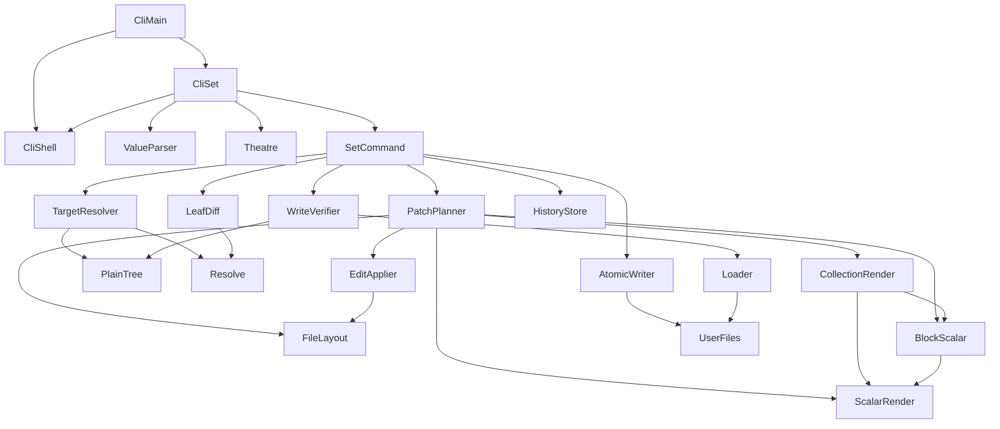
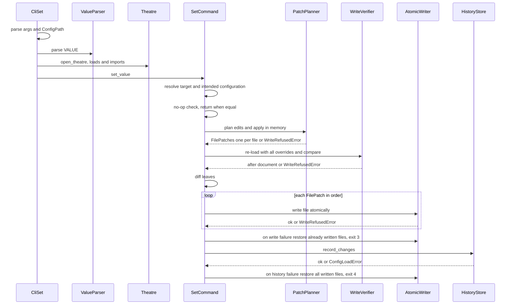
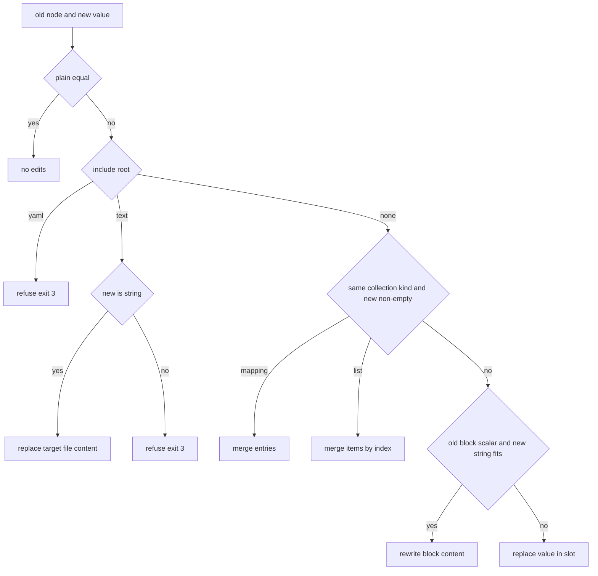

# Design Document: config-set-writeback

## Overview
**Purpose**: This feature delivers `troupe config set PATH VALUE`: it changes one setting of a theatre's
configuration and writes the change back into the file that holds it, changing only the bytes the step 1
contract requires, and records the change as `set`/`remove` events in the configuration history.

**Users**: Developers who hand-edit their theatre configuration and review every change as a diff use it to
change settings from the shell and scripts.

**Impact**: Adds the `troupe.config.writeback` package (VALUE parsing, write-target resolution, text layout
analysis, renderers, patch planner, verification, leaf diff, atomic file writing, the set use case) and
registers the `set` subcommand through a new `troupe.cli.set_command` module, which takes the CLI shell names
from the foundation leaf module `troupe.cli.shell` and is listed in `troupe.cli.main`'s `SUBCOMMAND_REGISTRARS`
registration list. config-foundation's modules are consumed unchanged; every upstream addition this spec relies
on (U1–U6, see "Required Upstream Additions") is delivered in config-foundation.

### Goals
- Every rule of the contract section `set PATH VALUE` is implemented by one named function and proved by a
  byte-exact test through the real CLI.
- A successful set changes only required bytes; any doubt ends in exit 3 with no file changed.
- The written configuration is proven, before writing, to equal the intended configuration by re-loading it
  with the foundation loader.

### Non-Goals
- Loading, includes, path syntax and resolution, history storage/import/printing, error types (config-foundation).
- Step 5's change of the new-key target rule; anchors/aliases/merge keys (step 6); multi-document files; TAB
  before end-of-line comments; concurrent writers; Windows.
- Cross-file atomicity beyond "verify everything in memory, then write each file atomically, roll back written
  files on a write failure" (13.6, 14.5): a set that changes several files is carried out (PO decision B), but a
  crash between two renames, like a crash mid-write, is undefined. Include creation is supported only by writing
  the `file:` string itself; the included target is never created or edited by the set (2.7, 14.8).

## Boundary Commitments

### This Spec Owns
- The `set` subcommand: its argparse subparser, handler and success behaviour (no output).
- VALUE parsing into a typed, style-free value tree (`NewValue`).
- Write-target resolution: rules 1–4, exit 5 cases for `set`, the intended configuration, no-op detection.
- All rendering rules: scalar style choice, quoting and escaping, literal and folded block scalars, block and
  flow collections, indentation detection, placement of new entries, deletion of entries, comment columns,
  line endings of inserted text.
- The patch planner (entry-wise merge, kind changes) and the edit applier.
- Write verification by re-load, the leaf diff that produces `SetChange`/`RemoveChange`, and the call to
  `HistoryStore.record_changes`.
- **Writing user files**: the atomic file writer is the only code in the system that writes a user file.

### Out of Boundary
- Reading user files (only the foundation loader reads them; the writer works on `SourceFile.text`).
- The model types, scalar typing, path parsing, walking and flattening, history aggregate/store, error classes
  and message format (consumed, never redefined).
- `show`/`history` output, the import, reconciliation of hand edits.
- Any behaviour for later contract steps (no hooks for step 5/6).

### Allowed Dependencies
- Python 3.12 standard library (`argparse` via the foundation parser, `difflib`, `os`, `secrets`, `stat`,
  `dataclasses`, `enum`).
- ruamel.yaml (pinned by the foundation, `<0.20`): `YAML(typ="rt").compose` only, for VALUE parsing and for
  representability probes on in-memory snippets. Never `load`/`dump`.
- config-foundation public names listed in its "Shared Seams" table, and nothing else. Besides the model,
  loader, resolve, history and error names, this includes `INCLUDE_PREFIX` (`troupe.config.constants`),
  `MappingEntry.key_style: ScalarStyle`, `LeafChange` (the `SetChange | RemoveChange` alias), and the CLI
  shell names `TroupeArgumentParser`, `Handler` (`Callable[[argparse.Namespace, io.BytesIO], None]`),
  `SubcommandRegistrar` and `theatre_option_parent` from the leaf module `troupe.cli.shell` (which imports
  nothing from other `troupe.cli` modules); `SUBCOMMAND_REGISTRARS`, `build_parser` and `run` stay in
  `troupe.cli.main`.
- Dependency direction inside this spec (imports point left only):
  `value → compare → layout → edits → scalar_render → block_scalar → collection_render → target → planner →
  verify → leaf_diff → atomic → setter → cli.set_command`.
- CLI import chain: `troupe.cli.shell ← troupe.cli.set_command ← troupe.cli.main`. `set_command` imports the
  shell names from `troupe.cli.shell` only and never imports `troupe.cli.main` (no cycle); `troupe.cli.main`
  imports `add_set_subparser` from `set_command`. The setter core `troupe.config.writeback.*` never imports
  `troupe.cli.*`. Only `atomic` writes files; no module of this spec
  reads user files from disk.

### Revalidation Triggers
- Any change to the foundation seams consumed here (model fields, span semantics, `load_config` overrides,
  `walk_path`/`flatten_leaves`, `record_changes`, error classes, `MappingEntry.key_style`, `INCLUDE_PREFIX`,
  the `troupe.cli.shell` names, `SUBCOMMAND_REGISTRARS`, and the `Theatre` context manager that closes the history
  store, config-foundation 7.9).
- Step 5 (new-key target rule) or step 6 (anchors) — the target resolver and planner must be revisited.
- A change to the multi-file write protocol (verify all, write each atomically, roll back on failure; 13.6, 14.5,
  14.10), a decision to create include targets, or a different collection-replacement strategy.
- A change to file authority (PO decision A: `old` values come from the files as on disk, never from the history).
- A change of include semantics in the foundation loader (the verifier relies on it to judge written `file:` strings).
- A ruamel.yaml upgrade beyond 0.19.x (positions, fold markers, representability probes).

## Required Upstream Additions (config-foundation)
| ID | Addition | Why | Blocking for |
|----|----------|-----|--------------|
| U1 | The loader removes U+0007 characters from the value of every folded (`>`) scalar before storing it in `ConfigScalar.value` (ruamel's round-trip composer inserts U+0007 as fold markers, e.g. `'a\x07 b\n'` for `>\n  a\n  b\n`; U+0007 cannot occur in YAML source, so removal is exact). A loader test asserts `>\n  a\n  b\n` loads as `"a b\n"`. | Without it, folded values are wrong for `show`, no-op detection, verification and leaf diffs. | Requirements 10, 14.1, 15 — **delivered in config-foundation** |
| U2 | `MappingEntry.key_style: ScalarStyle` — the style of each mapping key, so key styles come from the model, never from span text. | Key style retention and sibling key styles (6.x, 7.x). | Requirements 6, 7 — **delivered in config-foundation** |
| U3 | CLI shell seams: `Handler` and `SubcommandRegistrar` protocols, `TroupeArgumentParser` and `theatre_option_parent` in the leaf module `troupe.cli.shell`; the marked registration list `SUBCOMMAND_REGISTRARS` in `troupe.cli.main`. | Lets `set_command` register `set` without editing parsing/dispatch and without an import cycle. | Requirements 1, 16 — **delivered in config-foundation** |
| U4 | pytest setting `pythonpath = ["tests"]` in `pyproject.toml`. | `tests/writeback/` imports `set_support`. | All test tasks — **delivered in config-foundation** |
| U5 | `LeafChange`, `INCLUDE_PREFIX` and `TroupeArgumentParser` listed in the foundation "Shared Seams" table. | This spec imports only Shared Seams names. | Requirements 2, 15, 1 — **delivered in config-foundation** |
| U6 | An empty root document has style `BLOCK`; span semantics are documented: block collection/scalar spans may overrun into trailing blank lines, and the spans of empty (zero-length) null scalars are unreliable positions. | Insertion into an empty root (3.3); the writer computes content ends and empty-value slots itself instead of trusting those spans. | Requirements 3, 5, 8, 11 — **delivered in config-foundation** |

Status: U1–U6 are all delivered in config-foundation (U1 as its requirement 3.8 and loader task 3.2); this
spec consumes them and keeps a guard test for U1 (task 2.6).

Span semantics (U6): the foundation documents that a zero-length null scalar's `Span` is not a reliable
position (probes in `research.md`) and that block spans may overrun trailing blank lines. This spec never uses
the span of an empty scalar; it locates empty values from the key's `:` or the item's `-`, and computes block
content ends itself.

## Architecture

### Existing Architecture Analysis
config-foundation defines a layered design: CLI → theatre session → file layer (locate, loader) and pure
model/resolve modules, with an event-sourced history. Files are authoritative for current values (confirmed by the
product owner, decision A); the history is append-only change history. This spec adds a write path beside `show_value`, keeping the file layer as the only code that
touches user files (loader reads, `atomic` writes).

### Architecture Pattern & Boundary Map


**Architecture Integration**:
- Selected pattern: a pure *plan* stage (resolve → plan edits for every affected file → apply in memory → verify
  all patched files together) followed by a small *effect* stage (atomic write of each file in order, rollback of
  already-written files on a write failure → record events, rollback of all written files on a history
  failure). Everything before the first write is side-effect free, so every refusal trivially leaves files
  unchanged (14.7).
- Domain boundaries: renderers produce text fragments only; the planner alone decides positions; the layout
  module alone interprets raw file text (lines, columns, comments); the edit applier alone mutates text.
- Existing patterns preserved: typed errors carrying file and path, single-place constants
  (`INCLUDE_PREFIX`), buffered CLI output, tests on real files through the real CLI.
- Steering compliance: Product Principles 1–3 (only requested bytes, conservative refusal, errors name path and
  file); `structure.md` "file layer owns the user's bytes".

### Technology Stack
| Layer | Choice / Version | Role in Feature | Notes |
|-------|------------------|-----------------|-------|
| CLI | `argparse` via foundation `TroupeArgumentParser`, `SUBCOMMAND_REGISTRARS` and `run` | `set PATH VALUE`, shared `--theatre` | VALUE starting with `-` needs `--` unless numeric |
| Parsing | ruamel.yaml 0.19.1 `compose` | VALUE parsing; representability probes | Same pin as foundation; never dumps |
| Comparison | `difflib.SequenceMatcher` (stdlib) | Folded paragraph alignment | `autojunk=False` |
| File I/O | `os.open(O_CREAT|O_EXCL)`, `os.fsync`, `os.replace` | Atomic write next to the target | Mode bits copied; symlink resolved |
| Events | foundation `HistoryStore.record_changes` (eventsourcing) | One batch per set | No new event types |

## File Structure Plan

### Directory Structure
```
src/troupe/config/writeback/
├── __init__.py
├── value.py              # ValueParser: VALUE text → NewValue (NewScalar/NewMapping/NewSequence); exit 2 errors
├── compare.py            # PlainTree: model/NewValue → ordered plain tree; typed equality; splice at a path
├── layout.py             # FileLayout: lines, columns, line breaks, indentation step, dash offset, comments,
│                         #   value slots (key ':'/item '-' positions), content ends, insertion points
├── edits.py              # EditApplier: TextEdit, non-overlap check, application, comment-column fix-up
├── scalar_render.py       # ScalarRender: representability, style choice, plain/single/double rendering, keys
├── block_scalar.py       # BlockScalar: literal rendering, chomping, header rewrite, folded paragraphs and wrap
├── collection_render.py  # CollectionRender: new block/flow collections and entries as text lines
├── target.py             # TargetResolver: rules 1–4, exit 5 mapping, intended configuration, NewValue for text includes
├── planner.py            # PatchPlanner: slot changes, merge, add entries, deletions, kind changes → FilePatches (one per file)
├── verify.py             # WriteVerifier: re-load with all overrides, compare with intended, map failures to exit 3
├── leaf_diff.py          # LeafDiff: before (as on disk) / after leaves → SetChange/RemoveChange in recording order
├── atomic.py             # AtomicWriter: the only writer of user files (atomic replace, restore)
└── setter.py             # SetCommand: set_value use case (no-op, plan, verify, write all, roll back, record, compensate)
src/troupe/cli/
└── set_command.py        # CliSet: add_set_subparser, handle_set (new module of this spec)
tests/
├── set_support.py        # helpers for set tests: subprocess and in-process `troupe config` runners, assert
│                         #   exact file bytes, snapshot theatre tree
├── writeback/            # unit tests, one module per writeback module (test_value.py … test_atomic.py);
│                         #   they `import set_support`, relying on the foundation's pytest setting
│                         #   `pythonpath = ["tests"]` (config-foundation task 1.1)
├── test_set_cli.py       # VALUE parsing, usage errors, exit codes, stderr naming, import on first set
├── test_set_targets.py   # rules 1–4: includes, text includes (CRLF), new keys, intermediates, appends, exit 5
├── test_set_quoting.py   # scalar style retention/fallback, sibling styles, escaping
├── test_set_collections.py  # new collections, indentation, placement, trailing comments, flow appends
├── test_set_replacements.py # merges, deletions, kind changes, includes inside replaced collections
├── test_set_block_scalars.py # literal and folded rules
├── test_set_comments.py  # end-of-line comment columns
├── test_set_preservation.py # CRLF/mixed/BOM/no final newline, symlinks, permissions, untouched files
├── test_set_safety.py    # verification refusals, no-op, unloadable new includes, multi-file rollback, write failures, no extra files
└── test_set_history.py   # set/remove events, order, typed comparison, no-op, history failure compensation
```

### Modified Files
- `src/troupe/cli/main.py` — the only change is one added entry, `add_set_subparser` (imported from
  `troupe.cli.set_command`), in the foundation's marked registration list `SUBCOMMAND_REGISTRARS`. Parsing,
  dispatch through `args.handler` and error mapping in `run` are reused unchanged.
- `src/troupe/cli/shell.py` — **not modified by this spec**; `set_command.py` only imports
  `TroupeArgumentParser`, `Handler`, `SubcommandRegistrar` and `theatre_option_parent` from it (never from
  `troupe.cli.main`, which imports `set_command`).
- `pyproject.toml` — **not modified by this spec**; the pytest `pythonpath = ["tests"]` setting that lets
  `tests/writeback/` import `set_support` is delivered by config-foundation (its task 1.1).
- `src/troupe/config/loader.py` — **not modified by this spec**; U1 is delivered by config-foundation.

## System Flows

### Set command

**Key decisions**: argument and VALUE errors (exit 2) happen before `open_theatre`, so they create no state;
everything after `open_theatre` up to the first write is pure; a refusal at any step raises before any write
(14.7); every patch is verified before the first write (13.6); files are written one after another in the
patches' order, and a failure restores the already-written files in reverse order (14.5); history is recorded
only after every write succeeded; the import done by `open_theatre` is not undone by a later refusal (1.6,
foundation decision); `handle_set` runs inside `with open_theatre(...) as theatre:`, so the history store is
closed when the command ends (config-foundation 7.9).

### Slot change decision (planner)


## Requirements Traceability

| Requirement | Summary | Components | Interfaces | Flows |
|-------------|---------|------------|------------|-------|
| 1.1, 1.5 | Invocation, no output, usage errors | CliSet | `add_set_subparser`, `handle_set` | Set command |
| 1.2, 1.3, 1.4 | VALUE as one flow node; exit 2 | ValueParser | `parse_value` | Set command |
| 1.6 | Import before set | CliSet, foundation Theatre | `open_theatre` | Set command |
| 2.1, 2.6 | Change where written, incl. YAML includes | TargetResolver, PatchPlanner | `resolve_target`, `plan_patch` | Slot change |
| 2.7, 2.8 | `file:` strings written as strings; equal include unchanged | PlainTree, ScalarRender, PatchPlanner | `IncludeDirective`, `new_to_plain`, `plain_equal` | Slot change |
| 2.2, 2.3, 2.4 | Text include content, CRLF, non-string → 3 | TargetResolver, PatchPlanner | `text_include_value`, `plan_patch` | Slot change |
| 2.5 | YAML include root → 3 | PatchPlanner | `plan_patch` | Slot change |
| 3.1–3.3 | New keys, intermediates, empty root | TargetResolver, PatchPlanner, CollectionRender | `AddKeyTarget`, `add_entries` | Set command |
| 3.4–3.6, 4.2, 4.3, 16.3 | Exit 5 cases | TargetResolver | `resolve_target` | — |
| 4.1 | Append | TargetResolver, PatchPlanner | `AppendTarget`, `add_entries` | — |
| 5.1, 5.2 | Entry-wise merge | PatchPlanner, PlainTree | `merge_mapping`, `merge_sequence` | Slot change |
| 5.3, 5.4, 5.7 | Deletions, refusal when a line is shared | PatchPlanner, FileLayout | `delete_entry` | — |
| 5.5, 5.6 | Scalar or empty collection over block collection | PatchPlanner, FileLayout | `replace_value` | Slot change |
| 5.8, 5.9 | Includes inside replaced collections | PatchPlanner | `change_slot` | Slot change |
| 6.1–6.6 | Scalar style retention, fallback, escaping | ScalarRender | `choose_style`, `render_scalar` | — |
| 7.1–7.4 | Sibling styles, minimal style | ScalarRender, CollectionRender, PatchPlanner | `SiblingStyles`, `render_block_entry`, `render_flow_entry` | — |
| 8.1–8.6 | Block/flow collections, indentation, dash offset, compact items | CollectionRender, FileLayout | `render_block`, `render_flow`, `indent_step`, `dash_offset` | — |
| 9.1–9.7 | Literal blocks, chomping, header kept, fallback | BlockScalar, ScalarRender | `render_literal`, `rewrite_block` | Slot change |
| 10.1–10.7 | Folded paragraphs | BlockScalar | `rewrite_folded`, `wrap_paragraph` | — |
| 11.1, 11.2 | Insertion below trailing comments | FileLayout | `insertion_point` | — |
| 11.3 | Flow append on last entry's line | PatchPlanner | `add_entries` | — |
| 11.4, 11.5 | Scalar → block collection key line | PatchPlanner, EditApplier | `replace_value` | — |
| 11.6 | File without final line break | PatchPlanner, FileLayout | `insertion_point`, `line_break_at` | — |
| 12.1–12.4 | Comment columns | EditApplier, FileLayout | `apply_edits`, `comment_start` | — |
| 13.1, 13.4 | Only required bytes, other files untouched | PatchPlanner, EditApplier, AtomicWriter | `FilePatch` | Set command |
| 13.2 | Line endings of inserted text | FileLayout | `line_break_at` | — |
| 13.3, 13.5 | UTF-8/BOM, symlink, permissions | AtomicWriter | `write_atomically` | — |
| 13.6 | Several files per set: all built and verified before any write | PatchPlanner, WriteVerifier, SetCommand | `plan_patch` (tuple of `FilePatch`), `verify_patch`, `set_value` | Set command |
| 14.1, 14.2 | Verify by re-load | WriteVerifier, PlainTree | `verify_patch` | Set command |
| 14.3, 14.4 | Atomic write, no extra file after any outcome | AtomicWriter, SetCommand | `write_atomically` | Set command |
| 14.5 | Write failure → restore written files, 3 | SetCommand, AtomicWriter | `write_patches`, `restore_file` | Set command |
| 14.10 | Restore failure keeps original exit code, names files | SetCommand | `set_value` | Set command |
| 14.6 | No-op first | SetCommand, PlainTree | `set_value`, `plain_equal` | Set command |
| 14.7 | No change on any failure | SetCommand | pure plan stage | Set command |
| 14.8 | Unloadable new include → 3 | WriteVerifier | `verify_patch` | Set command |
| 14.9 | Unsupported layouts → 3 | PatchPlanner, EditApplier | `WriteRefusedError` | — |
| 15.1–15.5, 15.7 | Events (`old` from the files as on disk), typed comparison, order, leaves of new includes | LeafDiff, SetCommand | `diff_leaves(theatre.document, after)`, `record_changes` | Set command |
| 15.6 | Restore all written files on history failure → 4 | SetCommand, AtomicWriter | `restore_file` | Set command |
| 16.1, 16.2, 16.4 | Messages, exit 3 naming, load errors | CliSet, SetCommand (PATH added to write failures), all raisers | foundation `format_message` | — |

## Components and Interfaces

| Component | Domain/Layer | Intent | Req Coverage | Key Dependencies | Contracts |
|-----------|--------------|--------|--------------|------------------|-----------|
| ValueParser | Core | VALUE text → typed value tree | 1.2–1.4 | ruamel compose (P0), `resolve_plain_scalar` (P0) | Service |
| PlainTree | Core | Ordered typed plain trees, equality, splicing | 5.1, 5.2, 14.1, 14.6, 15.3 | model (P0) | Service |
| FileLayout | Core (text) | Interpret raw text of one file | 8.2, 8.3, 11.1, 11.2, 11.6, 12.x, 13.2 | model (P0) | Service |
| EditApplier | Core (text) | Apply edits, fix comment columns | 12.1–12.4, 13.1, 14.9 | FileLayout (P0) | Service |
| ScalarRender | Core (render) | Style choice and scalar text | 2.7, 6.x, 7.x | ruamel compose (P1), scalars (P0) | Service |
| BlockScalar | Core (render) | Literal/folded rendering and rewrites | 9.x, 10.x | ScalarRender (P0), difflib (P1) | Service |
| CollectionRender | Core (render) | New collections and entries as text | 7.4, 8.x, 9.1–9.3 | ScalarRender, BlockScalar (P0) | Service |
| TargetResolver | Core | Rules 1–4 targets, exit 5, intended tree | 2.x, 3.x, 4.x, 16.3 | `walk_path` (P0), PlainTree (P0) | Service |
| PatchPlanner | Core | Edits for one set → one FilePatch per changed file | 2.x, 3.x, 4.1, 5.x, 9.x, 11.x, 13.1, 13.6, 14.9 | all renderers, FileLayout, EditApplier (P0) | Service |
| WriteVerifier | Core | Re-load with all patches and compare | 13.6, 14.1, 14.2, 14.8 | `load_config` (P0), PlainTree (P0) | Service |
| LeafDiff | Core | Leaf changes for history | 15.1–15.5, 15.7 | `flatten_leaves` (P0) | Service |
| AtomicWriter | File layer | Only writer of user files | 13.3, 13.5, 14.3, 14.4, 14.5, 15.6 | OS (P0) | Service |
| SetCommand | Application | `set_value` use case | 1.6, 13.4, 13.6, 14.4–14.7, 14.10, 15.x, 16.2 | all above, HistoryStore (P0) | Service |
| CliSet | CLI | `set` subparser and handler (`troupe.cli.set_command`) | 1.1, 1.5, 1.6, 16.1, 16.2, 16.4 | `troupe.cli.shell` (P0), SetCommand (P0) | Service |

### Core

#### ValueParser

| Field | Detail |
|-------|--------|
| Intent | Parse VALUE as exactly one YAML 1.2 core-schema flow node |
| Requirements | 1.2, 1.3, 1.4 |

**Responsibilities & Constraints**
- Composes VALUE with a fresh `YAML(typ="rt")`. Refuses (`UsageError(path=str(path))`): YAML errors, multiple
  documents, `None` result (empty/whitespace/comment-only), any node whose span text starts with `!` or `&`, any
  alias, any block node (scalar style `|`/`>` or collection with `flow_style` false), duplicate/empty/non-scalar
  mapping keys, characters that cannot be encoded as UTF-8 (surrogate escapes from argv).
- Types plain scalars with the shared `resolve_plain_scalar`; quoted scalars are `str`. Keeps the plain source
  text of non-string scalars as `spelling` (6.3). Key text is the key scalar's value (as the loader does).

**Contracts**: Service [x]
```python
@dataclass(frozen=True)
class NewScalar:
    value: ScalarValue
    spelling: str | None          # source text for int/float/bool/None; None for strings

@dataclass(frozen=True)
class NewMapping:
    entries: tuple[tuple[str, NewValue], ...]   # VALUE order

@dataclass(frozen=True)
class NewSequence:
    items: tuple[NewValue, ...]

NewValue: TypeAlias = NewScalar | NewMapping | NewSequence

def parse_value(text: str, path: ConfigPath) -> NewValue: ...   # raises UsageError naming PATH
```

#### PlainTree

| Field | Detail |
|-------|--------|
| Intent | One definition of "same configuration" for no-op, merge, verification and leaf diff |
| Requirements | 2.7, 2.8, 5.1, 5.2, 14.1, 14.6, 15.3 |

**Contracts**: Service [x]
```python
@dataclass(frozen=True)
class IncludeDirective:
    text: str                      # the whole "file:..." string as written
    content: PlainValue | None     # expanded content; None = "whatever the include loads" (written by this set)

PlainValue: TypeAlias = ScalarValue | IncludeDirective | PlainMapping | list["PlainValue"]
PlainMapping: TypeAlias = dict[str, "PlainValue"]          # insertion-ordered

def node_to_plain(node: ConfigNode) -> PlainValue: ...
    # an include root becomes IncludeDirective(INCLUDE_PREFIX + include.spec, content=<expanded plain value>)
def new_to_plain(value: NewValue) -> PlainValue: ...
    # a string starting with INCLUDE_PREFIX becomes IncludeDirective(text, content=None)
def plain_equal(a: PlainValue, b: PlainValue, *, ordered: bool) -> bool: ...
def scalar_equal(a: ScalarValue, b: ScalarValue) -> bool: ...
def splice(root: PlainMapping, path: ConfigPath, value: PlainValue,
           text_content: Callable[[str, IncludeDirective], PlainValue]) -> PlainMapping: ...
```
- `scalar_equal`: same Python type and (for floats) equal `repr`, otherwise `==`; so `1`, `1.0`, `True`, `"1"`
  differ, `nan` equals `nan`, `0.0` differs from `-0.0`.
- `IncludeDirective` equality: equal texts, and contents equal unless either content is `None`; never equal to a
  non-directive value. Hence an unchanged include written again is a no-op (2.8), a YAML include root compared
  with any other value differs (rule 4 refusal), and a directive written by this set matches whatever its target
  loads as, provided it loads (14.1, 14.8).
- `plain_equal(ordered=True)` also compares mapping key order (used by verification); `ordered=False` is used
  for no-op detection and merge decisions (mapping order in VALUE is not significant, 5.1).
- `splice` returns a new tree with the value at `path` replaced, missing intermediate mappings created and a list
  index equal to the length appended (this is the *intended configuration*). When a mapping replaces a mapping
  (at PATH or at any depth below it), the existing keys that remain keep their existing order and new keys are
  appended in VALUE order, mirroring the planner's merge (5.1); a VALUE listing existing keys in another order
  therefore verifies.
- Text includes at any depth: whenever `splice` (directly at PATH or while merging a mapping or list below
  it) places a string over an existing text-include directive, the result is `IncludeDirective(<same text>,
  content=text_include_value(string, target))`, so rule 1 applies at every depth (2.2, 2.3, 5.1, 5.2), an
  unchanged text-include content is a no-op (14.6), and only a non-string over a text include differs as a
  value (2.4). A YAML include directive is never rewritten this way (rule 4).
- `splice` takes the text-include content as a caller-supplied callback (`text_content`); TargetResolver passes one
  that applies `text_include_value` (line-break conversion), so PlainTree imports nothing from `target.py`.

#### FileLayout

| Field | Detail |
|-------|--------|
| Intent | All interpretation of raw file text: lines, columns, comments, slots, ends, insertion points |
| Requirements | 8.2, 8.3, 11.1, 11.2, 11.6, 12.1, 12.3, 13.2 |

**Responsibilities & Constraints**
- Built once per file from `SourceFile.text` and the document nodes whose origin is that file (plus include
  directive origins in that file). Pure; character indices and code-point columns throughout.
- **Lines**: line starts, line of an index, column of an index (code points), line content end (before the line
  break), whether a line is blank or a comment line (first non-space character `#`) and its indentation.
- **Line break for an insertion** (`line_break_at`): CRLF for `LineEnding.CRLF`; LF for LF/NONE; for MIXED the
  break of the line the insertion follows, LF when that line has none (13.2).
- **Token ends and comments**: the token-end floor of a line is the greatest end of any key span, non-empty
  flow scalar span, flow collection span, block scalar header, `:` or `-` indicator on that line. The
  end-of-line comment of the line is the first `#` after the floor that is preceded by a space (TAB before a
  comment is out of contract) (12.x).
- **Value slots**: for a mapping entry, the key column and the index just after the entry's `:` (found by
  scanning from the key span end over spaces); for a sequence item, the column of its `-` (scanning back from
  the item start over spaces) and the index after the `-`. Empty null values are located only through their
  slot (never through their span).
- **Content end** of a node: non-empty flow scalar or flow collection → span end; empty null → its slot's
  indicator end; block scalar → end of the last non-blank content line for clip/strip, span end for keep;
  block collection → content end of its last entry (key end for an entry whose value is empty).
- **Inline extent** of a value in its slot: the span of a non-empty flow scalar or flow collection; the
  empty span at the indicator end for an empty value or for a block collection that starts on a later line;
  the header indicator characters (`|`/`>`, indentation and chomping indicators) of a block scalar; for a block
  collection starting on the slot's line (compact list item) the text from the collection start to the line
  content end, excluding the end-of-line comment.
- **Body lines** of a block scalar or block collection: the whole lines after the line holding the end of the
  inline extent, through the line of the content end, including their line breaks; none for other values.
- **Entries column** of a block collection: column of its first key or `-`.
- **Insertion point** for a new entry of a block collection (11.1, 11.2): start of the line after the content
  end of the last entry; then repeatedly skip blank lines tentatively and accept comment lines whose
  indentation is ≥ the entries column; stop at any other line; the insertion point is after the last accepted
  line (blank lines skipped without a following accepted comment stay below the insertion). At end of file
  without a final line break the insertion point is the end of file and `needs_leading_break` is true (11.6).
  The empty root (`Span(0, 0)` root) inserts at end of file.
- **Indentation step** (8.2): first block mapping, in document order, that is directly the value of a block
  mapping entry within this file: its entries column minus the parent key column; 2 when none exists.
- **Dash offset** (8.3): first block sequence directly under a block mapping entry within this file: its dash
  column minus the parent key column (0 allowed); the indentation step when none exists.

**Contracts**: Service [x]
```python
@dataclass(frozen=True)
class ValueSlot:
    file: SourceFile
    path: ConfigPath
    parent_style: CollectionStyle      # style of the containing collection
    in_sequence: bool                  # item of a sequence (True) or value of a mapping entry (False)
    owner_column: int                  # key column or '-' column
    indicator_end: int                 # index just after ':' or '-'
    node: ConfigNode

@dataclass(frozen=True)
class InsertionPoint:
    index: int
    needs_leading_break: bool

class FileLayout:
    @classmethod
    def build(cls, file: SourceFile, document: ConfigDocument) -> FileLayout: ...
    def column(self, index: int) -> int: ...
    def line_of(self, index: int) -> int: ...
    def line_span(self, line: int) -> Span: ...                 # content, without line break
    def line_break_at(self, index: int) -> str: ...
    def comment_start(self, line: int) -> int | None: ...
    def entry_slot(self, mapping: ConfigMapping, entry: MappingEntry, path: ConfigPath) -> ValueSlot: ...
    def item_slot(self, sequence: ConfigSequence, index: int, path: ConfigPath) -> ValueSlot: ...
    def content_end(self, node: ConfigNode, slot: ValueSlot | None) -> int: ...
    def inline_extent(self, slot: ValueSlot) -> Span: ...
    def body_lines(self, slot: ValueSlot) -> Span | None: ...  # whole lines incl. breaks
    def entries_column(self, collection: ConfigMapping | ConfigSequence) -> int: ...
    def insertion_point(self, collection: ConfigMapping | ConfigSequence) -> InsertionPoint: ...
    def starts_line(self, index: int) -> bool: ...              # only spaces before index on its line
    def indent_step(self) -> int: ...
    def dash_offset(self) -> int: ...
```

#### EditApplier

| Field | Detail |
|-------|--------|
| Intent | Apply planned edits to one file's text and keep end-of-line comments at their columns |
| Requirements | 12.1, 12.2, 12.3, 12.4, 13.1, 14.9 |

**Contracts**: Service [x]
```python
class EditKind(Enum):
    INLINE = "inline"     # replaces characters within line content; triggers comment fix-up
    LINES = "lines"       # inserts or deletes whole lines; never triggers comment fix-up

@dataclass(frozen=True)
class TextEdit:
    start: int
    end: int              # start == end for insertions
    text: str
    kind: EditKind

def apply_edits(layout: FileLayout, edits: Sequence[TextEdit]) -> str: ...
```
- Edits are sorted by position (equal positions keep planner order); overlapping edits raise
  `WriteRefusedError` (planner bug guard, 14.9).
- Comment fix-up: for each line holding the original `end` of an INLINE edit and having an end-of-line comment
  that starts after that end and is not removed by an edit, the whitespace run before `#` is replaced by
  `max(1, C − P)` spaces, where `C` is the comment's original column and `P` the column at which that
  whitespace run starts in the edited text. Lines without INLINE edits are never touched (12.4).

#### ScalarRender

| Field | Detail |
|-------|--------|
| Intent | Decide and render the style of single scalars and keys |
| Requirements | 2.7, 6.1–6.6, 7.1–7.4, 9.3, 9.7 |

**Responsibilities & Constraints**
- Representability (6.4, 6.5): a cheap syntactic check (one line, no control characters, no leading/trailing
  whitespace for plain; no control character except TAB and no line break for single-quoted) followed, for plain,
  by a parse probe: compose `k: <text>` (block value), `[<text>]` (flow item) or `<text>: v` / `{<text>: v}`
  (keys) and require a plain scalar whose value is `text` and, for values, `resolve_plain_scalar(text) == text`
  as a `str`. Keys are compared as text only (the foundation treats keys textually).
- Style choice for a changed scalar (6.1, 6.2): keep `old_style` if it is PLAIN/SINGLE/DOUBLE and can represent
  the value; otherwise PLAIN → SINGLE → DOUBLE. Non-strings are always written plain with their `spelling`
  (6.3). Strings containing a line break are not decided here when the parent is a block collection (literal
  block, BlockScalar); in flow context they are double-quoted (9.3).
- New keys/values (7.1–7.4): the same chain started from the sibling style when one is given.
- Double-quoted rendering (6.6): escape `\`, `"`, U+0000–U+001F, U+007F–U+009F (named escapes
  `\0 \a \b \t \n \v \f \r \e \N`, otherwise `\xHH` with upper-case hex); everything else literal.
  Single-quoted: `'` doubled.
- Existing styles come from the model, never from span text: a key's style is `MappingEntry.key_style`
  (foundation Shared Seams), a scalar value's style is `ConfigScalar.style`; `quote_style_of` narrows either to
  a `QuoteStyle` (literal/folded → `None`, i.e. no preferred quote style; `None` in → `None` out, for a
  sibling whose value has no scalar style, e.g. a text-include directive).
- Strings starting with `INCLUDE_PREFIX` get no special treatment: they are rendered like any other string
  (2.7); whether the resulting include loads is decided by WriteVerifier.

**Contracts**: Service [x]
```python
class Context(Enum):
    BLOCK_VALUE = "block-value"
    FLOW_VALUE = "flow-value"
    BLOCK_KEY = "block-key"
    FLOW_KEY = "flow-key"

QuoteStyle: TypeAlias = Literal[ScalarStyle.PLAIN, ScalarStyle.SINGLE_QUOTED, ScalarStyle.DOUBLE_QUOTED]

def can_represent(style: QuoteStyle, text: str, context: Context) -> bool: ...
def choose_style(value: str, context: Context, preferred: QuoteStyle | None) -> QuoteStyle: ...
def render_scalar(value: NewScalar, context: Context, preferred: QuoteStyle | None, path: ConfigPath) -> str: ...
def render_key(key: str, context: Context, preferred: QuoteStyle | None) -> str: ...
def quote_style_of(style: ScalarStyle | None) -> QuoteStyle | None: ...   # None for None, literal, folded
```

#### BlockScalar

| Field | Detail |
|-------|--------|
| Intent | Literal block rendering, block header/chomping, rewrite of existing literal and folded blocks |
| Requirements | 9.1, 9.2, 9.4, 9.5, 9.6, 9.7, 10.1–10.7 |

**Responsibilities & Constraints**
- `literal_fits(value)`: no control character other than TAB/LF, no U+2028/U+2029, first non-empty line does
  not start with a space; otherwise callers fall back to double-quoted (9.7).
- Chomping: required chomping is strip (no trailing LF), clip (exactly one), keep (more than one) (9.1);
  for an existing block, the old chomping is kept when it can represent the value (keep represents ≥ 1
  trailing LF; clip exactly one; strip none), otherwise the required one (9.4).
- Literal content: body lines (value minus trailing LFs, split on LF) at `indent` columns, empty lines as bare
  breaks, then one extra bare break per trailing LF beyond the first for keep. All breaks use the given
  line-break string.
- Rewrite of an existing block (9.4, 9.5): header characters `|`/`>` and indentation indicator kept, chomping
  character replaced if required, header comment kept; content region = first content line through the
  content end (span end when old or new chomping is keep); content indentation = the explicit indicator
  added to the owner column, else the indentation of the first non-empty content line. A region that ends at
  end of file without a final break produces content without a final break.
- Folded (10.x): old paragraphs are maximal runs of non-empty content lines; their text is the lines' content
  joined by single spaces; more-indented lines (content starting with space/TAB) in the old block → refuse
  (10.7). New paragraphs are the non-empty LF-separated segments of the value body; a segment starting with
  space/TAB → refuse (10.6). `SequenceMatcher(None, old_texts, new_texts, autojunk=False)` opcodes:
  `equal` → old line bytes kept; `replace` → pairs in order, re-wrapped at the paired old paragraph's longest
  content-line width, extra new paragraphs at the block's overall width; `insert` → overall width; `delete` →
  dropped. Separators between two paragraphs that were adjacent and unchanged with the same number of empty
  lines keep their old bytes; others are `k + 1` bare breaks for `k` empty segments. Overall width = longest
  old content line; no wrapping when the old value had no content line.
- `wrap_paragraph(text, width)`: words are maximal substrings separated by single spaces with non-space
  characters on both sides; greedy fill so each line's length ≤ width; a longer word takes its own line (10.2).

**Contracts**: Service [x]
```python
class Chomping(Enum):
    STRIP = "-"
    CLIP = ""
    KEEP = "+"

def required_chomping(value: str) -> Chomping: ...
def literal_fits(value: str) -> bool: ...
def render_literal(value: str, indent: int, line_break: str) -> tuple[str, str]: ...
    # (header such as "|-", content lines text)
def wrap_paragraph(text: str, width: int | None) -> list[str]: ...
def rewrite_block(layout: FileLayout, slot: ValueSlot, scalar: ConfigScalar, value: str) -> list[TextEdit]: ...
    # literal or folded; raises WriteRefusedError for 10.6, 10.7
```

#### CollectionRender

| Field | Detail |
|-------|--------|
| Intent | Render new collections and new entries (keys with values, list items) as text |
| Requirements | 7.1–7.4, 8.1, 8.4, 8.5, 8.6, 9.1–9.3 |

**Responsibilities & Constraints**
- Block mapping entry: `{column}{key}: {inline}` + break, then nested lines; nested mapping at `column + step`,
  nested list with dashes at `column + dash_offset`; multi-line string → literal block at `column + step`;
  empty collection → `{}`/`[]` inline (8.6).
- Block list item: `{column}- {inline}`; a mapping or list item is compact: its first entry follows `- `, further
  entries at `column + 2` (8.4).
- Flow: `{k: v, k2: v2}` / `[a, b]` with `, ` and `: `; strings with line breaks double-quoted (8.5, 9.3).
- Only the first-level new entry may receive sibling styles; everything nested inside a new collection uses the
  minimal style (7.4).

**Contracts**: Service [x]
```python
@dataclass(frozen=True)
class RenderContext:
    step: int
    dash_offset: int
    line_break: str
    path: ConfigPath                         # for include-guard errors

@dataclass(frozen=True)
class SiblingStyles:
    key: QuoteStyle | None
    value: QuoteStyle | None

def render_block_entry(key: str | None, value: NewValue, column: int, siblings: SiblingStyles,
                       ctx: RenderContext) -> str: ...       # key None → list item; ends with a break
def render_block_value(value: NewValue, owner_column: int, in_sequence: bool,
                       ctx: RenderContext) -> tuple[str, str]: ...  # (inline part, following lines)
def render_flow_entry(key: str | None, value: NewValue, siblings: SiblingStyles, ctx: RenderContext) -> str: ...
def render_flow_value(value: NewValue, ctx: RenderContext) -> str: ...
```

#### TargetResolver

| Field | Detail |
|-------|--------|
| Intent | Decide what PATH addresses for a set and what the configuration must become |
| Requirements | 2.1, 2.2, 2.3, 2.6, 3.1–3.6, 4.1–4.3, 16.3 |

**Responsibilities & Constraints**
- Uses `walk_path(document.root, path)`:
  - `COMPLETE` → `ReplaceTarget`.
  - `MISSING_KEY` where the deepest node is a mapping and none of the remaining segments is digit-only →
    `AddKeyTarget` (3.1, 3.2); a digit-only remaining segment → `PathNotFoundError` (3.6).
  - `INDEX_OUT_OF_RANGE` with index == length and no further segment → `AppendTarget` (4.1); otherwise
    `PathNotFoundError` (4.2, 4.3).
  - `NOT_AN_INDEX`, `SCALAR` → `PathNotFoundError` (3.4, 3.5).
  - Errors carry `file=deepest.origin.file.path` and `path=str(path)` (16.3).
- Text includes (2.2, 2.3): the new plain value at a text-include target is VALUE with every LF not preceded by
  CR replaced by CRLF when `include.target.line_ending is LineEnding.CRLF`; VALUE exactly otherwise.
- Intended configuration: `splice(node_to_plain(root), path, new_plain, text_content)`; at a text-include target, at PATH or at
  any depth inside a replaced collection, the new plain value is `IncludeDirective(<unchanged directive>,
  content=text_include_value(...))` (PlainTree rule), so rule 1 changes the content while the directive stays as
  it is.

**Contracts**: Service [x]
```python
@dataclass(frozen=True)
class ReplaceTarget:
    node: ConfigNode
    parent: ConfigMapping | ConfigSequence
    key: str | int

@dataclass(frozen=True)
class AddKeyTarget:
    mapping: ConfigMapping
    missing: tuple[str, ...]            # first missing key, then intermediates; VALUE goes at the last

@dataclass(frozen=True)
class AppendTarget:
    sequence: ConfigSequence

WriteTarget: TypeAlias = ReplaceTarget | AddKeyTarget | AppendTarget

@dataclass(frozen=True)
class SetRequest:
    path: ConfigPath
    target: WriteTarget
    value: NewValue
    current: PlainMapping
    intended: PlainMapping

def resolve_target(document: ConfigDocument, path: ConfigPath, value: NewValue) -> SetRequest: ...
def text_include_value(value: str, target: SourceFile) -> str: ...
```

#### PatchPlanner

| Field | Detail |
|-------|--------|
| Intent | Turn a `SetRequest` into the changed text of every file the set must change (one `FilePatch` per file) |
| Requirements | 2.1, 2.4, 2.5, 2.6, 2.7, 2.8, 3.1–3.3, 4.1, 5.1–5.9, 9.1–9.7, 11.3–11.6, 13.1, 13.6, 14.9 |

**Responsibilities & Constraints**
- `change_slot(slot, old, new)` follows the "Slot change decision" flow; it is called for `ReplaceTarget` and
  recursively by merges. YAML include root with a differing value → `WriteRefusedError(file=include.target.path)`
  (2.5, 5.8); text include → whole-file replacement of `include.target` (string) or refusal (2.4).
- **Scalar replacement in place** (old plain/quoted/empty, new single-line text, parent block or flow): INLINE
  edit replacing the scalar span; for an empty value, INLINE insertion of `" " + text` at the slot's indicator
  end (the comment fix-up then restores any following comment's column).
- **Block rewrite**: old literal/folded, new string that `literal_fits` (literal) or folds (folded) →
  `BlockScalar.rewrite_block`.
- **Replace value** (all other kind changes, parent block): edits on the slot = INLINE edit on the inline extent
  (new inline text; empty text removes the spaces after the indicator when no comment follows, 11.5) + LINES
  deletion of old body lines (5.5) + LINES insertion of new following lines at the old body start, or after the
  line holding the end of the inline extent when there is no old body (11.4). Literal blocks render header inline and content as following lines. A list item gets a
  compact collection unless its line has an end-of-line comment.
- **Replace value, parent flow**: one INLINE edit replacing the old span with the flow rendering.
- **Merge** (5.1, 5.2): `merge_mapping` / `merge_sequence` call `change_slot` for kept entries, `delete_entry` for
  absent ones and `add_entries` once for new ones; a flow collection whose entries are all deleted while new
  ones are added is replaced as a whole flow rendering.
- **add_entries** (3.x, 4.1, 11.x): block → one LINES insertion at `insertion_point` (leading break when
  needed), entries at `entries_column` (root: 0), sibling styles from the last existing entry (key: `quote_style_of(entry.key_style)`, value:
  `quote_style_of(scalar.style)` when the value is a scalar — a text-include sibling has `style=None`, which
  yields `None`, i.e. no preferred style — and no preferred style otherwise); flow → one INLINE
  insertion right after the last entry's content end (`", " + entry`), or after the opening bracket when empty.
  `AddKeyTarget` renders `missing[0]` with a nested NewMapping chain built from `missing[1:]`.
- **delete_entry** (5.3, 5.4, 5.7): block → LINES deletion from the entry's line start through the line break of
  its content-end line, refused when `starts_line` is false; flow → the entry plus the preceding `,` and spaces
  (first entry: through the following `,` and spaces), refused when the range spans lines.
- Collects edits per file (keyed by `SourceFile.real_path`) and applies each file's edits with `apply_edits`
  into one `FilePatch` per changed file (13.6, PO decision B). A rule-1 change in another file (for example a
  text-include target inside a replaced mapping, next to an ordinary value changed in the including file) is
  legitimate: the contract requires each existing value to be changed in the file that contains it. Edits that
  would change the configuration at other paths (a file included at two places) are not refused here but by
  WriteVerifier's comparison (14.2, PO decision C).
- Order: patches are returned in the order their files appear in `document.files` (read order, root file
  first), so the write order is deterministic.

**Contracts**: Service [x]
```python
@dataclass(frozen=True)
class FilePatch:
    file: SourceFile
    new_text: str

def plan_patch(document: ConfigDocument, request: SetRequest) -> tuple[FilePatch, ...]: ...
    # one FilePatch per changed file, in document.files order; never two patches for the same real_path.
    # raises WriteRefusedError(file=..., path=..., problem=...) for every refusal; path=str(request.path),
    # except a YAML include root that would change inside a replaced collection (5.8): there path is that
    # nested value's path (e.g. `agents.coder`) and file is the included file
```
- Preconditions: `request.intended` differs from `request.current` (no-op handled by SetCommand).
- Postconditions: the tuple is non-empty; for every patch `new_text != file.text`; nothing is written.

#### WriteVerifier

| Field | Detail |
|-------|--------|
| Intent | Prove the patched texts of all files, together, load as the intended configuration |
| Requirements | 13.6, 14.1, 14.2, 14.8 |

**Contracts**: Service [x]
```python
def verify_patch(config_file: Path, document: ConfigDocument, patches: Sequence[FilePatch],
                 request: SetRequest) -> ConfigDocument: ...
```
- Overrides: every `document.files` entry by `real_path` with its original text, and every patched file with its
  `new_text` (all patches at once, 13.6). Targets of includes written by this set are not in the overrides and are
  read from disk by the loader (read-only), exactly as a later `show` would read them.
- `ConfigLoadError` (including a missing or unreadable target of a newly written include, an include cycle, or a
  target that fails to load) → `WriteRefusedError(file=<first patched file>.path, path=str(PATH),
  problem=<"written value cannot be read back: " + loader message>)`; the loader message names the file that
  failed and, for includes, the include target (14.8).
- Mismatch (`plain_equal(node_to_plain(after.root), request.intended, ordered=True)` false) →
  `WriteRefusedError` naming the first patched file (further patched files in `problem`) and PATH (14.2,
  confirmed by the product owner, decision C). Because every include in the read-back tree is an
  `IncludeDirective` that must match the intended tree, no separate check of the set of files read is needed.
- Runs before any file is written; a refusal therefore leaves every file unchanged.

#### LeafDiff

| Field | Detail |
|-------|--------|
| Intent | Derive the history changes of one set |
| Requirements | 15.1, 15.2, 15.3, 15.4, 15.5, 15.7 |

**Contracts**: Service [x]
```python
def diff_leaves(before: ConfigDocument, after: ConfigDocument) -> tuple[LeafChange, ...]: ...
```
- `before` is always `theatre.document`, the configuration that `open_theatre` loaded from disk for this command
  (PO decision A). Every `old` is therefore the value currently in the files, including a hand edit made since
  the import; the history is never consulted, and the hand edit itself produces no event (15.1, 15.2).
- `flatten_leaves` of both; keyed by `str(leaf.path)`. `SetChange(path, old or None, new)` for each after-leaf
  that is new or not `scalar_equal`, in after-document order; then `RemoveChange(path, old)` for each
  before-leaf whose path is gone, in before-document order.
- The after document is the verified read-back, so leaves of a newly written YAML include are created or
  changed leaves and a newly written text include is one string leaf (15.7).

### File layer

#### AtomicWriter

| Field | Detail |
|-------|--------|
| Intent | The only writer of user files: atomic replace and restore |
| Requirements | 13.3, 13.5, 14.3, 14.4, 14.5, 15.6 |

**Contracts**: Service [x]
```python
def write_atomically(file: SourceFile, text: str) -> None: ...
def restore_file(file: SourceFile) -> None: ...     # write_atomically(file, file.text)
```
- Writes `file.real_path` only (never `file.path`), both in `write_atomically` and `restore_file`; the temporary
  file lives in `real_path`'s directory, so a symlink stays a symlink (13.5). Encodes `text` as UTF-8 (a BOM in `text` is kept, 13.3).
- Creates `.<name>.troupe-tmp-<16 hex>` in the target's directory with `O_CREAT|O_EXCL|O_WRONLY` and the
  target's permission bits, writes, `fsync`s, `os.replace`s onto the target; on any exception removes the temp
  file and raises `WriteRefusedError(file=file.path)` (14.4, 14.5).
- No extra file once a command finishes (PO decision E, confirmed with that condition): the temporary file exists
  only between its creation and the rename (success) or its removal in a `finally` block (failure). After every
  handled outcome — success, verification refusal, write failure (including rollback), history failure
  (including restore) — the listing of every directory that holds a written file equals the listing before the
  command. A crash between create and rename is undefined behaviour and may leave the hidden temp file.
- Never creates directories; never touches other files.

### Application and CLI

#### SetCommand

| Field | Detail |
|-------|--------|
| Intent | The `set` use case, ordering pure planning before effects |
| Requirements | 1.6, 13.4, 13.6, 14.4, 14.5, 14.6, 14.7, 14.10, 15.1, 15.2, 15.4, 15.6, 16.2 |

**Contracts**: Service [x]
```python
@dataclass(frozen=True)
class SetOutcome:
    written: tuple[Path, ...]         # empty for a no-op; otherwise the written files in write order
    changes: tuple[LeafChange, ...]

def set_value(theatre: Theatre, path: ConfigPath, value: NewValue) -> SetOutcome: ...
def write_patches(patches: Sequence[FilePatch]) -> None: ...
    # writes each patch with write_atomically in order; on a WriteRefusedError restores the already-written
    # files in reverse order with restore_file, then raises (see below)
```
- Steps: `resolve_target` on `theatre.document` (the files as on disk, decision A) → if
  `plain_equal(current, intended, ordered=False)` return no-op (14.6) → `plan_patch` (all patches) →
  `verify_patch` (all patches at once, 13.6) → `diff_leaves(theatre.document, after)` → `write_patches` →
  `theatre.history.record_changes(changes)` (empty sequence records nothing, 15.4). Nothing is written until
  every patch has been verified.
- Write failure (14.5): when writing patch *k* fails, patches *1..k−1* are restored to their original text in
  reverse order and `WriteRefusedError(file=<file k>, path=str(PATH), problem=<reason>)` is raised (exit 3); no
  history event is recorded. A `WriteRefusedError` from `write_atomically` (which knows only the file) is thus
  always re-raised with PATH, so every exit 3 names PATH, the file and why (16.2).
- History failure (15.6): a `ConfigLoadError` from recording restores **every** written file (reverse order) and
  is re-raised (exit 4) naming the store.
- Restore failure (14.10): every restore is attempted even if an earlier one fails; the original error is raised
  with its own exit code (3 for a write failure, 4 for a history failure) and its `problem` additionally names
  each file that could not be restored. The error's `file` stays the failed file (write) or the store
  (history).

#### CliSet

| Field | Detail |
|-------|--------|
| Intent | Register and handle `troupe config set PATH VALUE` |
| Requirements | 1.1, 1.5, 1.6, 16.1, 16.2, 16.4 |

**Contracts**: Service [x]
```python
def add_set_subparser(subparsers: argparse._SubParsersAction[TroupeArgumentParser]) -> None: ...
def handle_set(args: argparse.Namespace, out: io.BytesIO) -> None: ...
    # ConfigPath.parse(args.path) → parse_value(args.value, path) →
    # with open_theatre(args.theatre) as theatre: set_value(theatre, path, value); writes nothing to out
```
- Lives in the new module `src/troupe/cli/set_command.py`, which imports `TroupeArgumentParser`, `Handler`,
  `SubcommandRegistrar` and `theatre_option_parent` from `troupe.cli.shell` and never imports `troupe.cli.main`.
  `add_set_subparser` (a `SubcommandRegistrar`) adds `set PATH VALUE` with the
  shared `--theatre` option (`theatre_option_parent()`) and `set_defaults(handler=handle_set)`; `handle_set`
  matches the foundation `Handler` protocol `Callable[[argparse.Namespace, io.BytesIO], None]`.
- `handle_set` parses PATH and VALUE first (exit 2 errors create no state) and only then calls `open_theatre`
  itself, inside a `with` block so the history store is closed when the command ends (config-foundation 7.9,
  PO decision E).
- The only change to `src/troupe/cli/main.py` is adding `add_set_subparser` to the marked registration list
  `SUBCOMMAND_REGISTRARS`; errors propagate to `run`, which maps them to exit codes and stderr (16.1); load
  errors are the foundation's (16.4).

## Data Models

### Domain Model
- **Value slot**: where a value sits (file, parent style, owner column, indicator end, node). Derived, never
  stored.
- **Write target**: Replace / AddKey / Append (sum type), plus the intended configuration.
- **Text edit**: `(start, end, text, kind)` on one file's original text; a set yields edits for one or more
  files, grouped into one `FilePatch` per file.
- **Leaf change**: foundation `SetChange` / `RemoveChange`; this spec decides which ones and their order.
- Invariants: no file is written unless verification of all patches succeeded; every written file is either
  kept (all writes succeeded) or restored (any write or the history recording failed); history batch recorded
  only after every write succeeded.

### Data Contracts & Integration
- History events: unchanged foundation contract (`op` `set` with `old`/`new`, `op` `remove` with `new` null),
  appended as one batch with consecutive `seq`.

## Error Handling

### Error Strategy
Every refusal is detected in the pure plan stage and raised as a foundation error carrying file and PATH; the
CLI shell maps it to the exit code and prints `format_message` to stderr with empty stdout.

Errors carry one `file` and one `path`. When a message must name several files (14.2: every patched file;
14.10: the failed file or the history store plus every file that could not be restored), `file` holds the first
one and the others are named in `problem`. For 5.8 (a value inside a replaced collection that wholly comes from a YAML
include would change), `path` is that nested value's path (for example `agents.coder`), not PATH, and `file`
is the included file.

### Error Categories and Responses
| Situation | Error | Exit | Message names |
|-----------|-------|------|---------------|
| Bad command line, malformed PATH | `UsageError` (foundation parser) | 2 | usage / PATH |
| VALUE not a single flow node; bad VALUE keys | `UsageError` | 2 | PATH, VALUE problem |
| Config cannot be loaded | `ConfigLoadError` (foundation) | 4 | file |
| PATH not found / below scalar / bad index / digit key | `PathNotFoundError` | 5 | file of deepest node, PATH |
| YAML include root replaced; text include with non-string | `WriteRefusedError` | 3 | included file, PATH (5.8: the nested value's path) |
| Unsupported layout; folded more-indented | `WriteRefusedError` | 3 | file, PATH, reason |
| Newly written include cannot be read back (missing target, cycle, target fails to load) | `WriteRefusedError` | 3 | file, PATH, include target |
| Verification failed (parse error or mismatch, e.g. file included at two places) | `WriteRefusedError` | 3 | first patched file (others in `problem`), PATH |
| File cannot be written (already-written files restored) | `WriteRefusedError` (re-raised by SetCommand with PATH) | 3 | failed file, PATH, reason |
| History cannot be recorded after write (all written files restored) | `ConfigLoadError` (store) | 4 | history store |
| Restore after a write or history failure fails | original error, original exit code | 3 or 4 | as above, plus every unrestored file in `problem` |

### Monitoring
None (CLI tool); stderr only.

## Testing Strategy
All behaviour tests build real theatres in `tmp_path`, run the real console script and compare **whole file
bytes** with an expected byte string (`set_support.assert_file_bytes`), plus exit code, empty stdout and stderr.
Every rule test additionally asserts that all other files of the theatre are byte-identical and that no extra
file exists (`set_support.snapshot_tree`).

### Unit Tests
- ValueParser: each contract example typed correctly; empty, comment-only, block mapping, block list, literal,
  tag, anchor, alias, two documents, duplicate/empty/complex keys → `UsageError` naming PATH (1.2–1.4).
- ScalarRender: representability table (plain vs `0.2`/`true`/`~`/`a: b`/` x`/`a #b`/`[x]` in flow/`a\tb`;
  single vs TAB/line break), escape table for every control character, `é`, U+2028 literal, `\N` for U+0085
  (6.4–6.6).
- BlockScalar: chomping table; literal rendering with empty lines and CRLF; `wrap_paragraph` greedy cases incl.
  overlong word and double spaces; paragraph alignment for insert/delete/replace (9.x, 10.x).
- FileLayout: comment detection after quoted `#`, token floor with flow collections, empty-null slots for the
  three probe shapes, insertion points with trailing/less-indented comments and blank lines, indent step 2/4,
  dash offset 0/2, MIXED line breaks (11.x, 12.x, 13.2).
- EditApplier: comment column restore when shorter/longer/reaching, code-point columns with multibyte text,
  overlapping edits refused (12.x).

### Integration Tests (through the CLI, byte-exact)
- Rules 1–4: value in root and in YAML include; text include LF/CRLF; non-string into text include → 3;
  `agents.coder` include root → 3; new key, intermediates, empty root, append, index > length → 5, digit key → 5,
  below null → 5 (2.x–4.x).
- Writing rules: style retention and fallback per style; sibling key/value styles; double escaping; block and
  flow new collections with step 2 and 4 and indentless lists; literal/`|-`/`|+`; header chomping change;
  folded re-wrap with unchanged, changed, inserted paragraphs; more-indented → 3; trailing comments;
  less-indented comment; flow append with trailing comma and comment; scalar → block with and without
  comment; comment columns incl. multibyte (5.x–12.x).
- Merges and kind changes: mapping/list merges keeping comments of unchanged entries; deletions; scalar over
  block collection; `{}` over block mapping; compact list item refusal (5.x).

### Safety Tests
- No-op (same value, `1.0` vs `1.00`) → exit 0, files and history unchanged (14.6, 15.4).
- Diamond include edit → 3 with files unchanged; new `file:` string with a missing target or a cycle → 3 naming
  PATH and the target (14.2, 14.8). A `file:` string with an existing YAML/text target succeeds and records the
  include's leaves (2.7, 15.7).
- Two-file set (`p, '{t: new, n: 2}'` on a mapping holding a text include and an ordinary value) → exit 0, both
  files changed byte-exactly, events for both leaves (13.6).
- Rollback: the same two-file set with the second `os.replace` failing (injected at the OS boundary, the restore
  call succeeds) → exit 3, the first file restored byte-identical, no `set` event, no temp file (14.5); with the
  restore failing too → exit 3 naming the unrestored file (14.10).
- Write failure (read-only directory) → 3, file unchanged, no temp file; injected failure between temp write
  and rename (monkeypatched `os.replace` at the OS boundary) leaves no temp file (14.3–14.5).
- History failure injected at the SQLite boundary after the writes → every written file restored byte-identical,
  exit 4 naming `history.sqlite` (15.6).
- No extra file (PO decision E): the listing of every directory that holds a written file is compared before and
  after a successful set and after each failure path — verification refusal, write failure (incl. rollback) and
  history failure — and must be unchanged apart from file contents (14.4).
- Files are the truth (PO decision A): import, hand-edit `a` from `1` to `5`, `set a 7` → the `set` event has
  `old` 5, and no event exists for the hand edit (15.1).
- Every non-zero exit asserts `stdout == b""` and the named file/PATH (16.x).
